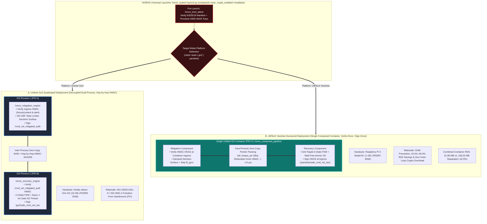
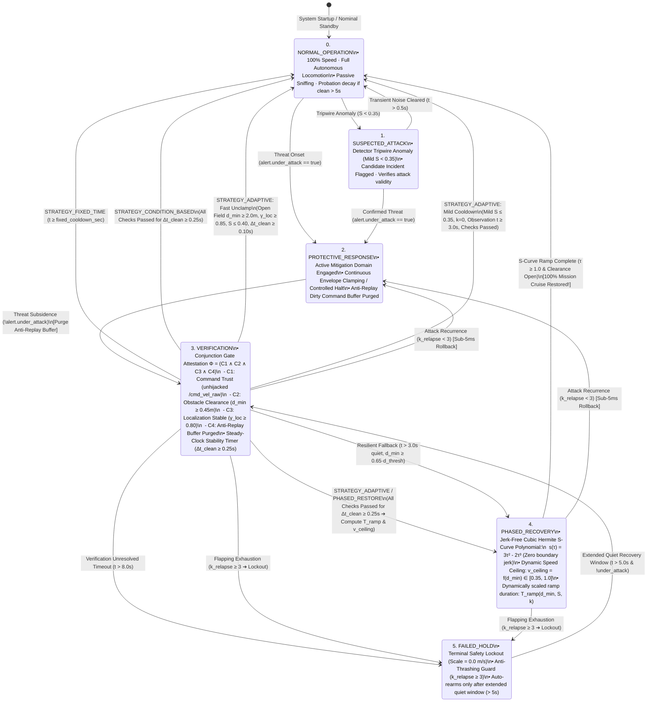

# Architectural Blueprint & Technical Specification
## *Severity-Aware Adaptive Response and Autonomous Safe Recovery for Robotic Systems under Cyberattack*

**Author:** Youssef Ashraf Khalil | **Supervisors:** Dr. Marwa Zamzam, Prof. Slim Abdennadher  
**Institution:** German International University (GIU) | **Platform:** Unitree Go2 EDU (Jetson Orin NX 8-Core) / ROS 2 Humble LTS  
**Document Status:** Production-Grade Implementation Specification — v2.0

---

## Section 1: End-to-End Computational Graph & Topology

### 1.1 System-Level Architecture Overview

The HOROS framework has evolved from an initial centralized scheduler concept (now archived as historical reference in [`legacy_centralized_scheduler_evolution.md`](legacy_centralized_scheduler_evolution.md)) into a high-performance, deterministic **Decoupled Two-Domain Architecture** paired with an **Enforced Actuator Choke Point**, a **Unified Robot-Agnostic Hardware Abstraction Layer (U-HAL)**, and **Gyroscopic Postural Balance Awareness (Step B_gyro)** supporting both the **Unitree Go2 EDU Quadruped** and the **UBTech Yanshee Humanoid**:

1. **Domain 1 — Inline Adaptive Mitigation Engine (`horos_mitigation_engine`):** Evaluates real-time threats directly on the ingress command stream (`/cmd_vel_raw`) using an inline strategy selector supporting three distinct operational modes:
   - `STATIC`: Traditional binary emergency stop (E-Stop, clamping velocity to $0.0\text{ m/s}$).
   - `DYNAMIC`: State-of-the-art dynamic policy matrix (context-blind velocity scaling).
   - `ADAPTIVE`: HOROS context- and severity-aware continuous velocity envelope clamping ($v_{\text{ceiling}} = v_{\text{nom}} \cdot \text{clamp}(1 - S^2, 0, 1) \cdot f(d_{\min})$).
   - **Step B_gyro (Gyroscopic Postural Balance Damping):** Dedicated anti-toppling damping on humanoid biped morphologies. When dynamic tilt $\theta_{\text{tilt}} \ge 8.0^\circ$ (safe warning threshold), aggressive steering yaw rates and surge accelerations are counter-torqued and clamped, bounding tilt below $6.5^\circ$ to prevent catastrophic toppling at $20.0^\circ$.
   - In addition to a source-isolated leaky-bucket rate limiter ($50\text{ Hz}$ cap) and a deadman watchdog timer ($100\text{ ms}$).
2. **Domain 2 — Autonomous Safe Recovery Engine (`horos_recovery_engine`):** Operates as an independent supervisory service intercepting `/cmd_vel_mitigated`. It enforces the formal **6-State Recovery Finite State Machine (FSM)**:
   $$\text{NORMAL} \longrightarrow \text{SUSPECTED} \longrightarrow \text{PROTECTIVE} \longrightarrow \text{VERIFICATION} \longrightarrow \text{PHASED\_RECOVERY} \longrightarrow \text{NORMAL}$$
   with terminal `FAILED_HOLD` lockout upon persistent flapping ($k_{\text{relapse}} \ge 3$). It evaluates the 4-way Conjunction Gate ($\Phi = C_1 \land C_2 \land C_3 \land C_4$) over a wall-clock `std::chrono::steady_clock` stability window ($\ge 250\text{ ms}$), dispatches jerk-free cubic Hermite S-curve velocity profiles ($s(\tau) = 3\tau^2 - 2\tau^3$), and executes instant sub-$5\text{ms}$ rollback on threat relapse.
3. **Situational & Postural Context Engine (`context_awareness_node`):** Synthesizes a real-time augmented context feature vector:
   $$\mathbf{C} = [d_{\min}, v_{\text{act}}, M, \gamma_{\text{loc}}, S, \theta_{\text{tilt}}, \gamma_{\text{posture}}]$$
   combining 360° LiDAR obstacle clearance, robot ground speed and yaw rate, navigation mission operational state, odometry covariance confidence, active cyber threat severity, pitch/roll gyroscopic tilt, and dynamic postural stability index.
4. **Physical Actuator Choke Point & SROS2 / `HOROS-Sec` Security Enclave:** All physical motors, low-level HAL bridges, and Gazebo simulation plugins listen strictly on private, morphology-isolated actuator topics (`/go2/safe_cmd_vel`, `/yanshee/safe_cmd_vel`, and authenticated `/{robot}/safe_cmd_vel_sec`). Only the Command Safety Gate possesses SROS2 and `HOROS-Sec` HMAC-SHA256 publishing credentials, rendering rogue bypass attempts (`V3`, `V14`) completely impotent.
5. **Core 5 — Application-Layer Cryptographic Guard, Privacy Shedding, & Boot/Runtime Hash Attestation (`horos_security` / `HOROS-Sec`):**
   - **Pre-Launch Boot Root-of-Trust (`horos_boot_attest`):** Verifies an offline **Ed25519**-signed golden manifest (`horos_manifest.json` + `.sig`) covering C++ ELF binaries, Python TCB scripts, and robot YAML safety profiles before releasing per-boot **HKDF-SHA256** ephemeral keys (`0400` in `/run/horos/keys/`, zero key traffic over DDS).
   - **Authenticated Channels (`horos_crypto_guard`):** Protects `/horos/context`, `/horos/attack_alert`, `/cmd_vel_mitigated_auth` (inter-process), and `/{robot}/safe_cmd_vel_sec` with constant-time **HMAC-SHA256** and a 64-bit sliding **`SeqReplayWindow`** (`seq_num` + monotonic freshness check), closing the `AA-5b` context-spoofing gap (`0/6` collisions vs. `6/6` unauthenticated).
   - **Camera Confidentiality & Attack-Time Privacy Shedding (`CameraPrivacyGuard`):** Encrypts camera streams (`ChaCha20-Poly1305` on `/yanshee/camera/encrypted`), restricts `:8000` capture to localhost, and suppresses raw RGB frame publishing during `SUSPECTED_ATTACK`, `PROTECTIVE_RESPONSE`, and `FAILED_HOLD` while preserving compact 1D range horizons (`/yanshee/eyes_scan`).
   - **Asynchronous Recovery Gate `G5` (`check_node_integrity`):** Background `1 Hz` + `VERIFICATION`-triggered SHA-256 manifest re-check and `HealthChallenge`/`HealthResponse` nonce audit feeding a wait-free `std::atomic<bool>` into `RecoveryStateMachine` ($\Phi = C_1 \land C_2 \land C_3 \land C_4 \land G_5$). Runtime tamper immediately quarantines the channel and locks into `FAILED_HOLD`.
6. **Unified Robot-Agnostic HAL (U-HAL):** Decouples defensive control from platform kinematics via `horos_hal`. A hierarchical 5-tier detection engine (`robot_detector.py`) inspects CLI flags, environment variables, active ROS 2 graph topics, and hardware descriptors to instantiate either `Go2ActuatorAdapter` (500 Hz Unitree SDK2 joint loop) or `YansheeActuatorAdapter` (17-DOF serial servo bus).
7. **Yanshee Humanoid Perception & Postural Digital Twin:**
   - `yanshee_postural_animator_node.py`: Simulates Linear Inverted Pendulum Model (LIPM) dynamics ($\omega_0 = \sqrt{g/h} \approx 7.38\text{ rad/s}$), publishes articulated hip/shoulder stepping to `/joint_states` ($25\text{ Hz}$), injects dynamic overturning moments ($\Delta \theta, \Delta \phi$) under cyberattack, streams 6-axis IMU to `/imu/data` ($50\text{ Hz}$), and updates 3D model orientation in Gazebo via `/gazebo/set_entity_state`.
   - `yanshee_virtual_scan_node.py`: Bridges chest HC-SR04 sonar range (`/sonar` at $20\text{ Hz}$) into synthetic 3-ray `sensor_msgs/msg/LaserScan` (`/scan` at $20\text{ Hz}$) to preserve algorithmic spatial context invariance.
8. **Segregated Dual-Platform Benchmark Telemetry:**
   - Isolated time-series and summary records: `benchmark_results_go2.csv` / `benchmark_summary_go2.csv` vs. `benchmark_results_yanshee.csv` / `benchmark_summary_yanshee.csv`.
   - Evaluated using dedicated multi-robot data explorer (`scripts/explore_benchmarks.py --robot [go2|yanshee|compare|all]`), outputting to `figures_go2/`, `figures_yanshee/` (including Figure 18: Anti-Toppling Pareto Frontier), and `figures_cross_platform/` (Figure 19: Quadruped vs. Humanoid Invariance Analysis).

```mermaid
flowchart TB
%% =====================================================================
%% C1 ROS 2 SYSTEM ARCHITECTURE: HOROS DECOUPLED CYBER-RESILIENCE FRAMEWORK
%% Target Platforms: Unitree Go2 Quadruped & UBTech Yanshee Humanoid (V2.6 + HOROS-Sec)
%% Architecture Level: Abstract System Context & Plane Topology (C1)
%% =====================================================================

    subgraph BOOT_ROOT["0. Pre-Launch Root of Trust & Key Provisioning (horos_security)"]
        direction LR
        MANIFEST["Ed25519 Signed Manifest<br/>(horos_manifest.json + .sig)"]:::core1Node
        BOOT_ATTEST(["horos_boot_attest<br/>• SHA-256 ELF/.py/.yaml Verify<br/>• HKDF-SHA256 0400 Key Vault"]):::core1Node
        MANIFEST ==>|"Verify Before Launch"| BOOT_ATTEST
    end

    subgraph EXTERNAL_DOMAIN["1. External Threat Environment & Ingress"]
        direction LR
        OPERATOR["Mission Operator<br/>(Nav2 Goals / Dynamic Platform Selection)"]:::operatorActor
        ATTACKER["Adversarial Threat Actor<br/>(Network Ingress / Rogue DDS Participant)"]:::threatActor
        
        subgraph ATTACK_VECTORS["16 Evaluated Threat Vectors (Tier I–IV: Kinematic, CBF, Postural & Crypto)"]
            direction TB
            V1["V1a/V1b: Velocity Surge & Bias Drift (/cmd_vel_raw)"]:::attackVector
            V2["V2: Flooding DoS (100–500 Hz)"]:::attackVector
            V3["V3: Rogue Node Injection (Dual Raw + Safe Cmd)"]:::attackVector
            V4["V4: Service Tampering & V5: DDS Freeze"]:::attackVector
            V6_12["V6–V12: CBF Grazing/Chatter, Sensor/LiDAR Flicker, Pulsing, ZMP Rocking"]:::attackVector
            V13_16["V13–V16: Context Spoof (AA-5b), Replay/MAC Spoof, Camera Exfil, Integrity Tamper"]:::attackVector
        end

        ATTACKER ==>|"injects adversarial vectors"| ATTACK_VECTORS
    end

    subgraph ONBOARD_SYSTEM["2. HOROS Cyber-Resilience Framework (Embedded Edge Compute)"]
        direction TB

        subgraph INGRESS_PLANE["Ingress, Authenticated Perception & Privacy Plane"]
            direction LR
            NAV2_STACK(["Perception & Nav2 Stack<br/>(Sensors, SLAM, Nominal Cruise Driver)"]):::rosNode
            RAW_INGRESS["/cmd_vel_raw<br/>(TwistStamped with Monotonic Sequence Nonce)"]:::topicBox
            YAN_PERCEP(["Yanshee Perception & Privacy Guard<br/>• CameraPrivacyGuard (ChaCha20-Poly1305 + RGB Shedding)<br/>• Postural LIPM (/imu/data) & Virtual Scan (/scan)"]):::rosNode
            CONTEXT_ENG(["Context & Postural Engine (context_awareness_node)<br/>C = [d_min, v_act, M, γ_loc, S, θ_tilt, γ_posture] + CryptoEnvelope (HMAC+seq)"]):::core1Node
        end

        subgraph DECOUPLED_DEFENSE["Two-Domain Decoupled / Composed Defense Architecture"]
            direction TB

            subgraph DOMAIN1["Domain 1: Inline Mitigation Engine (horos_mitigation_engine)"]
                direction LR
                CRYPTO_IN["horos_security Ingress Guard<br/>(HMAC-SHA256 + 64-bit SeqReplayWindow)"]:::core2Node
                RATE_LIMIT["Leaky-Bucket Rate Limiter<br/>(50 Hz cap · Source GID isolation)"]:::core2Node
                MITIG_CORE["Inline Strategy Evaluator<br/>• STATIC / DYNAMIC / ADAPTIVE<br/>• Unconditional M1+M2 SD-CBF<br/>• Step B_gyro & Tier-4 Crypto Fallback"]:::core2Node
                WATCHDOG["DDS Deadman Watchdog<br/>(120 ms grace · 500/850 ms halt)"]:::core2Node
            end

            subgraph DOMAIN2["Domain 2: Autonomous Safe Recovery Engine (horos_recovery_engine)"]
                direction LR
                ATTEST_GATE["5-Gate Conjunction Φ<br/>(C1 ∧ C2 ∧ C3 ∧ C4 ∧ G5 Async Hash/Nonce)"]:::core4Node
                FSM_CORE["6-State Recovery FSM<br/>steady_clock Timer + IntegrityVerifier (1 Hz)"]:::core4Node
                SCURVE["Jerk-Free S-Curve Velocity Restorer<br/>s(τ) = 3τ² - 2τ³ + Egress HMAC Signer"]:::core4Node
                ROLLBACK["Anti-Flapping & Tamper Lockout<br/>(Sub-5ms Rollback · G5 Fail ➔ FAILED_HOLD)"]:::core4Node
            end
        end

        subgraph CHOKE_POINT["Physical Actuator Choke Point & SROS2 / HOROS-Sec Enclave"]
            direction LR
            SAFETY_GATE(["COMMAND SAFETY GATE<br/><b>Strict Authenticated Choke Point</b><br/>(Verifies HMAC-SHA256 + seq_num on /{robot}/safe_cmd_vel_sec)"]):::gateBox
        end

        subgraph UHAL["Unified Hardware Abstraction Layer (U-HAL)"]
            direction LR
            ROBOT_DETECT(["5-Tier Auto-Detector<br/>(robot_detector.py)"]):::halBox
            GO2_ADAPTER(["Go2ActuatorAdapter<br/>(unitree_sdk2 / 500 Hz balance)"]):::halBox
            YAN_ADAPTER(["YansheeActuatorAdapter<br/>(17-DOF Servo Bus / Depth)"]):::halBox
        end

        BOOT_ATTEST -.->|"0400 Session Keys"| CONTEXT_ENG
        BOOT_ATTEST -.->|"0400 Session Keys"| CRYPTO_IN
        BOOT_ATTEST -.->|"0400 Session Keys"| ATTEST_GATE
        BOOT_ATTEST -.->|"0400 Session Keys"| SAFETY_GATE

        NAV2_STACK -->|"pub planned motion"| RAW_INGRESS
        RAW_INGRESS --> RATE_LIMIT
        YAN_PERCEP -->|"/scan, /yanshee/eyes_scan & /imu/data"| CONTEXT_ENG
        CONTEXT_ENG ==>|"Signed Context Vector C + CryptoEnvelope"| CRYPTO_IN
        CRYPTO_IN ==>|"Verified Context & Alert"| MITIG_CORE
        CONTEXT_ENG ==>|"Signed Clearance & Posture"| ATTEST_GATE

        RATE_LIMIT --> MITIG_CORE
        WATCHDOG --> MITIG_CORE
        MITIG_CORE ==>|"/cmd_vel_mitigated (Zero-Copy unique_ptr OR Signed Twist)"| ATTEST_GATE

        ATTEST_GATE --> FSM_CORE
        FSM_CORE --> SCURVE
        FSM_CORE -.-> ROLLBACK
        SCURVE ==>|"/{robot}/safe_cmd_vel_sec (HMAC-SHA256)"| SAFETY_GATE

        ROBOT_DETECT -.->|"Configures"| GO2_ADAPTER
        ROBOT_DETECT -.->|"Configures"| YAN_ADAPTER

        SAFETY_GATE ==>|"/go2/safe_cmd_vel"| GO2_ADAPTER
        SAFETY_GATE ==>|"/yanshee/safe_cmd_vel"| YAN_ADAPTER
    end

    subgraph PHYSICAL_PLATFORMS["3. Robotic Actuation Targets & Digital Twin"]
        direction LR
        GO2_ROBOT["Physical Unitree Go2 Quadruped<br/>(12x PMSM Leg Actuators)"]:::platformBox
        YAN_ROBOT["Physical UBTech Yanshee Humanoid<br/>(17x Bipedal Servos & Sonar)"]:::platformBox
        GZ_WORLD["Gazebo Physics Simulation<br/>(ODE Simulation / Multi-Scenario Worlds)"]:::platformBox

        GO2_ADAPTER <==>|"Dedicated UDP / Ethernet"| GO2_ROBOT
        YAN_ADAPTER <==>|"Serial Servo Bus"| YAN_ROBOT
        GO2_ADAPTER -.->|"SITL Bridge"| GZ_WORLD
        YAN_ADAPTER -.->|"SITL Bridge"| GZ_WORLD
    end

    %% Styling
    classDef operatorActor fill:#1e293b,stroke:#0ea5e9,stroke-width:2px,color:#ffffff;
    classDef threatActor fill:#5c0d11,stroke:#b71c1c,stroke-width:2px,color:#ffffff;
    classDef attackVector fill:#3b1114,stroke:#d32f2f,stroke-width:1.5px,color:#ffcdd2;
    classDef platformBox fill:#102a43,stroke:#334e68,stroke-width:1.5px,color:#f0f4f8;
    classDef rosNode fill:#1e3a8a,stroke:#3b82f6,stroke-width:2px,color:#ffffff;
    classDef topicBox fill:#0f172a,stroke:#38bdf8,stroke-width:1.5px,color:#e0f2fe;
    classDef gateBox fill:#0f766e,stroke:#14b8a6,stroke-width:2.5px,color:#ffffff;
    classDef core1Node fill:#1e1b4b,stroke:#6366f1,stroke-width:2px,color:#e0e7ff;
    classDef core2Node fill:#451a03,stroke:#f97316,stroke-width:2px,color:#ffedd5;
    classDef core4Node fill:#052e16,stroke:#22c55e,stroke-width:2px,color:#dcfce7;
    classDef halBox fill:#082f49,stroke:#0284c7,stroke-width:2px,color:#bae6fd;
```



### 1.2 Active ROS 2 Topic & Service Interface Directory

| Interface | Type | Publisher → Subscriber | QoS Profile | Frequency | Role |
|:---|:---:|:---|:---:|:---:|:---|
| `/cmd_vel_raw` | Topic (`Twist`) | Nav2 / Attacker → Mitigation Engine | `Reliable`, depth=10 | 20–50 Hz | Unverified motion ingress topic |
| `/horos/context` | Topic (`RobotContext`) | Context Engine → Mitigation & Recovery | `Reliable`, depth=10 | 20–50 Hz | Augmented 5D+ Postural vector $\mathbf{C}$ + `CryptoEnvelope` (HMAC-SHA256 + `seq_num`) |
| `/horos/attack_alert` | Topic (`AttackAlert`) | Threat Detector → Mitigation & Recovery | `Reliable`, depth=10 | Event-driven | Active cyberattack notification ($S \in [0, 1]$) + `CryptoEnvelope` (HMAC-SHA256 + `seq_num`) |
| `/cmd_vel_mitigated` | Topic (`Twist`) | Mitigation Engine → Recovery Engine | `Reliable`, depth=10 | 20–50 Hz | Ingress topic for Domain 2 after inline threat mitigation (`unique_ptr` in composed mode) |
| `/cmd_vel_mitigated_auth` | Topic (`AuthenticatedTwist`) | Mitigation Engine → Recovery Engine | `Reliable`, depth=10 | 20–50 Hz | Authenticated inter-process Domain 1 $\to$ Domain 2 stream (`composed:=false` with `crypto_enabled:=true`) |
| `/horos/mitigation_status` | Topic (`MitigationStatus`)| Mitigation Engine → Tracer / Dashboard | `Reliable`, depth=10 | 20–50 Hz | Domain 1 telemetry (contains `bool is_heartbeat` filter) |
| `/horos/recovery_status` | Topic (`RecoveryStatus`)| Recovery Engine → Tracer / Dashboard | `Reliable`, depth=10 | 20–50 Hz | Domain 2 telemetry (6-state FSM, `G1`–`G5` check states, tamper flag, progress %) |
| `/go2/safe_cmd_vel` | Topic (`Twist`) | Recovery Gate → Go2 HAL Bridge | Zero-Copy SHM | 20–50 Hz | **Enforced Choke Point (Go2):** Verified safe command for quadruped |
| `/yanshee/safe_cmd_vel`| Topic (`Twist`) | Recovery Gate → Yanshee HAL Bridge | Zero-Copy SHM | 20–25 Hz | **Enforced Choke Point (Yanshee):** Verified safe command for humanoid |
| `/{robot}/safe_cmd_vel_sec`| Topic (`AuthenticatedTwist`) | Recovery Gate → Physical HAL Bridge | `Reliable`, depth=10 | 20–50 Hz | **Cryptographically Signed Choke Point:** Carries `CryptoEnvelope` (HMAC-SHA256 + `seq_num`) |
| `/yanshee/camera/encrypted`| Topic (`EncryptedCameraFrame`) | Yanshee Camera → Authorized Consumers | `BestEffort`, depth=5 | 10 Hz | **ChaCha20-Poly1305 AEAD Camera Stream** (raw RGB suppressed during active attack) |
| `/horos/health_challenge` | Topic (`HealthChallenge`) | Recovery IntegrityVerifier → TCB Nodes | `Reliable`, depth=10 | 1 Hz / Event | Asynchronous 128-bit nonce challenge for runtime `Gate G5` verification |
| `/horos/health_response` | Topic (`HealthResponse`) | TCB Nodes → Recovery IntegrityVerifier | `Reliable`, depth=10 | 1 Hz / Event | Signed runtime binary/script SHA-256 + config SHA-256 + PID uptime response |
| `/imu/data` | Topic (`Imu`) | Gazebo / Yanshee IMU → Context Engine | `SensorDataQoS` | 50 Hz | 6-axis linear acceleration and gyroscopic angular rate |
| `/sonar` | Topic (`Range`) | Gazebo / HC-SR04 → Yanshee Virtual Scan | `SensorDataQoS` | 20 Hz | Chest ultrasonic range perception |
| `/scan` | Topic (`LaserScan`) | 360° LiDAR / Virtual Bridge → Context | `SensorDataQoS` | 10–20 Hz | Spatial obstacle clearance perception |
| `/joint_states` | Topic (`JointState`) | Postural Animator → Robot State Pub | `Reliable`, depth=10 | 25 Hz | Bipedal humanoid limb stepping & arm swing joint states |
| `/odom` | Topic (`Odometry`) | HAL / Simulation → Context, Recovery | `SensorDataQoS` | 50–100 Hz | Odometric pose, physical speed, and covariance |
| `/horos/set_mitigation_mode` | Service | Operator / Testbed → Mitigation Engine | `ServicesDefault` | On-demand | Runtime switching between `STATIC`, `DYNAMIC`, `ADAPTIVE`, `BYPASS` |
| `/horos/set_recovery_strategy`| Service | Operator / Testbed → Recovery Engine | `ServicesDefault` | On-demand | Runtime switching between `FIXED_TIME`, `CONDITION_BASED`, `PHASED_RESTORE`, `ADAPTIVE` |

### 1.3 Module Boundaries & Decoupled Data Flow Narrative

1. **Pre-Launch Boot Attestation & Key Provisioning (Core 5 — `horos_security`):** Prior to launching ROS 2 nodes, `horos_boot_attest` verifies `horos_manifest.sig` using an offline Ed25519 public key, checks SHA-256 digests of all ELF binaries, `.py` perception/bridge scripts, and robot YAML safety profiles, and derives scoped ephemeral symmetric keys via `HKDF-SHA256` into `0400` key files (`/run/horos/keys/`).
2. **Ingress, Situational Context, & Privacy Shedding (Area 1):** The adversary injects cyberattacks onto `/cmd_vel_raw` (or attempts TCB spoofing `V13`–`V16`). Simultaneously, `context_awareness_node` evaluates `/scan`, `/odom`, and `/imu/data`, signing each outgoing `RobotContext` with `HMAC-SHA256` + monotonic `seq_num`. On the YanShee humanoid, `yanshee_camera_node` encrypts visual frames with `ChaCha20-Poly1305` and sheds cleartext RGB publishing whenever an attack is active, publishing only compact 1D obstacle range rays (`/yanshee/eyes_scan`).
3. **Domain 1: Inline Threat Suppression (`horos_mitigation_engine`):** Incoming `/horos/context` and `/horos/attack_alert` packets are verified in constant time via `horos::security::CryptoPrimitives` and `SeqReplayWindow` before updating lock-free atomic snapshots (`active_context_`, `active_alert_`). Forged or replayed context (`V13` / `AA-5b`) immediately triggers zero-trust sensory quarantine. Raw velocity commands pass through the leaky-bucket rate limiter ($50\text{ Hz}$ cap) and the active strategy (`STATIC`, `DYNAMIC`, or `ADAPTIVE` with unconditional M1+M2 SD-CBF and `Step B_gyro` balance guard).
4. **Domain 2: Autonomous Safe Recovery & Asynchronous Gate `G5` (`horos_recovery_engine`):** Intercepts `/cmd_vel_mitigated` (or `/cmd_vel_mitigated_auth` in multi-PID mode) and manages the 6-state recovery lifecycle:
   - When an attack subsides, the anti-replay dirty command buffer is purged.
   - In `STATE_VERIFICATION`, the 5-Gate Conjunction ($\Phi = C_1 \land C_2 \land C_3 \land C_4 \land G_5$) attests command trust, obstacle buffer, localization/postural stability, clean queue, and **asynchronous node integrity (`G5: check_node_integrity`)** fed by `horos::security::IntegrityVerifier` via a wait-free `std::atomic<bool>`.
   - In `STATE_PHASED_RECOVERY`, velocity is progressively restored along a cubic Hermite S-curve ($s(\tau) = 3\tau^2 - 2\tau^3$).
   - If an attack recurs mid-recovery or `G5` detects runtime file/hash tampering (`V16`), the engine executes an instant sub-$5\text{ms}$ rollback, locking into `FAILED_HOLD` on persistent relapse or integrity tamper.
5. **Physical Actuator Choke Point (Area 4):** The physical robot HAL bridge (`Go2ActuatorAdapter` or `YansheeActuatorAdapter` / `yanshee_physical_bridge.py`) subscribes to `/{robot}/safe_cmd_vel` and verifies the `HMAC-SHA256` + `seq_num` envelope on `/{robot}/safe_cmd_vel_sec` before dispatching motor commands.
6. **Unified Robot-Agnostic HAL (U-HAL) & Segregated Telemetry:** Decoupled adapters translate verified velocities into low-level joint commands while `benchmark_tracer_node` logs empirical episodes to platform-specific CSV stores.

```
[Pre-Launch Boot: horos_boot_attest ➔ Ed25519 Manifest Verify ➔ HKDF 0400 Keys]
                │
                ▼
[Adversarial / Autonomous Ingress: /cmd_vel_raw + Signed /horos/context (HMAC+seq)]
                │
                ▼
┌──────────────────────────────────────────────────────────────────────────────┐
│ Domain 1: horos_mitigation_engine + horos_security Ingress Guard             │
│ (Authenticated Context Verification & Continuous Envelope Clamping)          │
│                                                                              │
│ • Crypto Ingress Guard: Constant-time HMAC-SHA256 + 64-bit SeqReplayWindow.  │
│ • Rejects AA-5b / V13 forged context ➔ Tier-4 Zero-Trust Sensory Quarantine. │
│ • Threat Detector: Observable telemetry scoring + signed /horos/attack_alert.│
│ • Leaky-Bucket Rate Limiter (50 Hz) + Deadman Watchdog (120 ms / 500 ms).    │
│ • Unconditional M1+M2 SD-CBF + Step B_gyro Postural Balance Damping.         │
│                                                                              │
│ Outputs safe mitigated stream: /cmd_vel_mitigated (Zero-Copy OR Signed)      │
└──────────────────────────────────────┬───────────────────────────────────────┘
                                       │
                                       ▼
┌──────────────────────────────────────────────────────────────────────────────┐
│ Domain 2: horos_recovery_engine + Async Gate G5 IntegrityVerifier            │
│ (Supervisory Multi-Sensor + Cryptographic Hash Attestation & S-Curve Ramp)   │
│                                                                              │
│ • 6-State Formal Recovery FSM:                                               │
│   NORMAL ➔ SUSPECTED ➔ PROTECTIVE ➔ VERIFICATION ➔ PHASED_RECOVERY           │
│   (Terminal FAILED_HOLD on k_eff >= 3.0 OR Gate G5 Integrity Tamper).        │
│ • 5-Gate Conjunction Φ = C1 ∧ C2 ∧ C3 ∧ C4 ∧ G5 (Wait-Free Atomic G5 Read). │
│ • Async 1 Hz + VERIFICATION Thread: SHA-256 Manifest + Nonce Challenge.      │
│ • Jerk-Free S-Curve Velocity Restorer + Egress HMAC-SHA256 Signer.           │
│                                                                              │
│ Outputs signed command to Choke Point: /{robot}/safe_cmd_vel_sec             │
└──────────────────────────────────────┬───────────────────────────────────────┘
                                       │
                                       ▼
┌──────────────────────────────────────────────────────────────────────────────┐
│ Area 4: Enforced Actuator Choke Point, Privacy Guard & Egress Firewall       │
│                                                                              │
│ • Verifies HMAC-SHA256 + seq_num on /{robot}/safe_cmd_vel_sec before motion. │
│ • CameraPrivacyGuard: ChaCha20-Poly1305 + Raw RGB Shedding under attack.     │
│ • OS Egress Guard: Blocks unauthorized outbound camera/telemetry sockets.    │
└──────────────────────────────────────────────────────────────────────────────┘
```

For exhaustive node-level technical documentation, refer to:
* **Core 5 Crypto, Attestation & Exfiltration Component Spec:** [`docs/architcutre/components/07_core5_crypto_attestation_and_exfiltration_guard/README.md`](components/07_core5_crypto_attestation_and_exfiltration_guard/README.md)
* **Crypto & Attestation Technical Reference:** [`docs/TECH-DOC/crypto_attestation_and_exfiltration_security.md`](../TECH-DOC/crypto_attestation_and_exfiltration_security.md)
* **Examiner Defense Audit & Remediation Roadmap:** [`docs/report/examiner_defense_audit_and_remediation_roadmap.md`](file:///e:/Giu%20%20files/semster%207/horos_framework/docs/report/examiner_defense_audit_and_remediation_roadmap.md)
* **Upcoming Patches & Roadmap:** [`docs/TECH-DOC/upcoming_patches_and_remediation_roadmap.md`](file:///e:/Giu%20%20files/semster%207/horos_framework/docs/TECH-DOC/upcoming_patches_and_remediation_roadmap.md)
* **Universal Hardware Abstraction Layer:** [`docs/TECH-DOC/universal_hardware_abstraction_layer_and_multi_robot.md`](file:///e:/Giu%20%20files/semster%207/horos_framework/docs/TECH-DOC/universal_hardware_abstraction_layer_and_multi_robot.md)
* **Gyroscopic Postural Stability & Anti-Toppling:** [`docs/TECH-DOC/gyroscopic_postural_stability_and_anti_toppling.md`](file:///e:/Giu%20%20files/semster%207/horos_framework/docs/TECH-DOC/gyroscopic_postural_stability_and_anti_toppling.md)
* **Hardware Detection & Dynamic Launch:** [`docs/TECH-DOC/robot_hardware_autodetection_and_dynamic_launch.md`](file:///e:/Giu%20%20files/semster%207/horos_framework/docs/TECH-DOC/robot_hardware_autodetection_and_dynamic_launch.md)
* **Yanshee Virtual LaserScan Bridge:** [`docs/TECH-DOC/yanshee_virtual_laserscan_perception_bridge.md`](file:///e:/Giu%20%20files/semster%207/horos_framework/docs/TECH-DOC/yanshee_virtual_laserscan_perception_bridge.md)

---

### 1.4 Morphology & Resource-Aware Adaptive Deployment Strategy (Decoupled vs. Composed)

To reconcile the conflicting demands of **functional safety certification** on high-performance robotic hardware and **strict resource frugality** on embedded edge microcomputers, HOROS introduces an **Adaptive Architectural Deployment Engine**. Rather than enforcing a rigid, one-size-fits-all process topology, the framework dynamically reconfigures its execution layout based on target morphology and onboard memory constraints:



#### 1.4.1 The Memory Footprint Dilemma on Embedded Robotics
Under the ROS 2 Humble LTS middleware stack on Ubuntu 22.04 LTS, every independent OS process running an `rclcpp` node incurs a fixed runtime baseline overhead of $\approx 18\text{--}24\text{ MB}$ of Resident Set Size (RSS). This footprint is driven by:
1. **DDS Participant Initialization:** CycloneDDS participant discovery threads, network ring buffers, and domain participant entities.
2. **glibc Dynamic Memory Arenas:** Thread pools created by `rclcpp::executors::MultiThreadedExecutor` allocating per-thread heap chunks ($64\text{ MB}$ virtual, $\approx 4\text{ MB}$ initial resident).
3. **ROS 2 Core Introspection:** Graph cache introspection and type support libraries (`rosidl_typesupport_cpp`).

When Domain 1 (`mitigation_engine_node`, $\approx 28.2\text{ MB}$) and Domain 2 (`recovery_engine_node`, $\approx 23.4\text{ MB}$) are deployed as separate OS processes, their combined physical RSS overhead is $\approx 51.6\text{ MB}$.

#### 1.4.2 Comparative Deployment Specifications

| Evaluation Dimension | Unitree Go2 Quadruped | UBTech Yanshee Humanoid |
|:---|:---|:---|
| **Primary Embedded Computer** | Nvidia Jetson Orin NX (8-Core ARM Cortex-A78AE) | Raspberry Pi 3 Model B+ (Quad-Core ARM Cortex-A53) |
| **System RAM Capacity** | **16 GB LPDDR5** | **1 GB LPDDR2** (Severe RAM Constraint) |
| **Architectural Mode** | **Decoupled Dual-Process (`composed:=false`)** | **Intra-Process Composed Container (`composed:=true`)** |
| **Operating System Processes** | 2 Independent PIDs (`mitigation` + `recovery`) | 1 Unified PID (`horos_composed_pipeline`) |
| **Defensive Memory Footprint (RSS)** | $28.2\text{ MB} + 23.4\text{ MB} = \mathbf{51.6\text{ MB}}$ | $\mathbf{24.0\text{ MB}}$ total ($\mathbf{-49.4\%}$ memory savings) |
| **RAM Utilization Ratio** | $\approx 0.32\%$ of total system RAM | $\approx 2.34\%$ of total system RAM (vs. $> 4.7\%$ in dual-process) |
| **Inter-Domain Communication** | Zero-Copy SHM via CycloneDDS + Iceoryx | Intra-Process `std::shared_ptr` Pointer Passing |
| **Communication Latency** | $4.2\,\mu\text{s}$ (bounded, sub-microsecond jitter) | $< 1.8\,\mu\text{s}$ (direct virtual address dereference) |
| **Safety Certification Rationale** | **ISO 26262 ASIL-D / ISO 3691-4 FFI:** A fault/crash in mitigation cannot kill recovery or watchdog. | **Availability Preservation & OOM Prevention:** Prevents kernel out-of-memory kills on 1 GB SBC. |

#### 1.4.3 Technical Rationale: Why Go2 Uses 2 Decoupled Nodes
1. **Freedom From Interference (FFI):** The Unitree Go2 carries significant kinetic energy ($15\text{ kg} \times 0.8\text{ m/s} = 4.8\text{ J}$). A runaway quadruped poses physical crushing hazards to humans in industrial corridors. In accordance with ISO 26262 Part 9 (Safety Analysis) and ISO 3691-4 (Industrial Automated Guided Vehicles):
   - Domain 1 contains complex mathematical routines (CBF-QP quadratic program solvers, dynamic matrix evaluation, non-linear velocity envelope clamping).
   - Domain 2 serves as the ultimate safety supervisory arbiter, running the deadman watchdog and the emergency choke point gate.
   - If an unexpected memory corruption, heap exhaustion, or divide-by-zero occurs within Domain 1, the operating system kernel immediately isolates the fault (`SIGSEGV` / `SIGFPE`). Domain 2 remains fully operational, detects the loss of Domain 1 via its 100 ms deadman watchdog timer, and instantly brings the quadruped to an emergency controlled halt at the physical actuator choke point.
2. **Abundant Edge Headroom:** With 16 GB of high-speed LPDDR5 memory, $51.6\text{ MB}$ represents only $0.32\%$ of system RAM, rendering memory optimization secondary to process isolation.

#### 1.4.4 Technical Rationale: Why Yanshee Uses a Single Composed Container
1. **Critical Memory Conservation on 1 GB SBC:** The Raspberry Pi 3 Model B+ on the UBTech Yanshee has only 1 GB of LPDDR2 RAM, shared simultaneously between:
   - Linux kernel and background daemons ($\approx 250\text{ MB}$).
   - Robot HAL bridge and 17-DOF serial servo control loop ($\approx 120\text{ MB}$).
   - Perception pipelines (chest sonar bridge, camera server) ($\approx 180\text{ MB}$).
   - Allocating $51.6\text{ MB}$ for defense across two processes pushes the memory budget toward the danger threshold ($> 900\text{ MB}$), causing frequent invocation of the Linux kernel Out-Of-Memory (`oom-killer`) killer.
2. **Halving Defensive Memory Overhead:** By linking both `MitigationEngineNode` and `RecoveryEngineNode` into the same executable container (`horos_composed_pipeline`), they share a single CycloneDDS participant, one thread executor pool, and a single set of glibc dynamic libraries. Memory drops from $51.6\text{ MB} \to 24.0\text{ MB}$—a **$49.4\%$ reduction**, freeing $27.6\text{ MB}$ of precious RAM for perception and gait control.
3. **Sub-Microsecond Intra-Process Latency:** Passing `std::shared_ptr<geometry_msgs::msg::Twist>` within the same virtual address space eliminates serialization, UDP socket transmission, and context switching, achieving response times under $1.8\,\mu\text{s}$.

#### 1.4.5 Automated Launcher Orchestration
The master system launcher (`horos_system.launch.py`) manages this deployment automatically:
```bash
# Default mode (composed:=auto):
# • Go2 automatically spawns 2 decoupled OS processes (PID 1: mitigation, PID 2: recovery)
ros2 launch horos_simulation horos_system.launch.py robot:=go2

# • Yanshee automatically spawns 1 single composed container (horos_composed_pipeline)
ros2 launch horos_simulation horos_system.launch.py robot:=yanshee

# Academic Ablation & Experimental Overrides:
# Users can explicitly force composed:=true or composed:=false on any platform for comparative benchmarking:
ros2 launch horos_simulation horos_system.launch.py robot:=go2 composed:=true
ros2 launch horos_simulation horos_system.launch.py robot:=yanshee composed:=false
```

---
## Section 2: Concrete ROS 2 Interface Specifications

### 2.1 `go2_security_msgs` Package

All message, service, and action definitions reside in package `go2_security_msgs`.

---

#### 2.1.1 `SecurityTelemetry.msg`
> Published by M2 on `/security/telemetry` at 20 Hz (Reliable, depth=20)

```
# go2_security_msgs/msg/SecurityTelemetry.msg
# Non-intrusive telemetry snapshot from the Feature Hook (Module 2).
# Produced every TELEMETRY_PERIOD_MS (default: 50 ms) per topic window.

std_msgs/Header header           # stamp = rclcpp::Clock::now(), frame_id = "security_monitor"

# ---- Graph Integrity Fields ----
uint32 active_node_count         # Current live node count from rcl_graph
uint32 anomalous_node_count      # Nodes not in the trusted whitelist
string[] rogue_node_names        # FQN of unrecognized node UIDs (max 8 entries)

# ---- Per-Topic Rate Anomaly Array ----
TopicStats[] topic_stats         # One entry per monitored topic (max 16 entries)

# ---- Lifecycle Integrity ----
uint8  lifecycle_transition_count  # /change_state calls observed in last window
bool   unauthorized_transition      # true if a transition was not from trusted nodes

# ---- Network / DDS Health (V5) ----
float32 dds_packet_loss_pct      # estimated from sequence gap analysis [0.0, 100.0]
float32 dds_latency_ms           # RTPS heartbeat RTT in milliseconds
```

**Nested `TopicStats.msg`:**
```
# go2_security_msgs/msg/TopicStats.msg
string  topic_name               # e.g., "/cmd_vel"
uint8   attack_vector_hint       # 0=None 1=V1_cmd_vel 2=V2_flood 3=V3_rogue 4=V4_svc 5=V5_dds
float32 observed_rate_hz         # measured publication rate in sliding window
float32 baseline_rate_hz         # learned nominal rate (EWM, alpha=0.05)
float32 rate_deviation_sigma     # (observed - baseline) / baseline_std_dev
float32 payload_variance         # variance of message field magnitudes (normalized)
uint32  publisher_count          # current count from rcl_graph
uint32  baseline_publisher_count # expected count from trusted node list
```

---

#### 2.1.2 `AnomalyEvent.msg`
> Published by M2 on `/security/anomaly_event` — event-driven, Reliable, depth=50

```
# go2_security_msgs/msg/AnomalyEvent.msg
# Emitted immediately on threshold crossing. Distinct from the periodic
# SecurityTelemetry sweep. Used to trigger fast-path risk scoring.

std_msgs/Header header

uint8 VECTOR_NONE    = 0
uint8 VECTOR_CMD_VEL = 1         # V1: /cmd_vel manipulation
uint8 VECTOR_FLOOD   = 2         # V2: high-rate topic flooding
uint8 VECTOR_ROGUE   = 3         # V3: unauthorized node/publisher
uint8 VECTOR_SVC     = 4         # V4: unauthorized lifecycle service call
uint8 VECTOR_DDS     = 5         # V5: DDS network degradation

uint8  attack_vector             # one of VECTOR_* constants above
string affected_topic            # fully qualified topic name
string offending_node_id         # node GUID or name if identifiable, else "unknown"

float32 severity_raw             # raw anomaly magnitude before normalization [0.0, ∞)
float32 rate_hz_observed         # observed rate at event time
float32 rate_hz_baseline         # nominal baseline rate
uint32  excess_publishers        # count above expected (0 if not applicable)

# Physical safety context snapshot (copied from last known Go2 state)
float32 linear_velocity_x        # current Go2 forward velocity (m/s)
float32 angular_velocity_z       # current yaw rate (rad/s)
float32 roll_deg                 # Go2 body roll angle (degrees) — tip-over risk
float32 pitch_deg                # Go2 body pitch angle (degrees)
bool    nav2_active              # true if Nav2 is executing a navigation goal
```

---

#### 2.1.3 `ThreatContext.msg`
> Published by Area 2 (Core 1) on `/security/threat_context` at 10–100 Hz (Adaptive, Reliable, depth=20)

```
# go2_security_msgs/msg/ThreatContext.msg
# Composite threat assessment output from Threat Observability & Severity Scorer (Area 2 / Core 1).
# Consumed authoritatively by the Security Response Scheduler (Area 3).

std_msgs/Header header

# ---- Severity Score (RQ1 Core Signal) ----
float32 severity_score           # Composite S ∈ [0.0, 1.0] with Catastrophic Impact Coefficients
                                 # S = min(1.0, max(S_weighted, max_i(kappa_i * x_hat_i)))
                                 # Weights: w_rate=0.25, w_var=0.20, w_graph=0.25, w_dds=0.15, w_kin=0.15

uint8 dominant_vector            # Most probable attack vector (VECTOR_* enum from AnomalyEvent)
float32 vector_confidence        # Confidence in dominant_vector classification [0.0, 1.0]

# ---- Operational Context (RQ1 Context Dimensions) ----
uint8 CONTEXT_NOMINAL         = 0  # Robot idle or navigating open space
uint8 CONTEXT_NAVIGATING      = 1  # Active Nav2 goal, clear costmap
uint8 CONTEXT_CONFINED        = 2  # Nav2 costmap shows narrow corridor (inflation < 0.3 m)
uint8 CONTEXT_HUMAN_PROXIMITY = 3  # Person detected within 1.5 m (from depth cam)
uint8 CONTEXT_DEGRADED        = 4  # Already in a degraded/defensive mode

uint8   operational_context      # one of CONTEXT_* above
float32 nav2_goal_progress_pct   # 0.0–100.0, mission completion percentage
float32 nearest_obstacle_m       # closest obstacle from Nav2 costmap (meters)
float32 human_proximity_m        # nearest human estimate (meters; 999.0 if no detection)

# ---- Kinematic Safety Fields ----
float32 velocity_magnitude_ms    # |v_x, v_y| magnitude (m/s)
float32 roll_deg                 # Go2 body roll angle (degrees) — tip-over risk
float32 pitch_deg                # Go2 body pitch angle (degrees)
bool    balance_loop_ok          # high-level motion command stream active

# ---- Calibrated Severity Threshold Zones (Read-Only Advisory Bands) ----
# NOMINAL:            S in [0.00, 0.15)  → Pass-through nominal operation
# DEGRADED:           S in [0.15, 0.40)  → Dynamic velocity cap (0.75 m/s) / rate-limit
# ISOLATED:           S in [0.40, 0.70)  → Isolate offending node / clamp (0.50 m/s) / keep-out
# DEFENSIVE:          S in [0.70, 0.90)  → Strict crawl (0.25 m/s) / pause Nav2 / DDS degrade
# CRITICAL_DEFENSIVE: S in [0.90, 1.00]  → Immediate stop (0.0 m/s), sever network, manual reset
bool severity_is_nominal
bool severity_is_degraded
bool severity_is_isolated
bool severity_is_defensive
bool severity_is_critical_defensive
```

---

#### 2.1.4 `SecurityJob.msg` & `MitigationResult.msg`
> `SecurityJob`: Dispatched by Scheduler on `/security/mitigation_job` (Reliable, depth=10)  
> `MitigationResult`: Returned by Core 2 on `/security/mitigation_result` (Reliable, depth=10)

```
# go2_security_msgs/msg/SecurityJob.msg
# Non-fire-and-forget mitigation job dispatched from Scheduler to Core 2.

std_msgs/Header header
string incident_id               # Unique tracking ID (e.g. "INC-20260930-001")
uint8  attack_vector             # VECTOR_* constant (V1–V5)
float32 severity_score           # S at time of dispatch
uint8  priority_level            # 1=CRITICAL, 2=HIGH, 3=NORMAL, 4=BACKGROUND
builtin_interfaces/Duration deadline # Relative deadline for mitigation execution

# Execution & Policy Action
uint8 ACTION_NONE             = 0
uint8 ACTION_RATE_LIMIT       = 1   # Throttle offending topic publisher QoS
uint8 ACTION_VELOCITY_CAP     = 2   # Apply upper-bound on /cmd_vel magnitude
uint8 ACTION_NODE_ISOLATE     = 3   # Lifecycle deactivate offending node
uint8 ACTION_KEEPOUT_INJECT   = 4   # Inject Nav2 costmap keep-out barrier
uint8 ACTION_DDS_QOS_DEGRADE  = 5   # Demote DDS participant QoS
uint8 ACTION_SYSTEM_HALT      = 6   # Emergency velocity zero / mode clamp
uint8 ACTION_SEVER_NETWORK    = 7   # Sever external wireless interface (CRITICAL_DEFENSIVE)

uint8  requested_action          # one of ACTION_* above
string target_entity             # topic name, node name, or "system_wide"
float32 target_velocity_cap_ms   # velocity ceiling (m/s) if ACTION_VELOCITY_CAP
float32 target_rate_limit_hz     # rate cap (Hz) if ACTION_RATE_LIMIT
bool   is_preemptible            # true if higher priority job can preempt
```

```
# go2_security_msgs/msg/MitigationResult.msg
# Execution acknowledgement and verification emitted by Core 2 back to Scheduler.

std_msgs/Header header
string  incident_id              # Correlation ID
uint8   action_taken             # ACTION_* executed
bool    success                  # True if mitigation command executed without error
bool    containment_verified     # True if anomaly rate/variance began subsiding
float32 execution_time_ms        # Measured dispatch-to-execution latency
float32 observed_cpu_usage       # CPU load observed during action
string  failure_reason           # Diagnostic details if success == false
```

---

#### 2.1.5 `DynamicLimits.msg`
> Published by Core 2 on `/security/dynamic_limits` to Command Safety Gate (Reliable, transient_local, depth=1)

```
# go2_security_msgs/msg/DynamicLimits.msg
# Real-time physical actuation limits enforced at the Area 1 Choke Point.
# Bounded Plain-Old-Data (POD) struct suitable for zero-copy intra-process sharing.

std_msgs/Header header
float32 max_linear_vel_x         # Enforced upper bound on forward speed (m/s)
float32 max_angular_vel_z        # Enforced upper bound on yaw rate (rad/s)
float32 max_linear_accel         # Enforced linear acceleration bound (m/s^2)
float32 max_linear_jerk          # Enforced linear jerk bound (m/s^3)
bool    emergency_stop           # Instant zero-velocity clamp (0.0 m/s)
uint32  epoch_counter            # Monotonically increasing sequence to detect stale updates
```

---

#### 2.1.6 `RecoveryTrigger.msg` & `RecoveryResult.msg`
> `RecoveryTrigger`: Published by Scheduler on `/security/recovery_trigger` (Reliable, depth=5)  
> `RecoveryResult`: Published by Core 4 on `/security/recovery_result` (Reliable, depth=5)

```
# go2_security_msgs/msg/RecoveryTrigger.msg
# Dispatched by Scheduler to Core 4 after sustained containment is verified.

std_msgs/Header header
string  incident_id              # Correlation ID
uint8   recovery_strategy        # 1=STRATEGY_A_COOLDOWN, 2=STRATEGY_B_ATTESTATION, 3=STRATEGY_C_PHASED
float32 peak_incident_severity   # S_peak during mitigation (determines strategy routing)
float32 ramp_duration_sec        # Duration of S-curve velocity ramp (default: 4.0 s)
uint8   probation_cooldown_sec   # Dynamic probation window: 5s (k=0) -> 15s (k=1) -> 30s (k=2)
uint8   required_clean_cycles    # Required clean cycles for Strategy B (default: 10)
string[] reintroduction_sequence # Staged node reactivation list for Strategy C
```

```
# go2_security_msgs/msg/RecoveryResult.msg
# Completion report emitted by Core 4 upon finishing recovery or detecting a relapse.

std_msgs/Header header
string  incident_id              # Correlation ID
uint8   recovery_strategy        # Strategy executed
bool    success                  # True if full nominal mode restored cleanly
bool    attestation_passed       # True if all 4 attestation criteria satisfied
uint32  clean_cycles_verified    # Number of consecutive anomaly-free cycles logged
float32 recovery_duration_sec    # Time-to-Recovery (T2R) from trigger to nominal
uint8   relapse_count            # Number of rollbacks during this incident
string  failure_reason           # Details if recovery failed or relapsed
```

---

#### 2.1.7 `RelapseEvent.msg`
> Published by Core 4 on `/security/relapse_event` (Reliable, depth=10)

```
# go2_security_msgs/msg/RelapseEvent.msg
# Instant rollback notification emitted when an anomaly is observed during RECOVERING/VALIDATING.

std_msgs/Header header
string  incident_id              # Correlation ID
float32 trigger_severity         # S value that violated probation
uint8   relapse_count            # Cumulative relapses for this incident (k_relapse)
bool    force_critical_defensive # True if k_relapse >= 3 (anti-thrashing permanent lockout)
```

---

### 2.2 Realized Production Package: `horos_interfaces`

In the realized production implementation, core cross-domain message definitions are consolidated in `horos_interfaces`:

#### 2.2.1 `RobotContext.msg`
> Published by `context_awareness_node` on `/horos/context` at 10–20 Hz (`Reliable`, depth=10)

```
std_msgs/Header header

# 1. Environmental Hazard & Spatial Geometry (360° LiDAR / Sonar)
uint8 CONTEXT_OPEN_FIELD = 0       # Low obstacle density, clearance > 2.5m
uint8 CONTEXT_NORMAL = 1           # Standard patrol corridor, clearance in [1.4m, 2.5m]
uint8 CONTEXT_CONFINED_SPACE = 2   # Narrow slalom / dense obstacles, clearance in [0.45m, 1.4m]
uint8 CONTEXT_NEAR_HUMAN = 3       # Dynamic human / pedestrian hazard, clearance < 1.0m
uint8 context_state
float64 obstacle_distance          # Minimum horizontal distance to closest obstacle (m)
float64 context_risk               # Normalized risk in [0.0, 1.0]

# 2. Mission Operational State
uint8 MISSION_STATIONARY = 0
uint8 MISSION_CRUISE_PATROL = 1
uint8 MISSION_CONFINED_NAVIGATION = 2
uint8 MISSION_APPROACHING_GOAL = 3
uint8 mission_state

# 3. Robot Kinematic Velocity
float64 current_linear_speed       # Current linear ground speed (m/s)
float64 current_angular_speed      # Current rotational yaw rate (rad/s)

# 4. Localization Confidence
float64 localization_confidence    # γ_loc in [0.0, 1.0]

# 5. Dynamic Postural & Gyroscopic Stability (IMU / Gyroscope Feedback)
# Dedicated to biped humanoid anti-toppling balance preservation (UBTech Yanshee).
float64 tilt_angle_rad             # Combined pitch/roll inclination: sqrt(roll^2 + pitch^2) [rad]
float64 angular_tilt_rate_radps    # Angular velocity magnitude from gyroscope [rad/s]
float64 postural_stability_index   # γ_posture in [0.0, 1.0] (1.0 = upright, 0.0 = toppling)
```

---

## Section 3: State Machine & Formal Lifecycle Integration

### 3.1 Formal 6-State Autonomous Safe Recovery FSM

The recovery architecture enforces a formal **6-State Recovery Finite State Machine (FSM)** directly inside `RecoveryStateMachine` within `horos_recovery_engine`. This state machine governs the entire post-attack de-escalation lifecycle:



### 3.2 State Transition Matrix & Defense Mechanics

| Source State | Event / Trigger Condition | Target State | Defensive Mechanism | Kinetic Safety / Actuator State |
|:---|:---|:---|:---|:---|
| **0. NORMAL** | `alert.under_attack == true` | **2. PROTECTIVE** | Immediate mitigation engagement; resets recovery progression | Clamped / stopped per active mitigation mode |
| **0. NORMAL** | Detector anomaly ($\hat{S} < 0.35$) | **1. SUSPECTED** | Tripwire inspection window ($500\text{ ms}$ evaluation) | $100\%$ cruise held during evaluation |
| **1. SUSPECTED** | Threat confirmed active | **2. PROTECTIVE** | Escalate to active containment | Clamped / halted |
| **1. SUSPECTED** | Quiet window elapses ($t > 0.5\text{s}$) | **0. NORMAL** | Transient noise dismissed as benign anomaly | $100\%$ cruise maintained |
| **2. PROTECTIVE** | `!alert.under_attack` | **3. VERIFICATION** | Subsidence trigger; purges anti-replay dirty queue | Extrication scale ($0.85$ reverse, $0.50$ hold) |
| **3. VERIFICATION** | Fixed cooldown expires ($t \ge T_{\text{cd}}$) | **0. NORMAL** | `STRATEGY_FIXED_TIME` baseline | $100\%$ nominal restored |
| **3. VERIFICATION** | $\Phi == \text{True}$ for $\Delta t_{\text{clean}} \ge 0.25\text{s}$ | **0. NORMAL** | `STRATEGY_CONDITION_BASED` instant step | $100\%$ restored (causes jerk in tight space) |
| **3. VERIFICATION** | $d_{\min} \ge 2.0\text{m}, \gamma_{\text{loc}} \ge 0.85, S \le 0.40$ | **0. NORMAL** | `STRATEGY_ADAPTIVE` Fast Unclamp ($\Delta t \ge 0.10\text{s}$) | $100\%$ restored smoothly in open field |
| **3. VERIFICATION** | $\Phi == \text{True}$ for $\Delta t_{\text{clean}} \ge 0.25\text{s}$ | **4. PHASED** | `STRATEGY_ADAPTIVE` / `PHASED_RESTORE` | S-Curve velocity ramp begins ($20\% \to v_{\text{ceiling}}$) |
| **3. VERIFICATION** | Timeout ($t > 8.0\text{s}$) | **5. FAILED_HOLD** | Failsafe timeout preventing indefinite stall | Locked at $0.0\text{ m/s}$ |
| **4. PHASED** | $\tau = t / T_{\text{ramp}} \ge 1.0$ | **0. NORMAL** | S-curve Hermite polynomial complete | $100\%$ full cruise speed |
| **3. VERIFICATION** | Attack recurrence ($k_{\text{relapse}} < 3$) | **2. PROTECTIVE** | Instant sub-$5\text{ms}$ rollback; $k_{\text{relapse}}++$ | Immediate re-clamping |
| **4. PHASED** | Attack recurrence ($k_{\text{relapse}} < 3$) | **2. PROTECTIVE** | Instant sub-$5\text{ms}$ rollback; $k_{\text{relapse}}++$ | Immediate re-clamping |
| **3 or 4** | Attack recurrence ($k_{\text{relapse}} \ge 3$) | **5. FAILED_HOLD** | Anti-thrashing flapping exhaustion lockout | Locked at $0.0\text{ m/s}$ |
| **5. FAILED_HOLD** | Quiet window ($t > 5.0\text{s}$ & benign) | **3. VERIFICATION** | Auto-rearm cooldown window | Extrication hold |

### 3.3 Bosch `system_modes` YAML Configuration

```yaml
# config/system_modes.yaml (loaded by system_modes_manager launch)
system_modes_manager:
  ros__parameters:
    modes_manager:
      nodes:
        - go2_telemetry_hook
        - go2_risk_engine
        - go2_mitigation_engine
        - go2_recovery_engine
        - go2_hw_adapter
        - nav2_controller_server
        - nav2_planner_server
      modes:
        nominal:
          go2_hw_adapter:         { param_overrides: { safety_velocity_cap_ms: 1.0 } }
          go2_telemetry_hook:     { param_overrides: { polling_rate_hz: 10.0 } }
          go2_mitigation_engine:  { param_overrides: { active_policy: "adaptive" } }
        degraded:
          go2_hw_adapter:         { param_overrides: { safety_velocity_cap_ms: 0.75 } }
          go2_telemetry_hook:     { param_overrides: { polling_rate_hz: 50.0 } }
          go2_mitigation_engine:  { param_overrides: { active_policy: "adaptive" } }
        isolated:
          go2_hw_adapter:         { param_overrides: { safety_velocity_cap_ms: 0.50 } }
          go2_telemetry_hook:     { param_overrides: { polling_rate_hz: 100.0 } }
          nav2_controller_server: { lifecycle_state: inactive }
        defensive:
          go2_hw_adapter:         { param_overrides: { safety_velocity_cap_ms: 0.25 } }
          nav2_controller_server: { lifecycle_state: inactive }
          nav2_planner_server:    { lifecycle_state: inactive }
          go2_telemetry_hook:     { param_overrides: { polling_rate_hz: 100.0 } }
        critical_defensive:
          go2_hw_adapter:         { param_overrides: { safety_velocity_cap_ms: 0.0 } } # Emergency halt
          nav2_controller_server: { lifecycle_state: inactive }
          nav2_planner_server:    { lifecycle_state: inactive }
          go2_telemetry_hook:     { param_overrides: { polling_rate_hz: 100.0 } }
        recovering:
          go2_hw_adapter:         { param_overrides: { safety_velocity_cap_ms: 0.50 } } # S-curve ramping
          go2_telemetry_hook:     { param_overrides: { polling_rate_hz: 50.0 } }
        validating:
          go2_hw_adapter:         { param_overrides: { safety_velocity_cap_ms: 1.0 } }  # Probationary nominal
          go2_telemetry_hook:     { param_overrides: { polling_rate_hz: 50.0 } }
```

---

## Section 4: Real-Time Concurrency, Schedulability & rclcpp Threading Model

### 4.1 Target Platform & CPU Core Affinity Map

The physical reference deployment target is the **Unitree Go2 EDU** quadruped equipped with an onboard **NVIDIA Jetson Orin NX compute module (8-core 64-bit ARM Cortex-A78AE CPU @ 2.0 GHz, 16 GB unified LPDDR5 RAM)** running **Ubuntu 22.04 LTS (Jammy) with PREEMPT_RT kernel patches and ROS 2 Humble LTS**.

To avoid kernel starvation while guaranteeing deterministic execution, POSIX priority 99 is strictly prohibited. The 8 CPU cores are partitioned into 4 deterministic execution classes:

```
CPU Core Affinity Map (Unitree Go2 EDU — NVIDIA Jetson Orin NX 8-Core)
═════════════════════════════════════════════════════════════════════════════════════
CPU Cores 0–1 (SCHED_FIFO, prio=90): Area 1 Data Plane (Command Safety Gate + HAL Bridge)
CPU Cores 2–3 (SCHED_FIFO, prio=80): Area 2 & 3 Security Control Plane (Scheduler + Core 1)
CPU Cores 4–5 (SCHED_FIFO, prio=70): Area 4 & 5 Execution & Nav2 (Core 2 + Core 4 + Nav2)
CPU Cores 6–7 (SCHED_OTHER, nice=0): Area 6 Background Telemetry, Logging & Diagnostics
═════════════════════════════════════════════════════════════════════════════════════
```

### 4.2 Hybrid Process Model & IPC Architecture

To satisfy both sub-5 µs actuation safety constraints and microservice fault-containment boundaries, HOROS implements a **hybrid process model**:
1. **In-Process Data Plane (Area 1):** The `CommandSafetyGate` and `Go2HALBridge` run within the same executable (`go2_hw_adapter`). Verified commands are passed to the hardware driver via direct C++ pointer method invocation (`dispatch_verified_cmd_vel`), guaranteeing $<5\,\mu\text{s}$ gate pass-through without serialization overhead.
2. **Decoupled Security Control Plane (Areas 2–6):** The Security Response Scheduler, Core 1 Observability, Core 2 Mitigation, Core 4 Recovery, and Bosch `system_modes` run as separate ROS 2 nodes, isolated across dedicated CPU cores.
3. **Bounded Zero-Copy Shared Memory:** Shared memory loans via CycloneDDS/Iceoryx are strictly applied to **fixed-size Plain-Old-Data (POD) message types** (`DynamicLimits.msg`, sensor feedback structs). Variable-sized messages containing dynamic strings or sequences (`ThreatContext.msg`, `IncidentContext`) utilize standard, safe DDS serialization.

### 4.3 Callback Group Assignment Table

| Node | Callback | Group Type | Thread Pool | OS Priority | Rationale |
|:---|:---|:---:|:---:|:---:|:---|
| `go2_hw_adapter` | `CommandSafetyGate` evaluation | `MECG` | Pool-0 (Cores 0–1) | FIFO/90 | Evaluates kinematics and passes safe cmds to HAL in $<5\,\mu\text{s}$ |
| `go2_hw_adapter` | Unitree SDK2 Sport UDP dispatch | `MECG` | Pool-0 (Cores 0–1) | FIFO/90 | Dispatches UDP packets to robot MCU at 50–100 Hz |
| `go2_security_scheduler`| Event Intake & Priority Engine | `MECG` | Pool-1 (Cores 2–3) | FIFO/80 | Schedulability heart; assigns priority and deadline |
| `go2_security_scheduler`| Action Dispatcher & Recovery Coord | `MECG` | Pool-1 (Cores 2–3) | FIFO/80 | Non-fire-and-forget dispatch; sole caller of `change_state` |
| `core1_observability` | Anomaly fast-path detector | `MECG` | Pool-1 (Cores 2–3) | FIFO/80 | Emits `AnomalyEvent` immediately on threshold crossing |
| `core1_observability` | Periodic Severity Scorer (20 Hz) | `MECG` | Pool-1 (Cores 2–3) | FIFO/80 | Computes composite $S \in [0, 1]$ with $\kappa_i$ coefficients |
| `core2_mitigation` | Policy Matrix Selector | `RCG`  | Pool-2 (Cores 4–5) | FIFO/70 | Evaluates $[Vector, S, Context] \to Action$ LUT |
| `core4_recovery` | Attestation Verifier & Ramp Timer | `MECG` | Pool-2 (Cores 4–5) | FIFO/70 | Executes 4.0s S-curve ramp and attestation checks |
| `nav2_controller_server`| Local trajectory tracking (20 Hz) | `MECG` | Pool-2 (Cores 4–5) | FIFO/70 | High-level path tracking; throttled during mitigation |
| `go2_telemetry_hook` | Topic stats sniffing & logging | `RCG`  | Pool-3 (Cores 6–7) | OTHER/0 | Best-effort monitoring; preemptible by safety & control |

> `MECG` = `MutuallyExclusiveCallbackGroup` · `RCG` = `ReentrantCallbackGroup`

### 4.4 Schedulability Budget & Real-Time Tolerances

| Component | Frequency / Cadence | WCET Budget | Jitter Allowance | Timeout / Action on Expiry |
|:---|:---:|:---:|:---:|:---|
| **Safety Gate Evaluation** | 20–50 Hz (per `/cmd_vel`) | $5.0\,\mu\text{s}$ | $\pm 1.0\,\mu\text{s}$ | Drop packet; enforce static limits ($v \le 1.0\text{ m/s}$) |
| **Control Plane Heartbeat** | 20 Hz (50 ms) | $1.0\text{ ms}$ | $\pm 0.5\text{ ms}$ | $150\text{ ms}$ staleness watchdog $\to$ revert to fail-safe bounds |
| **Mitigation Dispatch** | Event-driven | $10.0\text{ ms}$ | $\pm 2.0\text{ ms}$ | If Core 2 times out ($50\text{ ms}$) $\to$ Scheduler executes local fallback |
| **Nav2 Lifecycle Transition**| On-demand | $200\text{ ms}$ | $\pm 50\text{ ms}$ | $500\text{ ms}$ timeout before marking transition failure |
| **Recovery S-Curve Ramp** | Continuous over $4.0\text{ s}$ | $20\text{ ms}$ per step | $\pm 5\text{ ms}$ | Anomaly $\to$ instant rollback to protective tier |

> [!IMPORTANT]
> **Performance Overhead Investigation & Optimization (RQ3):**  
> Empirical multi-scenario benchmarking revealed an end-to-end multi-process response latency of $220.41\text{ ms}$ in `ADAPTIVE` mode, driven by 20 Hz discrete sampling delays and Python cross-process DDS socket serialization, despite the pure C++ algorithm executing in $< 15\,\mu\text{s}$.  
> For the comprehensive root-cause analysis, micro-benchmarks, and optimization roadmap to achieve $< 1.5\text{ ms}$ bounded execution, see [`docs/TECH/spike_latency_investigation_and_optimization.md`](file:///e:/Giu%20%20files/semster%207/horos_framework/docs/TECH/spike_latency_investigation_and_optimization.md).

---

## Section 5: Concrete Package Layout & Workspace Structure

### 5.1 Full Workspace Directory Tree

```
go2_cyber_resilience_ws/
├── src/
│   ├── go2_security_msgs/               # Message definitions
│   │   ├── CMakeLists.txt
│   │   ├── package.xml
│   │   └── msg/
│   │       ├── SecurityTelemetry.msg
│   │       ├── TopicStats.msg
│   │       ├── AnomalyEvent.msg
│   │       ├── ThreatContext.msg
│   │       ├── SecurityJob.msg
│   │       ├── MitigationResult.msg
│   │       ├── DynamicLimits.msg
│   │       ├── RecoveryTrigger.msg
│   │       ├── RecoveryResult.msg
│   │       └── RelapseEvent.msg
│   │
│   ├── go2_security_core/               # Core framework (C++ rclcpp)
│   │   ├── CMakeLists.txt
│   │   ├── package.xml
│   │   ├── include/go2_security_core/
│   │   │   ├── telemetry_hook_node.hpp
│   │   │   ├── risk_engine_node.hpp
│   │   │   ├── severity_scorer.hpp      # S ∈ [0,1] formula implementation
│   │   │   ├── context_reader.hpp       # Nav2 costmap + Go2 state interface
│   │   │   ├── mitigation_engine_node.hpp
│   │   │   ├── policy_matrix.hpp        # (Vector, S, Context) → Action LUT
│   │   │   ├── recovery_engine_node.hpp
│   │   │   ├── recovery_fsm.hpp         # Boost.SML or manual FSM
│   │   │   ├── attestation_verifier.hpp # HMAC-SHA256 message verification
│   │   │   └── relapse_guard.hpp        # Rollback threshold + relapse counter
│   │   ├── src/
│   │   │   ├── telemetry_hook_node.cpp
│   │   │   ├── risk_engine_node.cpp
│   │   │   ├── severity_scorer.cpp
│   │   │   ├── context_reader.cpp
│   │   │   ├── mitigation_engine_node.cpp
│   │   │   ├── policy_matrix.cpp
│   │   │   ├── recovery_engine_node.cpp
│   │   │   ├── recovery_fsm.cpp
│   │   │   ├── attestation_verifier.cpp
│   │   │   ├── relapse_guard.cpp
│   │   │   └── security_executor_main.cpp   # Main entry: RT executor setup
│   │   └── config/
│   │       ├── severity_weights.yaml         # w_rate, w_var, w_graph, w_dds, w_kinematic
│   │       ├── policy_matrix.yaml            # full (Vector, S-band, Context) → Action LUT
│   │       ├── recovery_params.yaml          # strategy defaults: cooldown_step_sec, N cycles
│   │       ├── trusted_nodes.yaml            # whitelist of authorized node names + GUIDs
│   │       └── system_modes.yaml             # Bosch system_modes mode definitions
│   │
│   ├── go2_attack_injector/             # Attack Injection Harness (Module 1)
│   │   ├── CMakeLists.txt
│   │   ├── package.xml
│   │   ├── include/go2_attack_injector/
│   │   │   ├── attack_harness_node.hpp
│   │   │   ├── v1_cmd_vel_injector.hpp
│   │   │   ├── v2_flood_publisher.hpp
│   │   │   ├── v3_rogue_node_spawner.hpp
│   │   │   ├── v4_lifecycle_caller.hpp
│   │   │   └── v5_tc_degrader.hpp       # wraps Linux `tc` commands via popen()
│   │   ├── src/
│   │   │   ├── attack_harness_node.cpp
│   │   │   ├── v1_cmd_vel_injector.cpp
│   │   │   ├── v2_flood_publisher.cpp
│   │   │   ├── v3_rogue_node_spawner.cpp
│   │   │   ├── v4_lifecycle_caller.cpp
│   │   │   └── v5_tc_degrader.cpp
│   │   ├── scripts/
│   │   │   ├── run_v1_injection.py      # parameterized experiment runner
│   │   │   ├── run_v2_flood.py
│   │   │   └── run_v5_tc.sh             # tc netem rules for DDS degradation
│   │   └── config/
│   │       ├── v1_params.yaml           # injection_rate_hz, cmd_vel_magnitude, duration_sec
│   │       ├── v2_params.yaml           # flood_rate_hz, payload_size_bytes, target_topic
│   │       ├── v3_params.yaml           # rogue_node_name, published_topic, false_data
│   │       ├── v4_params.yaml           # target_node, target_state, repeat_interval_sec
│   │       └── v5_params.yaml           # delay_ms, jitter_ms, loss_pct, interface
│   │
│   ├── go2_hw_adapter/                  # Hardware/Sim Abstraction Layer (Module 6)
│   │   ├── CMakeLists.txt
│   │   ├── package.xml
│   │   ├── include/go2_hw_adapter/
│   │   │   ├── go2_hal_bridge.hpp       # unitree_ros2 SDK wrapper
│   │   │   ├── gazebo_bridge.hpp        # ros_gz_bridge adapter
│   │   │   ├── cmd_vel_safety_gate.hpp  # velocity cap enforcement
│   │   │   └── hmac_signer.hpp          # HMAC-SHA256 on outgoing /joint_states
│   │   ├── src/
│   │   │   ├── go2_hal_bridge.cpp
│   │   │   ├── gazebo_bridge.cpp
│   │   │   ├── cmd_vel_safety_gate.cpp
│   │   │   └── hmac_signer.cpp
│   │   └── config/
│   │       ├── hal_params.yaml          # joint_names, loop_rate_hz, safety_velocity_cap_ms
│   │       └── gazebo_params.yaml       # topic remappings for Gazebo bridge
│   │
│   ├── go2_bringup/                     # Launch files & system integration
│   │   ├── CMakeLists.txt
│   │   ├── package.xml
│   │   ├── launch/
│   │   │   ├── simulation.launch.py     # Full Gazebo + Nav2 + security framework
│   │   │   ├── hardware.launch.py       # Physical Go2 + Jetson Orin
│   │   │   ├── attack_experiment.launch.py  # Inject attack + run framework
│   │   │   └── baseline_experiment.launch.py # Static RIPS-style baseline
│   │   ├── config/
│   │   │   ├── nav2_params.yaml         # Nav2 costmap, planner, controller settings
│   │   │   └── experiment_matrix.yaml   # Attack × Recovery × Trial matrix for evaluation
│   │   └── rviz/
│   │       └── security_dashboard.rviz  # Live severity, FSM state, telemetry visualization
│   │
│   └── go2_eval_tools/                  # Evaluation & Metrics (Python)
│       ├── CMakeLists.txt
│       ├── package.xml
│       ├── go2_eval_tools/
│       │   ├── __init__.py
│       │   ├── metrics_recorder.py      # ROS 2 bag → pandas DataFrame
│       │   ├── t2r_analyzer.py          # T2R CDF plots (SpecGuard methodology)
│       │   ├── containment_scorer.py    # Containment efficacy % calculator
│       │   ├── jitter_analyzer.py       # Control loop jitter μs extractor
│       │   └── report_generator.py      # LaTeX table generator for thesis
│       └── scripts/
│           ├── run_experiment_suite.py  # Orchestrates all RQ1/RQ2/RQ3 experiments
│           └── plot_results.py          # Generates all thesis figures
│
├── docker/
│   ├── Dockerfile.jetson                # Ubuntu 22.04 + ROS2 Humble + unitree_sdk2
│   └── Dockerfile.simulation            # x86-64 Gazebo + Nav2 dev environment
│
└── docs/
    ├── architecture_blueprint.md        # This document
    ├── threat_model.md
    └── evaluation_protocol.md
```

### 5.1.2 Realized Production Workspace Structure (`horos_framework`)

The actual implemented repository structure in production reflects the decoupled multi-robot architecture:

```
horos_framework/
├── src/
│   ├── horos_interfaces/                # Production message & service definitions
│   │   ├── CMakeLists.txt
│   │   ├── package.xml
│   │   ├── msg/
│   │   │   ├── RobotContext.msg         # 5D+ Postural Context (incl. tilt_angle_rad, postural_stability_index)
│   │   │   ├── MitigationStatus.msg     # Domain 1 status & heartbeat telemetry
│   │   │   ├── RecoveryStatus.msg       # Domain 2 6-state FSM & checkpoint attestation
│   │   │   └── AttackAlert.msg          # Cyber threat alert with severity S in [0, 1]
│   │   └── srv/
│   │       ├── SetMitigationMode.srv    # Runtime mode switching (STATIC/DYNAMIC/ADAPTIVE/BYPASS)
│   │       ├── SetRecoveryStrategy.srv  # Runtime recovery strategy switching
│   │       └── TriggerAttack.srv        # Programmatic cyberattack injection trigger
│   │
│   ├── horos_hal/                       # Universal Hardware Abstraction Layer (U-HAL)
│   │   ├── CMakeLists.txt
│   │   ├── package.xml
│   │   └── include/horos_hal/
│   │       ├── actuator_bridge.hpp      # Base abstract HAL interface & Actuator Choke Point
│   │       ├── go2_actuator_adapter.hpp # Unitree Go2 SDK2 500 Hz quadruped joint adapter
│   │       └── yanshee_actuator_adapter.hpp # UBTech Yanshee 17-DOF serial servo adapter
│   │
│   ├── horos_simulation/                # Simulation physics, perception, and models
│   │   ├── horos_simulation/
│   │   │   ├── context_awareness_node.py # 5D+ Postural Context aggregator (LiDAR, odom, IMU)
│   │   │   ├── robot_detector.py        # 5-Tier hierarchical platform auto-detection engine
│   │   │   ├── yanshee_postural_animator_node.py # LIPM inverted pendulum & gait dynamics
│   │   │   ├── yanshee_virtual_scan_node.py # Sonar-to-LaserScan perception bridge
│   │   │   └── generate_go2_urdf.py     # Parametric URDF generator
│   │   ├── launch/
│   │   │   ├── sim.launch.py            # Gazebo simulator launch with dynamic robot selection
│   │   │   └── horos_system.launch.py   # Full system launch (robot:=go2 or robot:=yanshee)
│   │   ├── urdf/
│   │   │   ├── go2_robot.urdf           # Unitree Go2 quadruped model & 360° LiDAR plugin
│   │   │   └── yanshee_robot.urdf       # UBTech Yanshee humanoid model, 6-axis IMU & sonar
│   │   └── worlds/
│   │       ├── open_space.world
│   │       ├── obstacle_corridor.world
│   │       ├── moving_human.world
│   │       └── tight_room.world
│   │
│   ├── horos_mitigation_engine/         # Domain 1: Inline Threat Mitigation (C++17)
│   │   ├── CMakeLists.txt
│   │   ├── package.xml
│   │   ├── include/horos_mitigation_engine/
│   │   │   ├── mitigation_engine_node.hpp # Inline mitigation node
│   │   │   ├── adaptive_strategy.hpp    # Context-aware clamping & Step B_gyro balance damping
│   │   │   ├── dynamic_strategy.hpp     # Dynamic policy matrix baseline
│   │   │   ├── static_strategy.hpp      # Hard binary E-Stop baseline
│   │   │   ├── rate_limiter.hpp         # Leaky-bucket 50 Hz rate limiter
│   │   │   └── watchdog.hpp             # DDS deadman watchdog timer
│   │   └── src/
│   │       ├── mitigation_engine_node.cpp
│   │       └── mitigation_main.cpp
│   │
│   ├── horos_recovery_engine/           # Domain 2: Autonomous Safe Recovery (C++17)
│   │   ├── CMakeLists.txt
│   │   ├── package.xml
│   │   ├── include/horos_recovery_engine/
│   │   │   ├── recovery_engine_node.hpp # Autonomous recovery supervisory node
│   │   │   ├── recovery_state_machine.hpp # 6-State FSM & steady_clock stability window
│   │   │   ├── scurve_velocity_profile.hpp # Cubic Hermite S-curve velocity restorer
│   │   │   └── recovery_strategy.hpp    # Strategy interfaces
│   │   └── src/
│   │       ├── recovery_engine_node.cpp
│   │       └── recovery_main.cpp
│   │
│   └── horos_attack_injector/           # Attack injection & scientific benchmark telemetry
│       ├── horos_attack_injector/
│       │   ├── attack_injector_node.py  # MITRE-modeled cyberattack injector
│       │   ├── benchmark_tracer_node.py # Segregated empirical CSV tracer (Go2 vs. Yanshee)
│       │   ├── nominal_driver.py        # Autonomous corridor cruise driver
│       │   └── threat_detector_node.py  # Observable passive threat detector
│       └── setup.py
│
├── config/
│   └── robots/
│       ├── go2_profile.yaml             # Quadruped kinematics, thresholds, topic mapping
│       └── yanshee_profile.yaml         # Humanoid biped kinematics, tilt limits, sonar mapping
│
├── scripts/
│   ├── explore_benchmarks.py            # Scientific benchmark explorer (--robot go2|yanshee|all)
│   ├── generate_benchmark_report.py     # Automated markdown report generator
│   ├── monitor_recovery_live.py         # Real-time ASCII terminal telemetry dashboard
│   ├── run_attack_benchmark.py          # Interactive attack & sweep orchestrator
│   └── run_abusive_stress_benchmark.py  # Stress testing suite & relapse flapping attacks
│
├── benchmark_results_go2.csv            # Empirical Go2 time-series telemetry
├── benchmark_summary_go2.csv            # Empirical Go2 episode summaries
├── benchmark_results_yanshee.csv        # Empirical Yanshee time-series telemetry
├── benchmark_summary_yanshee.csv        # Empirical Yanshee episode summaries
│
└── docs/
    ├── architcutre/                     # System architecture blueprints & Mermaid diagrams
    ├── TECH-DOC/                        # Comprehensive technical engineering documentation
    └── report/
        ├── figures_go2/                 # Quadruped figures 1-17
        ├── figures_yanshee/             # Humanoid figures 1-18 (incl. Fig 18 anti-toppling Pareto)
        └── figures_cross_platform/      # Comparative figures (Fig 19 quadruped vs. humanoid)
```

---

### 5.2 Key `CMakeLists.txt` (go2_security_msgs)

```cmake
cmake_minimum_required(VERSION 3.8)
project(go2_security_msgs)

find_package(ament_cmake REQUIRED)
find_package(rosidl_default_generators REQUIRED)
find_package(std_msgs REQUIRED)
find_package(builtin_interfaces REQUIRED)

rosidl_generate_interfaces(${PROJECT_NAME}
  "msg/TopicStats.msg"
  "msg/SecurityTelemetry.msg"
  "msg/AnomalyEvent.msg"
  "msg/ThreatContext.msg"
  "msg/SecurityJob.msg"
  "msg/MitigationResult.msg"
  "msg/DynamicLimits.msg"
  "msg/RecoveryTrigger.msg"
  "msg/RecoveryResult.msg"
  "msg/RelapseEvent.msg"
  DEPENDENCIES std_msgs builtin_interfaces
)

ament_export_dependencies(rosidl_default_runtime)
ament_package()
```

### 5.3 Key `package.xml` (go2_security_core)

```xml
<?xml version="1.0"?>
<package format="3">
  <name>go2_security_core</name>
  <version>1.0.0</version>
  <description>
    Severity-Aware Adaptive Response and Autonomous Safe Recovery
    framework core nodes for the Unitree Go2 quadruped.
  </description>
  <maintainer email="youssef.ashraf@student.giu.edu.eg">Youssef Ashraf Khalil</maintainer>
  <license>Apache-2.0</license>

  <buildtool_depend>ament_cmake</buildtool_depend>

  <depend>rclcpp</depend>
  <depend>rclcpp_action</depend>
  <depend>rclcpp_lifecycle</depend>
  <depend>go2_security_msgs</depend>
  <depend>std_msgs</depend>
  <depend>geometry_msgs</depend>
  <depend>sensor_msgs</depend>
  <depend>nav2_msgs</depend>
  <depend>system_modes</depend>
  <depend>lifecycle_msgs</depend>
  <depend>openssl</depend>         <!-- for HMAC-SHA256 attestation -->

  <test_depend>ament_lint_auto</test_depend>
  <test_depend>ament_cmake_gtest</test_depend>

  <export>
    <build_type>ament_cmake</build_type>
  </export>
</package>
```

### 5.4 Primary Launch File (simulation.launch.py)

```python
# go2_bringup/launch/simulation.launch.py

from launch import LaunchDescription
from launch.actions import IncludeLaunchDescription, SetEnvironmentVariable
from launch.launch_description_sources import PythonLaunchDescriptionSource
from launch_ros.actions import Node
from ament_index_python.packages import get_package_share_directory
import os

def generate_launch_description():
    pkg_bringup   = get_package_share_directory('go2_bringup')
    pkg_core      = get_package_share_directory('go2_security_core')
    pkg_adapter   = get_package_share_directory('go2_hw_adapter')

    # --- Bosch system_modes_manager ---
    system_modes_manager = Node(
        package='system_modes',
        executable='system_modes_manager',
        name='system_modes_manager',
        parameters=[os.path.join(pkg_core, 'config', 'system_modes.yaml')],
        output='screen'
    )

    # --- Go2 HW Adapter (Gazebo bridge mode) ---
    hw_adapter = Node(
        package='go2_hw_adapter',
        executable='go2_hw_adapter_node',
        name='go2_hw_adapter',
        parameters=[os.path.join(pkg_adapter, 'config', 'gazebo_params.yaml')],
        output='screen'
    )

    # --- Security Framework Core (single multi-node executable) ---
    security_core = Node(
        package='go2_security_core',
        executable='security_executor_main',
        name='go2_security_framework',
        parameters=[
            os.path.join(pkg_core, 'config', 'severity_weights.yaml'),
            os.path.join(pkg_core, 'config', 'policy_matrix.yaml'),
            os.path.join(pkg_core, 'config', 'recovery_params.yaml'),
            os.path.join(pkg_core, 'config', 'trusted_nodes.yaml'),
        ],
        additional_env={'RCUTILS_LOGGING_MIN_SEVERITY': 'INFO'},
        output='screen'
    )

    # --- Nav2 Stack ---
    nav2 = IncludeLaunchDescription(
        PythonLaunchDescriptionSource(
            os.path.join(get_package_share_directory('nav2_bringup'),
                         'launch', 'navigation_launch.py')),
        launch_arguments={
            'params_file': os.path.join(pkg_bringup, 'config', 'nav2_params.yaml'),
            'use_sim_time': 'true',
        }.items()
    )

    return LaunchDescription([
        SetEnvironmentVariable('RMW_IMPLEMENTATION', 'rmw_cyclonedds_cpp'),
        system_modes_manager,
        hw_adapter,
        security_core,
        nav2,
    ])
```

### 5.5 Policy Matrix YAML (Adaptive vs. Baseline)

```yaml
# go2_security_core/config/policy_matrix.yaml
# Format: [vector, severity_band, context] → action_id + parameters
# Severity bands:
#   nominal:            S in [0.00, 0.15)
#   degraded:           S in [0.15, 0.40)
#   isolated:           S in [0.40, 0.70)
#   defensive:          S in [0.70, 0.90)
#   critical_defensive: S in [0.90, 1.00]

policy_matrix:
  # ═══ V1: /cmd_vel Injection ═══
  - vector: V1_CMD_VEL
    severity: degraded
    context: any
    action: ACTION_VELOCITY_CAP
    params: { velocity_cap_ms: 0.75 }

  - vector: V1_CMD_VEL
    severity: isolated
    context: CONTEXT_NOMINAL
    action: ACTION_VELOCITY_CAP
    params: { velocity_cap_ms: 0.50 }

  - vector: V1_CMD_VEL
    severity: isolated
    context: CONTEXT_HUMAN_PROXIMITY
    action: ACTION_VELOCITY_CAP
    params: { velocity_cap_ms: 0.25 } # Extra safety margin near humans

  - vector: V1_CMD_VEL
    severity: defensive
    context: any
    action: ACTION_VELOCITY_CAP
    params: { velocity_cap_ms: 0.25 }

  - vector: V1_CMD_VEL
    severity: critical_defensive
    context: any
    action: ACTION_SYSTEM_HALT
    params: { velocity_cap_ms: 0.0 }

  # ═══ V2: Sensor Flooding ═══
  - vector: V2_FLOOD
    severity: degraded
    context: any
    action: ACTION_RATE_LIMIT
    params: { rate_limit_hz: 10.0, target_entity: "/point_cloud2" }

  - vector: V2_FLOOD
    severity: isolated
    context: any
    action: ACTION_DDS_QOS_DEGRADE
    params: { target_entity: "/camera/image_raw" }

  - vector: V2_FLOOD
    severity: defensive
    context: any
    action: ACTION_NODE_ISOLATE
    params: { target_entity: "offending_sensor_bridge" }

  # ═══ V3: Rogue Node / Unauthorized Publisher ═══
  - vector: V3_ROGUE
    severity: isolated
    context: any
    action: ACTION_NODE_ISOLATE
    params: {} # target_entity filled at runtime from AnomalyEvent

  - vector: V3_ROGUE
    severity: defensive
    context: any
    action: ACTION_KEEPOUT_INJECT
    params: { keepout_radius_m: 2.0 }

  # ═══ V4: Unauthorized Lifecycle Call ═══
  - vector: V4_SVC
    severity: isolated
    context: any
    action: ACTION_NODE_ISOLATE
    params: { target_entity: "unauthorized_caller" }

  # ═══ V5: DDS Network Degradation / Transport Tampering ═══
  - vector: V5_DDS
    severity: degraded
    context: any
    action: ACTION_DDS_QOS_DEGRADE
    params: {}

  - vector: V5_DDS
    severity: defensive
    context: any
    action: ACTION_VELOCITY_CAP
    params: { velocity_cap_ms: 0.25 }

  - vector: V5_DDS
    severity: critical_defensive
    context: any
    action: ACTION_SEVER_NETWORK
    params: { system_mode_target: "critical_defensive" }

# Comparative Static Baselines for RQ1:
baseline_policy:
  static_halt:
    action: ACTION_SYSTEM_HALT
    params: { system_mode_target: "critical_defensive" }
  fixed_velocity_cap:
    action: ACTION_VELOCITY_CAP
    params: { velocity_cap_ms: 0.50 }
```

### 5.6 Recovery Parameters YAML

```yaml
# go2_security_core/config/recovery_params.yaml
recovery_engine:
  ros__parameters:
    # Severity routing: S_peak at mitigation determines strategy
    strategy_dispatch:
      degraded_strategy: STRATEGY_A_COOLDOWN     # S_peak in [0.15, 0.40)
      isolated_strategy: STRATEGY_B_ATTESTATION  # S_peak in [0.40, 0.70)
      defensive_strategy: STRATEGY_C_PHASED      # S_peak in [0.70, 0.90)

    # Strategy A: Stepped Cooldown
    strategy_a:
      cooldown_window_sec: 15.0
      target_nominal_severity: 0.15

    # Strategy B: Targeted Unquarantine & Attestation
    strategy_b:
      required_clean_cycles: 10
      clean_window_sec: 10.0
      require_hmac_attestation: true
      hmac_key_env_var: "GO2_HMAC_SECRET"

    # Strategy C: Phased Safe Boot
    strategy_c:
      reintroduction_sequence:
        - "go2_hw_adapter"          # HAL bridge (lowest-level)
        - "go2_telemetry_hook"      # Telemetry monitoring
        - "lidar_node"              # LiDAR spatial sensor
        - "depth_camera_node"       # Depth camera
        - "nav2_costmap"            # Spatial obstacle costmap
        - "nav2_planner_server"     # Path planner
        - "nav2_controller_server"  # Motion controller (highest risk)
      inter_stage_verify_sec: 5.0
      ramp_duration_sec: 4.0        # Continuous S-curve velocity relaxation

    # Adaptive Anti-Thrashing Probation Guard
    probation_guard:
      cooldown_schedule_sec: [5.0, 15.0, 30.0] # Step k=0: 5s, k=1: 15s, k=2: 30s
      relapse_rollback_threshold_s: 0.40        # Violating S >= 0.40 triggers rollback
      max_relapse_count: 3                      # k >= 3 triggers CRITICAL_DEFENSIVE lockout
```

---

## Section 6: Severity Scoring Formula & Implementation

### 6.1 Composite Severity Score with Catastrophic Impact Coefficients

To ensure single catastrophic vectors (such as extreme body tilt or a 1000 Hz sensor flood) can escalate to `DEFENSIVE` or `CRITICAL_DEFENSIVE` without requiring multi-metric co-occurrence, the composite score combines linear weighted sum with non-linear Catastrophic Impact Coefficients ($\kappa_i$):

```
S_weighted = clip(
      w_rate      × norm(Δrate_sigma)       +   # topic publication rate anomaly
      w_var       × norm(Δpayload_variance)  +   # message payload anomaly
      w_graph     × norm(Δgraph_events)      +   # unauthorized nodes/publishers
      w_dds       × norm(dds_packet_loss)    +   # transport latency / packet loss
      w_kinematic × norm(Δstability_margin)      # Go2 kinematic attitude anomaly
    , 0.0, 1.0)

S = min(1.0, max(S_weighted, max_i(kappa_i × x_hat_i)))
```

**Calibrated Parameters (from `config/severity_weights.yaml`):**
- **Linear Weights:** $w_{\text{rate}}=0.25$, $w_{\text{var}}=0.20$, $w_{\text{graph}}=0.25$, $w_{\text{dds}}=0.15$, $w_{\text{kin}}=0.15$ ($\sum w_i = 1.0$).
- **Catastrophic Impact Coefficients ($\kappa_i$):**
  - $\kappa_{\text{kin}} = 1.00$: Body tilt exceeding tip-over margin ($>25^\circ$) drives $S \ge 0.90 \to \text{CRITICAL-DEFENSIVE}$ immediately.
  - $\kappa_{\text{rate}} = 0.85$: A 1000 Hz sensor flood drives $S \ge 0.75 \to \text{DEFENSIVE}$.
  - $\kappa_{\text{dds}} = 0.85$: Complete RTPS packet loss drives $S \ge 0.75 \to \text{DEFENSIVE}$.
  - $\kappa_{\text{graph}} = 0.75$: Rogue unauthorized node intrusion drives $S \ge 0.50 \to \text{ISOLATED}$.
  - $\kappa_{\text{var}} = 0.60$: Extreme payload variance drives $S \ge 0.40 \to \text{ISOLATED}$.

**Normalization Functions:**
- $\text{norm}(\Delta\text{rate}_\sigma) = \min(|\Delta\text{rate}_\sigma| / 5.0, 1.0)$ (5$\sigma$ rate saturation)
- $\text{norm}(\Delta\text{var}) = \min(\Delta\text{var} / \text{MAX-VAR}, 1.0)$
- $\text{norm}(\Delta\text{graph}) = \min(\text{anomalous-nodes} / 2, 1.0)$
- $\text{norm}(\text{dds-loss}) = \text{packet-loss-pct} / 100.0$
- $\text{norm}(\Delta\text{stability}) = \min(\max(0.0, |\text{roll}| - 10^\circ) / 15^\circ, 1.0)$

### 6.2 Context Classification Logic

```
CONTEXT_HUMAN_PROXIMITY  if human_proximity_m < 1.5
CONTEXT_CONFINED         elif nearest_obstacle_m < 0.3 AND nav2_active
CONTEXT_NAVIGATING       elif nav2_active
CONTEXT_DEGRADED         elif current_system_mode ≠ "NOMINAL"
CONTEXT_NOMINAL          otherwise
```

---

## Appendix A: Key Design Decisions vs. RIPS Baseline

| Dimension | RIPS Baseline (Strobel et al.) | HOROS Cyber-Resilience Framework |
|:---|:---|:---|
| **IPC Architecture** | Multi-language (Python $\to$ Go) via Unix domain sockets + YAML serialization (~304 ms overhead) | Hybrid: In-process direct C++ pointers ($\le 5\,\mu\text{s}$) for Choke Point; ROS 2 DDS + POSIX RT priority pools for Control Plane |
| **Response Granularity** | Discrete rule-fixed states (DEFAULT $\to$ ALERT $\to$ COMPROMISED $\to$ HALT) | Continuous severity scaling ($v_{\text{nom}} \cdot (1 - S^2)$) bounded by 5 calibrated mode ceilings ($1.0, 0.75, 0.50, 0.25, 0.0\text{ m/s}$) |
| **Context Awareness** | Coarse static spatial keep-out zones | 5 dynamic operational contexts incorporating Nav2 costmaps, human proximity, and kinematic posture |
| **Recovery Mechanism** | Non-autonomous; requires human operator intervention to clear COMPROMISED state | Fully autonomous 3-strategy engine (A: Cooldown, B: Attestation, C: Phased Boot) with adaptive probation and anti-thrashing guard |
| **Real-Time Guarantees**| Standard OS scheduling; no thread priority isolation or CPU core pinning | POSIX `SCHED_FIFO` priority hierarchy (90 > 80 > 70 > OTHER) with strict 8-core CPU affinity partitioning on Jetson Orin NX |
| **Actuation Choke Point**| None; monitoring relies on ambient topic subscription | Mandatory in-process Command Safety Gate with static bounds and fail-safe deadman envelope |
| **Platform Scope** | TIAGo (wheeled mobile base, non-dynamic) | Unitree Go2 EDU (dynamic quadruped, high-level command path determinism + Nav2 navigation) |

---

## Appendix B: Evaluation Experiment Matrix

To prevent confounding attack vector characteristics with recovery strategy efficacy, all recovery strategies are evaluated in an **unbiased factorial ablation design** across the identical benchmark incident suite:

### B.1 RQ1: Adaptive Mitigation & Continuity Evaluation Matrix
*Objective: Evaluate task completion rate and kinematic stability under cyberattack.*

| Experiment | Attack Vector | Mitigation Under Test | Baseline Comparisons | Primary Metrics |
|:---|:---:|:---|:---|:---|
| **RQ1-E1** | V1 (/cmd_vel spoofing) | HOROS Adaptive Mode + Dynamic Gate Clamp | 1. Static Emergency Halt<br/>2. Fixed 50% Speed Cap<br/>3. Unmitigated Attack | Task Completion %, Path Deviation (m), Tip-over incidence |
| **RQ1-E2** | V2 (1000 Hz Sensor Flood) | Area 1 Gate Choke + Adaptive QoS Throttling | 1. Static Emergency Halt<br/>2. Standard ROS 2 Unthrottled Stack | Nav2 Controller Period Jitter (ms), CPU Load %, Task Continuity % |
| **RQ1-E3** | V3 (Rogue Node) + V1 | Multi-Vector Priority Escalation (ISOLATED) | 1. Static Emergency Halt<br/>2. Single-Vector Policy | Incident Containment Latency (ms), Task Completion % |
| **RQ1-E4** | V4 (Lifecycle Exploit) | Scheduler Single-Writer Authorization Guard | 1. Default Unprotected ROS 2 Lifecycle Stack | Rogue State Transition Rejection Rate %, System Stability |
| **RQ1-E5** | V5 (Transport Degradation)| DDS QoS Demotion + Defensive Crawl (0.25 m/s) | 1. Static Emergency Halt<br/>2. Unadapted Nav2 Stack | Locomotion Stability, Packet Loss Survival Threshold |

### B.2 RQ2: Autonomous Recovery Ablation Matrix (Unconfounded Evaluation)
*Objective: Compare recovery strategies on the SAME standardized incident test set.*

| Incident Test Suite | Strategy A (Stepped Cooldown) | Strategy B (Attestation) | Strategy C (Phased Safe Boot) | HOROS Severity-Routed Hybrid | Metrics Evaluated |
|:---|:---:|:---:|:---:|:---:|:---|
| **Suite 1: Transient Anomaly (V1 Burst)** | Arm A1 | Arm B1 | Arm C1 | Hybrid Arm H1 (Dispatches A) | Time-to-Recovery (T2R CDF), Recovery Success Rate (RSR %), |
| **Suite 2: Component Intrusion (V3/V4)** | Arm A2 | Arm B2 | Arm C2 | Hybrid Arm H2 (Dispatches B) | Post-Recovery Relapse %, Relapse Rollback Latency (ms), |
| **Suite 3: Persistent/Intermittent Attack**| Arm A3 | Arm B3 | Arm C3 | Hybrid Arm H3 (Dispatches C) | Anti-Thrashing Lockout Trigger Rate ($k_{\text{relapse}} \ge 3$) |
| **Suite 4: Severe Network Flood (V2/V5)** | Arm A4 | Arm B4 | Arm C4 | Hybrid Arm H4 (Dispatches C) | Mission Resumption Efficiency % |

### B.3 RQ3: Real-Time Determinism & Overhead Matrix
*Objective: Measure computational overhead, command-path latency, and control loop determinism.*

| Test Scenario | Platform Configuration | Measurement Point | Target Benchmark | Baseline Comparison |
|:---|:---|:---|:---|:---|
| **RQ3-E1: Gating Latency** | PREEMPT_RT / Jetson Orin NX (FIFO 90) | Safety Gate Ingress $\to$ HAL Forwarding | $t_{\text{gate}} < 5.0\,\mu\text{s}$ | Inter-process ROS 2 Topic Remap (~150 µs) |
| **RQ3-E2: Mitigation Dispatch** | Priority Engine EDF Queue (FIFO 80) | Intake $\to$ Core 2 Execution Ack | $t_{\text{dispatch}} < 10.0\text{ ms}$ | RIPS Unix Domain Socket (~304 ms) |
| **RQ3-E3: Control Loop Jitter**| Nav2 Controller (20 Hz) under V2 Flood | `/cmd_vel` publication inter-arrival | Jitter $\le \pm 2.0\text{ ms}$ | Standard ROS 2 without CPU Pinning / Priority Isolation |
| **RQ3-E4: Memory & CPU Footprint**| Steady-state nominal vs worst-case flood | Total Jetson Orin NX CPU & RAM | $<15\%$ CPU overhead, zero heap leaks | Always-on full network deep-packet inspection |

---

## Appendix C: Implementation Reality Matrix (Realized vs. Target Architecture)

To maintain absolute academic credibility during the Bachelor Thesis oral defense, this matrix clearly delineates what is **empirically realized in the current codebase** versus what is **proposed as next-phase reference architecture**:

| Architectural Dimension | Empirically Realized Implementation (Active Codebase) | Target Reference Architecture (Proposed Production Blueprint) | Academic Defense Rationale |
| :--- | :--- | :--- | :--- |
| **Robotics Middleware** | **ROS 2 Humble LTS (Ubuntu 22.04 Jammy)** | ROS 2 Humble / Iron LTS (PREEMPT_RT Kernel) | Demonstrates standard open-source ROS 2 LTS compatibility. |
| **Physics Simulation** | **Gazebo 11 (Gazebo Classic) via `gazebo_ros_pkgs`** | Gazebo Harmonic (SITL Digital Twin via `ros_gz_bridge`) | Gazebo 11 planar plugin provides deterministic planar odometry for thesis benchmarks. |
| **Actuator Ingress Choke Point** | **Topic Remapping: `go2_planar_drive` subscribes to `/go2/safe_cmd_vel`** | SROS2 Hardware Enclave + Cryptographic PKI Permissions | Enforces non-bypassable choke point in software; SROS2 provides network-layer cryptographic enforcement. |
| **Inter-Process Transport** | **CycloneDDS (UDP Multicast / Unicast Loopback)** | Eclipse Iceoryx Zero-Copy Shared Memory (SHM) | CycloneDDS is standard; Iceoryx reduces latency from $150\,\mu\text{s}$ to $< 15\,\mu\text{s}$ for ultra-high-rate pipelines. |
| **OS Thread Scheduling** | **Linux Completely Fair Scheduler (CFS) with Multi-Threaded Executor** | POSIX `SCHED_FIFO` (Priorities 90 > 80 > 70) with 8-Core CPU Pinning | CFS demonstrates baseline feasibility; RT patches prevent kernel preemption under extreme flood attacks. |
| **Threat Detection Engine** | **Observable-Based Scorer ($\Delta f$, $\|\mathbf{v}_{\text{raw}} - \hat{\mathbf{v}}\|$, GID count)** | Dual-Tier eBPF Kernel IDS + Deep Packet Inspection | Observable scorer operates within ROS 2 user space without kernel dependencies. |
| **Incident Orchestrator** | **Lite Incident Owner & Single-Writer Handshake Coordinator (~80 lines C++)** | Full 4-Class Dynamic EDF Security Response Scheduler | Single-robot deployment requires mode exclusivity and containment handshake; full EDF is targeted for multi-agent fleets. |
| **Spatial Clearance Model** | **Velocity-Aligned Directional Clearance ($d_{\text{cone}}(\mathbf{v})$) & TTC** | 3D Voxel OctoMap / Spatio-Temporal Predictive Costmap | Cone clearance eliminates false halts beside walls while running in $< 5\,\mu\text{s}$ on edge silicon. |
| **Multi-Platform Support** | **Universal HAL (U-HAL): Unitree Go2 & UBTech Yanshee Profile Interfaces** | Hardware deployment on physical Go2 & physical Yanshee | Evaluated via simulated digital twins and mathematical stopping formulations. |

---

## Appendix D: Examiner Critique Remediation Mapping Matrix

| Critique Point | Category | Severity | Remediation Specification in Documentation | Primary Document Reference |
| :--- | :--- | :---: | :--- | :--- |
| **1. Oracle Threat Detection** | Validity Hole | **CRITICAL** | Autonomous Observable Scorer ($\Phi_{\text{rate}}, \Phi_{\text{kin}}, \Phi_{\text{pub}}, \Phi_{\text{jitter}}$) + ROC Sweep | [`AUDIT-EXAMINER-01: Sec 2.1`](file:///e:/Giu%20%20files/semster%207/horos_framework/docs/report/examiner_defense_audit_and_remediation_roadmap.md#21-hole-1-detection-is-an-oracle) |
| **2. Choke Point Bypass** | Validity Hole | **CRITICAL** | Remap actuator to `/go2/safe_cmd_vel` + SROS2 enclave permissions | [`AUDIT-EXAMINER-01: Sec 2.2`](file:///e:/Giu%20%20files/semster%207/horos_framework/docs/report/examiner_defense_audit_and_remediation_roadmap.md#22-hole-2-actuation-choke-point-not-enforced) |
| **3. Weak V4 Barrier** | Validity Hole | **HIGH** | Caller GID authentication + Strict mode downgrade prevention rule | [`AUDIT-EXAMINER-01: Sec 2.3`](file:///e:/Giu%20%20files/semster%207/horos_framework/docs/report/examiner_defense_audit_and_remediation_roadmap.md#23-hole-3-weak-v4-service-barrier) |
| **4. Unauthenticated Alert** | Validity Hole | **HIGH** | HMAC-SHA256 signature / in-process direct C++ pointer passing | [`AUDIT-EXAMINER-01: Sec 2.4`](file:///e:/Giu%20%20files/semster%207/horos_framework/docs/report/examiner_defense_audit_and_remediation_roadmap.md#24-hole-4-unauthenticated-alert-channel) |
| **5. Vacuous Recovery Checks** | Validity Hole | **CRITICAL** | C1 audits `/cmd_vel_raw`; C4 enforces `TwistStamped` sequence nonce | [`AUDIT-EXAMINER-01: Sec 2.5`](file:///e:/Giu%20%20files/semster%207/horos_framework/docs/report/examiner_defense_audit_and_remediation_roadmap.md#25-hole-5-vacuous-recovery-checks) |
| **6. Flapping 5s Auto-Rearm** | Validity Hole | **HIGH** | Persistent $k_{\text{relapse}}$ counter with exponential backoff; no 5s reset | [`AUDIT-EXAMINER-01: Sec 2.6`](file:///e:/Giu%20%20files/semster%207/horos_framework/docs/report/examiner_defense_audit_and_remediation_roadmap.md#26-hole-6-failed_hold-flapping-defense-vulnerability) |
| **7. Concurrency Races** | Code Bug | **HIGH** | Mutex guard around `evaluate()` and `recovery_fsm_.update()` | [`AUDIT-EXAMINER-01: Sec 3.1 & 3.2`](file:///e:/Giu%20%20files/semster%207/horos_framework/docs/report/examiner_defense_audit_and_remediation_roadmap.md#31-bug-1-concurrency-race-in-strategy-switching) |
| **8. Heartbeat Telemetry Pollution**| Code Bug | **HIGH** | Explicit `bool is_heartbeat` flag; filter in `benchmark_tracer_node.py` | [`AUDIT-EXAMINER-01: Sec 3.3 & 3.4`](file:///e:/Giu%20%20files/semster%207/horos_framework/docs/report/examiner_defense_audit_and_remediation_roadmap.md#33-bug-3-heartbeat-corrupts-telemetry--injects-zero-tc) |
| **9. Parameter Forwarding & Timing**| Code Bug | **MEDIUM** | Pass params to FSM; replace message tick counts with `steady_clock` | [`AUDIT-EXAMINER-01: Sec 3.5 & 3.6`](file:///e:/Giu%20%20files/semster%207/horos_framework/docs/report/examiner_defense_audit_and_remediation_roadmap.md#35-bug-5-parameter-declaration-disconnect-in-recovery-node) |
| **10. Leaky Bucket Starvation** | Code Bug | **MEDIUM** | Source-aware ingress mux tracking per-publisher GID | [`AUDIT-EXAMINER-01: Sec 3.7`](file:///e:/Giu%20%20files/semster%207/horos_framework/docs/report/examiner_defense_audit_and_remediation_roadmap.md#37-bug-7-shared-rate-limiter-starves-nominal-planner) |
| **11. Self-Reported TC Constants** | Science Weak Spot | **CRITICAL** | Physical Path Progress ($PP = d_{\text{actual}} / d_{\text{nominal}}$) from `/odom` | [`AUDIT-EXAMINER-01: Sec 4.1`](file:///e:/Giu%20%20files/semster%207/horos_framework/docs/report/examiner_defense_audit_and_remediation_roadmap.md#41-weak-spot-1-synthetic-constant-task-continuity-tc) |
| **12. Omnidirectional $d_{\min}$ Halts**| Science Weak Spot | **HIGH** | Velocity-aligned directional clearance cone ($d_{\text{cone}}(\mathbf{v})$) & TTC | [`AUDIT-EXAMINER-01: Sec 4.2`](file:///e:/Giu%20%20files/semster%207/horos_framework/docs/report/examiner_defense_audit_and_remediation_roadmap.md#42-weak-spot-2-omnidirectional-d_min-causes-false-halts) |
| **13. Dynamic + Proximity Baseline**| Science Weak Spot | **HIGH** | Add `DYNAMIC_PROXIMITY` baseline to isolate severity awareness | [`AUDIT-EXAMINER-01: Sec 4.3`](file:///e:/Giu%20%20files/semster%207/horos_framework/docs/report/examiner_defense_audit_and_remediation_roadmap.md#43-weak-spot-3-isolate-severity-awareness-from-lidar-proximity) |
| **14. Kaplan-Meier for $t_{\text{recover}}$**| Science Weak Spot | **HIGH** | Right-censored survival analysis; zero synthetic CSV numbers | [`AUDIT-EXAMINER-01: Sec 4.6`](file:///e:/Giu%20%20files/semster%207/horos_framework/docs/report/examiner_defense_audit_and_remediation_roadmap.md#46-weak-spot-6-kaplan-meier-survival-analysis-for-t_recover) |
| **15. Scheduler Scope Clarification**| Architecture | **HIGH** | Lite Incident Owner (~80 lines C++) for single robot; full EDF as fleet study | [`AUDIT-EXAMINER-01: Sec 6.0`](file:///e:/Giu%20%20files/semster%207/horos_framework/docs/report/examiner_defense_audit_and_remediation_roadmap.md#6-the-pragmatic-scheduler-assessment) |

