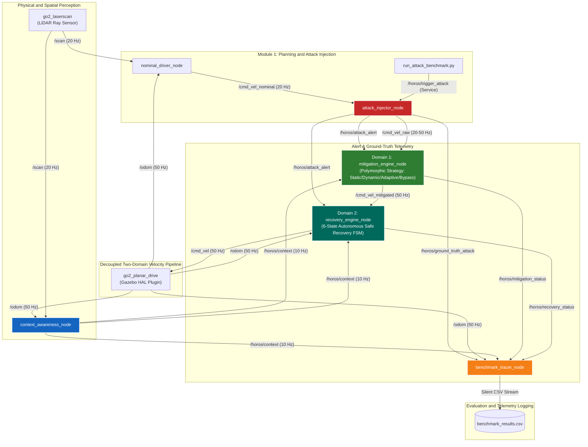

# Complete Topology of Connected Nodes, Publishers, & Subscribers

**Project:** HOROS Framework: Severity-Aware Adaptive Response and Autonomous Safe Recovery  
**Author:** Youssef Ashraf Khalil (GIU Cairo)  
**Academic Degree:** Bachelor of Science in Computer Science  

---

## 1. System-Wide Dataflow Architecture

The architecture enforces a decoupled two-domain pipeline:
- **Domain 1 (Mitigation Subsystem):** Inline suppression of adversarial perturbations, rate limiting, and continuous velocity envelope clamping (`/cmd_vel_raw` $\to$ `/cmd_vel_mitigated`).
- **Domain 2 (Autonomous Recovery Subsystem):** Multi-sensor state verification, anti-replay command buffer flush, flapping alert defense, and progressive velocity restoration (`/cmd_vel_mitigated` $\to$ `/cmd_vel`).

---

## 2. Comprehensive Node Connectivity Table

| Node Name | Executable & Package | Subscribed Topics | Published Topics | Services Offered / Called |
| :--- | :--- | :--- | :--- | :--- |
| **`nominal_driver_node`** | `nominal_driver` ([`horos_attack_injector`](file:///e:/Giu%20%20files/semster%207/horos_framework/src/horos_attack_injector/horos_attack_injector/nominal_driver.py)) | • `/scan` (`sensor_msgs/msg/LaserScan`, BestEffort) • `/odom` (`nav_msgs/msg/Odometry`, Reliable) | • `/cmd_vel_nominal` (`geometry_msgs/msg/Twist`, Reliable, 20 Hz) | *None* |
| **`attack_injector_node`** | `attack_injector_node` ([`horos_attack_injector`](file:///e:/Giu%20%20files/semster%207/horos_framework/src/horos_attack_injector/horos_attack_injector/attack_injector_node.py)) | • `/cmd_vel_nominal` (`geometry_msgs/msg/Twist`, Reliable) | • `/cmd_vel_raw` (`geometry_msgs/msg/Twist`, Reliable, 20 Hz) • `/horos/attack_alert` (`horos_interfaces/msg/AttackAlert`, 10) • `/horos/ground_truth_attack` (`horos_interfaces/msg/AttackAlert`, 10) | • `/horos/trigger_attack` (`horos_interfaces/srv/TriggerAttack`) [Server] |
| **`context_awareness_node`**| `context_awareness_node` ([`horos_simulation`](file:///e:/Giu%20%20files/semster%207/horos_framework/src/horos_simulation/horos_simulation/context_awareness_node.py)) | • `/scan` (`sensor_msgs/msg/LaserScan`, BestEffort) • `/odom` (`nav_msgs/msg/Odometry`, Reliable) | • `/horos/context` (`horos_interfaces/msg/RobotContext`, Reliable, 10 Hz) | *None* |
| **`mitigation_engine_node`** *(Domain 1)* | `mitigation_engine_node` ([`horos_mitigation_engine`](file:///e:/Giu%20%20files/semster%207/horos_framework/src/horos_mitigation_engine/src/mitigation_engine_node.cpp)) | • `/cmd_vel_raw` (`geometry_msgs/msg/Twist`, Reliable) • `/horos/attack_alert` (`horos_interfaces/msg/AttackAlert`, Reliable) • `/horos/context` (`horos_interfaces/msg/RobotContext`, Reliable) | • `/cmd_vel_mitigated` (`geometry_msgs/msg/Twist`, Reliable, 50 Hz) • `/horos/mitigation_status` (`horos_interfaces/msg/MitigationStatus`, Reliable, 50 Hz) | • `/horos/set_mitigation_mode` (`horos_interfaces/srv/SetMitigationMode`) [Server] |
| **`recovery_engine_node`** *(Domain 2)* | `recovery_engine_node` ([`horos_recovery_engine`](file:///e:/Giu%20%20files/semster%207/horos_framework/src/horos_recovery_engine/src/recovery_engine_node.cpp)) | • `/cmd_vel_mitigated` (`geometry_msgs/msg/Twist`, Reliable) • `/horos/attack_alert` (`horos_interfaces/msg/AttackAlert`, Reliable) • `/horos/context` (`horos_interfaces/msg/RobotContext`, Reliable) • `/odom` (`nav_msgs/msg/Odometry`, Reliable) | • `/cmd_vel` (`geometry_msgs/msg/Twist`, Reliable, 50 Hz) • `/horos/recovery_status` (`horos_interfaces/msg/RecoveryStatus`, Reliable, 10 Hz) | • `/horos/set_recovery_strategy` (`horos_interfaces/srv/SetRecoveryStrategy`) [Server] |
| **`go2_planar_drive`** *(Gazebo Plugin)* | `libgazebo_ros_planar_move.so` (`gazebo_ros`) | • `/cmd_vel` (`geometry_msgs/msg/Twist`) | • `/odom` (`nav_msgs/msg/Odometry`, 50 Hz) • `/tf` (`tf2_msgs/msg/TFMessage`, `odom -> base_footprint`) | *None* |
| **`go2_laserscan`** *(Gazebo Plugin)* | `libgazebo_ros_ray_sensor.so` (`gazebo_ros`) | *None (Ray Tracing)* | • `/scan` (`sensor_msgs/msg/LaserScan`, 20 Hz) | *None* |
| **`benchmark_tracer_node`** | `benchmark_tracer` ([`horos_attack_injector`](file:///e:/Giu%20%20files/semster%207/horos_framework/src/horos_attack_injector/horos_attack_injector/benchmark_tracer_node.py)) | • `/horos/mitigation_status` (`horos_interfaces/msg/MitigationStatus`, Reliable) • `/horos/attack_alert` (`horos_interfaces/msg/AttackAlert`, Reliable) • `/horos/recovery_status` (`horos_interfaces/msg/RecoveryStatus`, Reliable) • `/horos/context` (`horos_interfaces/msg/RobotContext`, Reliable) • `/odom` (`nav_msgs/msg/Odometry`, Reliable) | *None (Writes to `benchmark_results.csv`)* | *None* |
| **`attack_benchmark_client`** | `run_attack_benchmark.py` ([`scripts`](file:///e:/Giu%20%20files/semster%207/horos_framework/scripts/run_attack_benchmark.py)) | *None* | *None* | • `/horos/trigger_attack` (`horos_interfaces/srv/TriggerAttack`) [Client] • `/horos/set_mitigation_mode` (`horos_interfaces/srv/SetMitigationMode`) [Client] |
| **`abusive_stress_benchmark_client`** | `run_abusive_stress_benchmark.py` ([`scripts`](file:///e:/Giu%20%20files/semster%207/horos_framework/scripts/run_abusive_stress_benchmark.py)) | • `/horos/mitigation_status` • `/horos/recovery_status` • `/horos/context` | *None* | • `/horos/trigger_attack` [Client] • `/horos/set_mitigation_mode` [Client] • `/horos/set_recovery_strategy` [Client] |

---

## 3. Communication Topic Catalog

| Topic Name | Message Type | Rate | Purpose & Decoupling Boundary |
| :--- | :--- | :--- | :--- |
| `/cmd_vel_nominal` | `geometry_msgs/msg/Twist` | $20\text{ Hz}$ | Legitimate navigation planner commands from `nominal_driver`. |
| `/cmd_vel_raw` | `geometry_msgs/msg/Twist` | $20\text{ Hz}$ | Raw command flow emitted from `attack_injector_node` (compromised under attack). |
| `/cmd_vel_mitigated` | `geometry_msgs/msg/Twist` | $50\text{ Hz}$ | **Domain 1 Output:** Inline mitigated command flow with cyber-disturbances suppressed and spatial limits enforced. Dispatched exclusively to Domain 2. |
| `/cmd_vel` | `geometry_msgs/msg/Twist` | $50\text{ Hz}$ | **Domain 2 Output:** Fully verified and progressive-ramp commanded velocity received by Gazebo actuators / physical robot HAL. |
| `/scan` | `sensor_msgs/msg/LaserScan` | $20\text{ Hz}$ | 360° horizontal LiDAR range returns from `lidar_link`. |
| `/odom` | `nav_msgs/msg/Odometry` | $50\text{ Hz}$ | Robot planar position $(x, y)$, linear speed, and yaw heading $\psi$. |
| `/horos/attack_alert` | `horos_interfaces/msg/AttackAlert` | Event-Driven | Cyberattack detection alert containing threat type, severity score $S \in [0, 1]$, and affected topic. |
| `/horos/ground_truth_attack` | `horos_interfaces/msg/AttackAlert` | $20\text{ Hz}$ | Unfiltered ground-truth telemetry used by benchmark evaluators. |
| `/horos/context` | `horos_interfaces/msg/RobotContext` | $10\text{ Hz}$ | Operational context ($R_{\text{ctx}}$, obstacle clearance $d_{\min}$, localization confidence $\gamma_{\text{loc}}$, context state). |
| `/horos/mitigation_status` | `horos_interfaces/msg/MitigationStatus` | $50\text{ Hz}$ | Real-time mitigation status, active mode, applied action, and task continuity ($TC$). |
| `/horos/recovery_status` | `horos_interfaces/msg/RecoveryStatus` | $10\text{ Hz}$ | Recovery FSM state (`0..5`), state name string, progressive velocity scaling factor ($0.0 \to 1.0$), verification checks bitmask, and rollback counts. |
