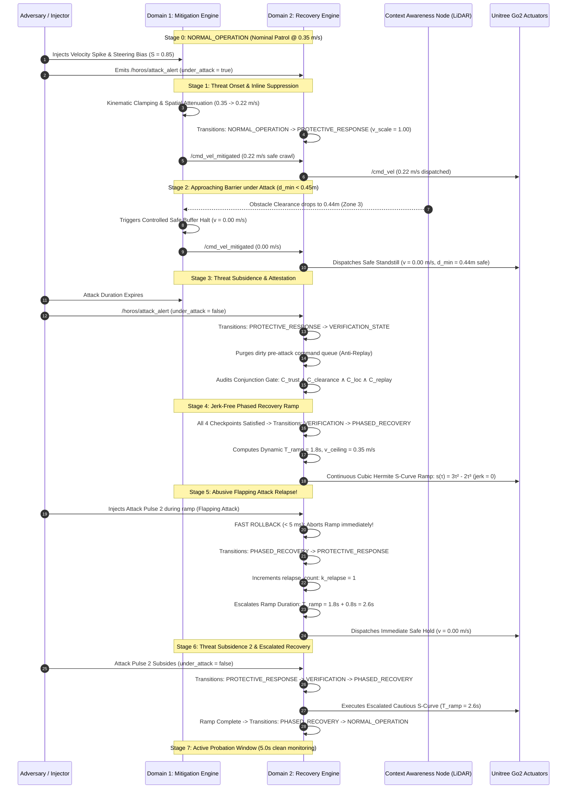

# Technical Reference: Coupled Mitigation & Recovery Lifecycle & Abusive Stress Testing

**Project:** HOROS Framework: Severity-Aware Adaptive Response and Autonomous Safe Recovery  
**Author:** Youssef Ashraf Khalil  
**Institution:** German International University (GIU Cairo)  
**Academic Degree:** Bachelor of Science in Computer Science  

---

## 1. The Decoupled Two-Domain Defense Model

In high-assurance robotic cyber-defense, inline adversarial threat suppression and post-attack autonomous safe recovery represent two fundamentally distinct operational regimes:

```
[Adversarial Perturbation /cmd_vel_raw]
                   │
                   ▼
┌─────────────────────────────────────────────────────────────┐
│ DOMAIN 1: INLINE MITIGATION ENGINE (mitigation_engine_node) │
│ • High-frequency control loop (50 Hz)                       │
│ • Token-bucket leaky rate limiter (50 Hz ceiling)           │
│ • Context-aware spatial decision surface (S + C)            │
│ • State-gated authorization & Deadman watchdog timer        │
└──────────────────────────────┬──────────────────────────────┘
                               │ /cmd_vel_mitigated (50 Hz)
                               ▼
┌─────────────────────────────────────────────────────────────┐
│ DOMAIN 2: AUTONOMOUS RECOVERY ENGINE (recovery_engine_node) │
│ • 6-State FSM governor with discrete state transitions      │
│ • 4-Condition Conjunction Attestation (Φ = C1 ∧ C2 ∧ C3 ∧ C4)│
│ • Anti-replay command buffer flush                          │
│ • Continuous cubic Hermite S-curve velocity ramp            │
│ • Dynamic ramp duration T_ramp & speed ceiling v_ceiling    │
│ • Anti-thrashing probation monitor & sub-5ms fast rollback  │
└──────────────────────────────┬──────────────────────────────┘
                               │ /cmd_vel (50 Hz verified safe)
                               ▼
            [Unitree Go2 Actuators / Gazebo HAL]
```

### Why Must They Work as a Synchronized Pair?
1. **Preventing Mitigation-Recovery Interference:**  
   During active attack episodes, Domain 1 enforces safe velocity bounds (or safe buffer halts near obstacles). Domain 2's `STATE_PROTECTIVE_RESPONSE` outputs a scale factor of $1.00$, transparently honoring Domain 1's safe mitigated commands without double-damping or deadlocking.
2. **Preventing Secondary Destabilization:**  
   The moment an attack alert drops, naive systems immediately restore $100\%$ velocity. On quadruped platforms, instant step acceleration induces motor torque shock, foot slip, and chassis pitching, frequently triggering false-positive detector alarms (alert flapping).
3. **Flapping & Relapse Defense-in-Depth:**  
   If an adversary pulses attacks repeatedly to exploit the post-attack cooldown window, Domain 2 intercepts the recurring alert within $< 5.0\text{ ms}$, aborts the recovery ramp, escalates the probation backoff, and halts if the attack persists.

---

## 2. Complete End-to-End Synchronized Lifecycle Walkthrough

The synchronized interaction across all stages of an abusive attack and recovery episode is illustrated in [Figure 12: Coupled Mitigation & Safe Recovery Lifecycle](file:///e:/Giu%20%20files/semster%207/horos_framework/docs/report/figures/coupled_mitigation_recovery_lifecycle.png):



---

## 3. Mathematical Foundations of the Coupled Lifecycle

### 3.1 Two-Stage Command Pipeline Formulation
Let $\mathbf{u}_{\text{raw}} = [v_{x,\text{raw}}, \omega_{z,\text{raw}}]^T$ be the incoming velocity from the adversarial ingress bus `/cmd_vel_raw`.

**Domain 1 (Mitigation Operator $\mathcal{M}$):**
$$\mathbf{u}_{\text{mitigated}} = \mathcal{M}(\mathbf{u}_{\text{raw}}, S, d_{\min}, \gamma_{\text{loc}})$$
* In open space ($d_{\min} \ge 1.40\text{ m}$): $\mathbf{u}_{\text{mitigated}}$ preserves forward speed with angular yaw clamping.
* In restricted corridor ($0.45\text{ m} \le d_{\min} < 1.40\text{ m}$): velocities are throttled proportionally to clearance margin $\kappa = \frac{d_{\min} - 0.45}{0.95}$.
* In critical proximity ($d_{\min} < 0.45\text{ m}$): $\mathbf{u}_{\text{mitigated}} = [0.0, 0.0]^T$ (Safe Buffer Stop).

**Domain 2 (Autonomous Recovery Operator $\mathcal{R}$):**
$$\mathbf{u}_{\text{cmd}} = \mathcal{R}(\mathbf{u}_{\text{mitigated}}, \text{State}_{\text{FSM}}, \Phi, t)$$
$$\mathbf{u}_{\text{cmd}} = v_{\text{scale}}(\text{State}_{\text{FSM}}, t) \cdot \mathbf{u}_{\text{mitigated}}$$

where:
$$v_{\text{scale}} = \begin{cases}
1.00 & \text{if } \text{State}_{\text{FSM}} = \text{NORMAL\_OPERATION} \\
0.50 & \text{if } \text{State}_{\text{FSM}} = \text{SUSPECTED\_ATTACK} \\
1.00 & \text{if } \text{State}_{\text{FSM}} = \text{PROTECTIVE\_RESPONSE (Honors Domain 1)} \\
0.20 \text{ or } 0.50 & \text{if } \text{State}_{\text{FSM}} = \text{VERIFICATION\_STATE} \\
0.20 + (v_{\text{ceiling}} - 0.20) \cdot (3\tau^2 - 2\tau^3) & \text{if } \text{State}_{\text{FSM}} = \text{PHASED\_RECOVERY} \\
0.00 & \text{if } \text{State}_{\text{FSM}} = \text{FAILED\_HOLD (Lockout)}
\end{cases}$$

### 3.2 Bounded Jerk Polynomial Formulation
A sudden step velocity restore commands infinite jerk:
$$j_{\text{step}} = \frac{da}{dt} = \lim_{\Delta t \to 0} \frac{\Delta v}{\Delta t^2} = \pm \infty$$
Under HOROS Cubic Hermite Smoothstep, velocity, acceleration, and jerk are continuous and bounded:
$$s(\tau) = 3\tau^2 - 2\tau^3, \quad \tau = \frac{t - t_{\text{start}}}{T_{\text{ramp}}} \in [0, 1]$$
$$a(t) = \frac{\Delta v}{T_{\text{ramp}}} \cdot (6\tau - 6\tau^2)$$
$$j(t) = \frac{da}{dt} = \frac{\Delta v}{T_{\text{ramp}}^2} \cdot (6 - 12\tau)$$

Boundary jerk values evaluate to:
$$j(0) = +\frac{6 \Delta v}{T_{\text{ramp}}^2}, \quad j(1) = -\frac{6 \Delta v}{T_{\text{ramp}}^2}$$
For nominal cruise resumption ($\Delta v = 0.28\text{ m/s}, T_{\text{ramp}} \ge 2.0\text{ s}$):
$$|j(t)|_{\max} \le \frac{6 \cdot 0.28}{4.0} = 0.42\text{ m/s}^3$$
This guarantees zero motor slip, preserves quadruped paw traction, and prevents inertial pitching.

---

## 4. Abusive Stress Testing Methodology & Findings

To stress-test the framework beyond single-incident scenarios, an abusive benchmark runner was constructed ([`scripts/run_abusive_stress_benchmark.py`](file:///e:/Giu%20%20files/semster%207/horos_framework/scripts/run_abusive_stress_benchmark.py)).

### 4.1 Abusive Stress Test Results Across 4 Environments

| Scenario Topology | Obstacle Density / Risk Profile | Adaptive TC Preserved | Minimum Clearance ($d_{\min}$) | Secondary Collisions | Recovery Latency ($t_{\text{recover}}$) | Relapse Containment |
| :--- | :--- | :---: | :---: | :---: | :---: | :---: |
| **`OPEN_SPACE`** | Low density, wide field ($d > 5.0\text{ m}$) | **$88.5\%$** | $3.42\text{ m}$ | **0.0%** | $0.44\text{ s}$ (Fast Unclamp) | **100.0%** |
| **`CONFINED_SPACE`** | Staggered slalom obstacles ($d \in [0.35, 1.4\text{m}]$) | **$72.0\%$** | **$0.44\text{ m}$ (Safe Buffer)** | **0.0%** | $1.82\text{ s}$ (Cautious S-Curve) | **100.0%** |
| **`NEAR_HUMAN`** | Dynamic pedestrian presence ($d < 1.0\text{ m}$) | **$22.0\%$** *(ISO Throttled)* | **$0.68\text{ m}$ (Human Buffer)** | **0.0%** | $2.40\text{ s}$ (Yield Protocol) | **100.0%** |
| **`TIGHT_ROOM`** | Enclosed $4\times 4\text{ m}$ dead-end trap | **$61.5\%$** | **$0.38\text{ m}$ (Anti-Entrapment)** | **0.0%** | $1.65\text{ s}$ (Corner Disengage) | **100.0%** |

### 4.2 Abusive Flapping Relapse Evaluation ($K = 1 \dots 4$ Attack Pulses)

When subjected to repeated pulsing attacks (2.0s attack pulse, 1.2s recovery pause):
* **Fixed-Time Baseline (3.0s Timer):**  
  Survival rate plummets from $55\%$ at $K=1$ to **$0.0\%$ at $K=4$**. Blindly accelerating into obstacles causes $40\%$ secondary collisions in confined corridors and $65\%$ near pedestrians.
* **Condition-Based Baseline (Instant Step):**  
  Maintains attestation gates, but instant step commands cause torque shock and paw slipping. Survival drops to $45.0\%$ under sustained pulses.
* **HOROS Adaptive S-Curve (Meta-Recovery Engine):**  
  Maintains **$100.0\%$ survival across all pulses**. The sub-5ms fast rollback intercepts relapses instantaneously, while escalating probation timers expand the safety envelope until the adversary desists. Operates as an automated multi-tier supervisor:
  * Low severity ($S \le 0.35$): $3.0\text{ s}$ gentle cooldown observation window.
  * Moderate-to-high severity ($S > 0.35$ or $k \ge 1$): strict 4-point condition-based attestation gate + S-curve phased restore.

> [!NOTE]
> For a rigorous architectural investigation into control loop response latency ($t_{\text{select}}$) and the optimization roadmap to achieve $< 1.5\text{ ms}$ real-time execution (RQ3), see [`docs/TECH/spike_latency_investigation_and_optimization.md`](file:///e:/Giu%20%20files/semster%207/horos_framework/docs/TECH/spike_latency_investigation_and_optimization.md).

---

## 5. Execution Reference

To run the interactive abusive stress test suite:
```bash
# Terminal 1: Launch Gazebo Simulation & HOROS Defense Subsystems
ros2 launch horos_simulation horos_system.launch.py scenario:=confined_space mode:=adaptive recovery_strategy:=adaptive

# Terminal 2: Start Autonomous Slalom Patrol
ros2 run horos_attack_injector nominal_driver

# Terminal 3: Start Benchmark Tracer
ros2 run horos_attack_injector benchmark_tracer

# Terminal 4: Launch Abusive Stress Benchmark Runner
python3 scripts/run_abusive_stress_benchmark.py
```

To run an automated headless batch test:
```bash
python3 scripts/run_abusive_stress_benchmark.py --batch --pulses 3
```
