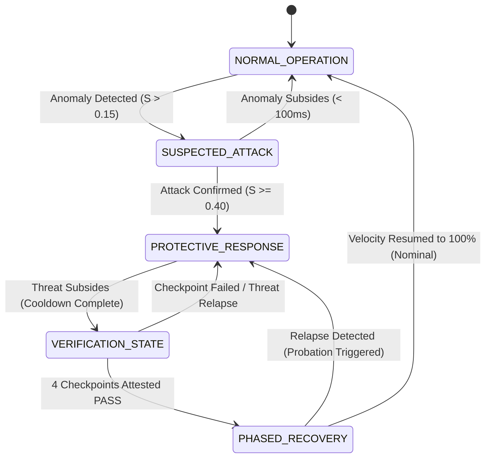

# HOROS Framework: Mathematical Foundations & Theoretical Defense Guide
**Comprehensive Master Reference for Bachelor Thesis Oral Examination**  
**Author:** Youssef Ashraf Khalil  
**Institution:** German International University (GIU Cairo), Department of Computer Science  
**Supervisors:** Dr. Marwa Zamzam, Prof. Slim Abdennadher  
**Primary Testbeds:** Unitree Go2 EDU Quadruped (Jetson Orin NX) & UBTech YanShee Biped Humanoid (Raspberry Pi 3 Model B)  
**Academic Degree:** Bachelor of Science in Computer Science  

---

## 1. Executive Research Motivation & Core Thesis Questions

During the oral bachelor thesis defense, examiners will evaluate whether you comprehend the exact physical, mathematical, and cybernetic mechanisms governing robotic behavior under attack.

### The Three Core Research Questions (RQs)

#### RQ1 (Availability vs. Security):
* **The Question:** *How does severity-aware adaptive mitigation improve preserved Task Continuity ($TC$) compared to traditional static binary emergency stops (E-Stops)?*
* **The Flaw of Baselines:** Traditional robotic security monitors (e.g., RIPS) execute a rigid binary fail-stop ($v^* = 0.0\text{ m/s}$) upon detecting an anomaly. While halting prevents forward motion, it yields near-zero Safe Task Continuity ($0.1\%$ Go2, $0.3\%$ YanShee, $0.0\%$ median), paralyzing mission-critical assets and leaving robots vulnerable to denial-of-service through continuous alarm tripping.
* **The HOROS Resolution:** HOROS demonstrates that severity-aware, spatially bounded velocity clamping ($\alpha_{\text{sev}}(S) = 1 - k_S S$ floored by $v_{\min,\text{floor}}$ combined with SD-CBF spatial envelopes) neutralizes cyberattacks while preserving **$42.1\% \pm 32.1\%$ Safe Task Continuity ($50.7\%$ median)** on Go2 and **$31.5\% \pm 26.5\%$ Safe Task Continuity ($26.9\%$ median)** on composed YanShee in simulation, alongside **$51.6\%$ policy / $46.9\%$ Safe TC** in single-session physical hardware feasibility runs ($0/84$ collisions under joint upstream clamping, quantized `max_level_v = 3` gait caps, and downstream IR braking).

#### RQ2 (Cyber-Physical Environmental Safety):
* **The Question:** *Why do state-of-the-art dynamic policy matrices fail in obstacle-rich confined spaces, and how does integrating real-time 360° LiDAR / spatial context prevent physical collisions?*
* **The Flaw of Baselines:** State-of-the-art dynamic matrices (e.g., attack-category velocity caps in `dynamic_strategy.hpp` or discrete tiers) are **spatially context-blind**—they command velocity limits regardless of whether an obstacle is $5.0\text{ m}$ away or $0.20\text{ m}$ away. On Go2 ($N=42$), `DYNAMIC` suffers **$14.3\%$ collisions ($6/42$)** overall ($28.6\%$ in `TIGHT_ROOM`), and in controlled closed-loop C++ sweeps (`SEV_SCALE`) suffers **$80.0\%$ collisions ($40/50$)**.
* **The HOROS Resolution:** HOROS continuously fuses real-time horizontal spatial clearance ($d_{\min}$) into continuous clamping envelopes and closed-form 1D Sampled-Data Control Barrier Functions (SD-CBF), enforcing analytical stopping boundaries ($d_{\text{crit}} = 0.45\text{ m}$ Go2, $0.25\text{ m}$ YanShee) and active gyroscopic balance damping, achieving $2.4\%$ ($1/42$) Go2 collisions ($p=0.0625$ vs.\ `DYNAMIC`, $p=1.00$ vs.\ `STATIC`), $0/112$ composed YanShee collisions (parity with `STATIC` and `DYNAMIC`), **$0/109$ ($0/100$ matched) collisions** vs.\ $12/104$ ($12/100$ matched) `BYPASS` ($p=4.88\times 10^{-4}$) when excluding the $32$ rotated rocking rows, and $0/112$ composed ($0/117$ full) / $0/84$ physical topples.

#### RQ3 (Real-Time Computational Feasibility & Low Execution Latency):
* **The Question:** *Does the adaptive decision surface maintain low observed latency ($< 2.0\text{ ms}$) suitable for real-time robotic control loops ($20\text{--}50\text{ Hz}$) on embedded single-board computers?*
* **The Flaw of Baselines:** Literature baselines (e.g., heavy Reinforcement Learning or LLM inference and large iterative optimization solvers) risk thread contention and deadline misses in high-frequency locomotion loops.
* **The HOROS Resolution:** HOROS replaces numerical iterative solvers with closed-form analytical 1D SD-CBF projection formulas, executing with an empirical in-node C++ decision latency ($t_{\text{select}}$) of **$18.43\,\mu\text{s}$ (Go2 x86\_64)**, **$12.03\,\mu\text{s}$ (YanShee x86\_64)**, and **$9.85 \pm 3.52\,\mu\text{s}$ on physical Raspberry Pi 3 Model B ARM Cortex-A53** under Linux `SCHED_OTHER` (plus $0.60\,\mu\text{s}$ vs.\ $12.51\,\mu\text{s}$ active-set QP in same-language Python microbenchmarking, while noting worst-case container loop tail $\max = 246.136\text{ ms}$ under OS preemption). C++ intra-process component composition lowers resident RAM by **$42.0\%$ ($106.54\text{ MB} \to 61.80\text{ MB}$)** on Raspberry Pi 3B.

---

## 2. Foundational Robotics Dynamics (Explained for Computer Scientists)

Examiners will probe whether you understand the physical laws that cause robots to tip over, crash, or skid when cyberattacks inject malicious commands.

---

### 2.1 The Zero Moment Point (ZMP) & Dynamic Support Polygon

The Zero Moment Point is the fundamental metric governing dynamic legged locomotion stability.

$$
\mathbf{p}_{\text{zmp}} = \mathbf{p}_{\text{com}} - \frac{z_{\text{com}}}{\ddot{z}_{\text{com}} + g} \ddot{\mathbf{p}}_{\text{com}}
$$

#### Comprehensive Variable Reference Table:

|Variable|Mathematical Domain|SI Units|Physical Meaning & Robotic Mechanism|Cyber-Physical Attack Impact & Defensive Role|
| :---: | :---: | :---: | :--- | :--- |
|**p**_zmp|ℝ² = [x_zmp, y_zmp]ᵀ|m (meters)|**Zero Moment Point:** 2D planar coordinate on ground contact surface (z=0) where the net tipping moment vanishes.|If an attack pushes **p**_zmp outside P_support, an uncountered rotational torque flips the robot over.|
|**p**_com|ℝ² = [x_com, y_com]ᵀ|m (meters)|**Center of Mass (CoM) Projection:** Ground projection of robot's total physical mass centroid.|Under static rest (p̈_com = 0), p_zmp ≡ p_com.|
|**p̈**_com|ℝ² = [ẍ_com, ÿ_com]ᵀ|m/s²|**Horizontal CoM Linear Acceleration:** Rate of horizontal CoM velocity change.|Injected velocity spikes command step velocity jumps (p̈_com → ∞), causing massive ZMP excursions.|
|z_com|ℝ⁺ (> 0)|m (meters)|**Vertical CoM Elevation:** Height of robot mass center above ground.|Go2: z_com ≈ 0.28 m; YanShee: z_com ≈ 0.18 m. Higher CoM increases tipping leverage arm.|
|z̈_com|ℝ (Real Scalar)|m/s²|**Vertical CoM Acceleration:** Vertical bouncing acceleration during step impacts.|Over flat terrain trotting, z̈_com ≈ 0, simplifying denominator to gravitational constant g (gravity).|
|g (gravity)|Constant ∈ ℝ⁺ (> 0)|m/s²|**Gravitational Acceleration:** Standard Earth gravity (9.81 m/s²).|Provides restoring ground normal force (F_N = mg) keeping soles in contact with floor.|

#### Derivation & Mechanics Rationale:
In dynamic contact mechanics, the ground reaction force $\mathbf{F}_R$ and moment $\mathbf{M}_R$ must balance d'Alembert's inertial reaction forces:

$$
\mathbf{F}_R = m(\ddot{\mathbf{p}}_{\text{com}} + g\hat{\mathbf{z}}), \qquad \mathbf{M}_R = \mathbf{p}_{\text{zmp}} \times \mathbf{F}_R
$$

Setting the horizontal tipping moments about the contact point to zero yields the cross-product equality:

$$
(x_{\text{com}} - x_{\text{zmp}})m(\ddot{z}_{\text{com}} + g) - z_{\text{com}} m \ddot{x}_{\text{com}} = 0 \implies x_{\text{zmp}} = x_{\text{com}} - \frac{z_{\text{com}}}{\ddot{z}_{\text{com}} + g}\ddot{x}_{\text{com}}
$$

#### The Support Polygon Condition (Equation 2.2):

$$
\mathbf{p}_{\text{zmp}} \in \mathcal{P}_{\text{support}} \equiv \text{Conv}(\{\mathbf{r}_1, \mathbf{r}_2, \dots, \mathbf{r}_k\})
$$

|Variable|Mathematical Domain|SI Units|Physical Meaning & Defensive Role|
| :---: | :---: | :---: | :--- |
|P_support|Subset ⊂ ℝ² (2D Plane)|m (meters)^2|**Support Polygon:** Convex hull of all active ground contact points supporting the robot.|
|**r**_i|ℝ² (2D Plane) = [x_i, y_i]^T|m (meters)|**Contact Point Location:** 2D coordinate of the i-th active foot sole in ground plane.|
|Convex Hull|Operator|—|**Convex Hull Operator:** Minimal convex set containing all active foot contact points.|

```
QUADRUPED DOUBLE-SUPPORT TROT:           BIPED SINGLE-SUPPORT SWING PHASE:
┌──────────────────────────────┐          ┌──────────────┐
│  Foot 1 (FL)    Foot 2 (FR)  │          │              │
│      •──────────────•        │          │  Stance Foot │
│      │  STABLE ZMP  │        │          │   [• ZMP]    │  <-- Single Sole
│      │      •       │        │          │              │      7.5cm x 5.0cm
│      •──────────────•        │          └──────────────┘
│  Foot 3 (RL)    Foot 4 (RR)  │          (Margin: barely ±2.5 cm lateral!)
└──────────────────────────────┘          (Attack spike pushes ZMP off foot!)
(Wide Support Polygon: ~45cm x 30cm)
```

#### CS Systems Analogy:
Think of $\mathcal{P}_{\text{support}}$ as a **hardware memory segmentation boundary (MMU)** and $\mathbf{p}_{\text{zmp}}$ as an active memory pointer:
* As long as the pointer stays within allocated segment bounds ($\mathbf{p}_{\text{zmp}} \in \mathcal{P}_{\text{support}}$), execution is valid.
* The moment an adversary injects sudden acceleration, d'Alembert reaction forces push the pointer out of bounds. This triggers a physical **Segmentation Fault** (robot loses ground counter-torque and tumbles to the floor).

#### Defense Oral Trap & Ready Answer:
* **Trap:** *"Why does an immediate Emergency Stop cause a quadruped or biped to fall if the command is zero velocity?"*
* **Rebuttal:** *"Zero velocity commands do not mean zero acceleration. Commanding an instantaneous step velocity change from $+0.35\text{ m/s}$ to $0.0\text{ m/s}$ in a single 10 ms cycle demands an acceleration of $\ddot{x}_{\text{com}} \approx -35.0\text{ m/s}^2$. Through Equation (2.1), the negative acceleration creates a massive positive shift: $\Delta x_{\text{zmp}} = -\frac{0.28}{9.81}(-35.0) \approx +1.00\text{ m}$. Because the foot support polygon is only $0.30\text{ m}$ long, the ZMP is thrown a full meter outside the feet, causing feet to slip and the robot to flip forward. This is why HOROS enforces rate-limited continuous clamping rather than binary halts."*

---

### 2.2 Multi-Body Rigid Manipulator Dynamics

Every joint motor on Go2 (12 actuators) and YanShee (17 actuators) is governed by nonlinear rigid-body equations of motion:

$$
\mathbf{\tau} = \mathbf{M}(\mathbf{q})\ddot{\mathbf{q}} + \mathbf{C}(\mathbf{q}, \dot{\mathbf{q}})\dot{\mathbf{q}} + \mathbf{G}(\mathbf{q})
$$

#### Comprehensive Variable Reference Table:

|Variable|Mathematical Domain|SI Units|Physical Meaning & Robotic Mechanism|Cyber-Physical Attack Impact & Defensive Role|
| :---: | :---: | :---: | :--- | :--- |
|**τ** (tau)|ℝⁿ (Configuration Space) (n=12 or 17)|N·m|**Generalized Joint Actuator Torques:** Vector of net motor torques commanded to joints.|Motors have hard physical limits (τ ≤ τ_{max}). Saturation causes loss of control authority.|
|q|ℝⁿ (Configuration Space)|rad|**Generalized Joint Coordinates:** Angular position vector of all joint servomotors.|Tracked by optical encoders; malicious commands command impossible joint trajectories.|
|q̇|ℝⁿ (Configuration Space)|rad/s|**Joint Angular Velocity Vector:** Instantaneous rate of change of joint angles.|High joint velocities inflate Coriolis forces quadratically (propto dot{**q**}^2).|
|q̈|ℝⁿ (Configuration Space)|rad/s^2|**Joint Angular Acceleration Vector:** Angular acceleration of joint shafts.|Stepped velocity cyberattacks demand ddot{**q**} → ∈fty, demanding unattainable infinite torque.|
|**M**(q)|ℝⁿˣⁿ (Symmetric Pos-Def)|kg·m (meters)^2|**Configuration Mass-Inertia Matrix:** Symmetric, positive-definite matrix of limb inertia.|Couples joint accelerations; accelerating one link induces reaction torques on all other links.|
|**C**(**q**,dot{**q**})|ℝⁿˣⁿ (Symmetric Pos-Def)|N·m·s (seconds)|**Coriolis and Centripetal Matrix:** Velocity-dependent dynamic cross-coupling terms.|Captures fictitious forces created by rotating coordinate frames of rapidly moving limbs.|
|**G**(**q**)|ℝⁿ (Configuration Space)|N·m|**Gravity Torque Compensation Vector:** Joint torques required just to balance robot weight.|Prevents robot limbs from collapsing under gravity when stationary.|
|n|Dimension scalar|—|**Degrees of Freedom (DOF):** Number of actuated joint motors.|Unitree Go2: n = 12 (3 DOF × 4 legs); UBTech YanShee: n = 17 (10 legs + 7 upper).|

#### CS Systems Analogy:
Think of Equation (2.3) as the **low-level CPU pipeline and bus bandwidth** of physical robotics:
* The joint motors implement PD position-error feedback: $\mathbf{\tau}_{\text{cmd}} = \mathbf{K}_p (\mathbf{q}_{\text{target}} - \mathbf{q}) + \mathbf{K}_d (\dot{\mathbf{q}}_{\text{target}} - \dot{\mathbf{q}})$.
* When an adversary injects high-amplitude command spikes, $\mathbf{q}_{\text{target}} - \mathbf{q}$ explodes.
* The required torque $\mathbf{\tau}$ exceeds the power supply bus limits ($\tau_{\max} \approx 23.7\text{ N}\cdot\text{m}$ on Go2, $2.5\text{ N}\cdot\text{m}$ on YanShee). The motor amplifiers saturate, bus voltage sags, joint tracking error accumulates, and leg compliance collapses.

---

### 2.3 Bipedal Humanoid Dynamics: 3D Linear Inverted Pendulum Model (3D-LIPM)

Unlike quadrupeds that rest stably on four legs, bipedal humanoids walk as dynamically unstable inverted pendulums:

$$
\ddot{x} = \frac{g}{z_c} x = \omega_0^2 x, \qquad \text{where } \omega_0 = \sqrt{\frac{g}{z_c}}
$$

#### Comprehensive Variable Reference Table:

|Variable|Mathematical Domain|SI Units|Physical Meaning & Robotic Mechanism|Cyber-Physical Attack Impact & Defensive Role|
| :---: | :---: | :---: | :--- | :--- |
|x|ℝ (Real Scalar)|m (meters)|**Relative CoM Displacement:** Horizontal offset between CoM and stance foot sole center.|In equilibrium, x = 0. Perturbations push x > 0, causing gravity to pull torso downward.|
|ddot{x}|ℝ (Real Scalar)|m/s²|**Horizontal CoM Linear Acceleration:** Rate of CoM falling acceleration.|Note the positive sign (+ω₀^2 x): acceleration is in the *same* direction as displacement.|
|z_c|ℝ⁺ (> 0)|m (meters)|**Fixed Walking CoM Elevation:** Assumed constant height of humanoid pelvis.|YanShee: z_c ≈ 0.18 m. Constrained by horizontal planar pelvis assumption.|
|ω₀|ℝ⁺ (> 0)|s⁻¹ (Hz)|**Natural Orbital Eigenfrequency:** Characteristic pendulum divergence frequency.|YanShee: ω₀ = sqrt{9.81 / 0.18} ≈ 7.38 s^{-1}. Governs exponential tipping rate.|
|c_1, c_2|ℝ (Real Scalar)|m (meters)|**Boundary Condition Constants:** Amplitude coefficients computed from initial state.|c_1 = frac{x(0) + dot{x}(0)/ω₀}{2}; c_2 = frac{x(0) - dot{x}(0)/ω₀}{2}.|
|t_{double}|ℝ⁺ (> 0)|s (seconds)|**Positional Error Doubling Time:** Time required for a CoM displacement to double.|t_{double} = frac{ln(2)}{ω₀} ≈ frac{0.693}{7.38} ≈ 0.094 s  (94 ms).|

#### Analytical Open-Loop Unstable Solution (Equation 2.5):

$$
x(t) = c_1 e^{\omega_0 t} + c_2 e^{-\omega_0 t}
$$

```
SYSTEM EIGENVALUE ANALYSIS:
Characteristic Equation: s² - ω₀² = 0  ===>  Eigenvalues: λ₁ = +ω₀,  λ₂ = -ω₀

        Im(s)
          │
          │
────x─────┼─────x────► Re(s)
   -ω₀    │    +ω₀
 (Stable) │  (UNSTABLE POLE in Right Half-Plane!)
          │
```

#### CS Systems Analogy:
The 3D-LIPM is the physical equivalent of an **uncontrolled recursive exponential fork-bomb**:
* In a normal pendulum (e.g. hanging cable), $\ddot{x} = -\omega^2 x$. The eigenvalue is imaginary ($\pm j\omega$), yielding bounded harmonic oscillation (negative feedback).
* In a standing humanoid, $\ddot{x} = +\omega_0^2 x$. The positive eigenvalue ($\lambda_1 = +7.38\text{ s}^{-1}$) acts as **runaway positive feedback**.
* If a cyberattack injects an unauthorized turning jerk that persists for just 3 control ticks ($150\text{ ms}$ at $20\text{ Hz}$), the CoM displacement doubles twice ($4\times$). Because YanShee's stance sole is only $7.5\text{ cm} \times 5.0\text{ cm}$ ($\pm 2.5\text{ cm}$ lateral boundary), the robot is guaranteed to topple unless gyroscopic damping intervenes immediately.

---

## 3. Quadruped vs. Biped Morphological Divergence

Why did HOROS evaluate both the **Unitree Go2 Quadruped** and the **UBTech YanShee Biped Humanoid**? To demonstrate algorithmic generality across the two extremes of legged locomotion:

```
QUADRUPED (Unitree Go2):                 BIPED HUMANOID (UBTech YanShee):
      ┌─────────────┐                           ┌───┐ Head (Camera)
 ┌────┤ Jetson Orin ├────┐                      │   │
 │    └─────────────┘    │                      └───┘
 │  360° Planar LiDAR    │                    ┌───────┐ Chest (IR Sensor)
┌┴┐                     ┌┴┐                   │ Pi 3B │
│ │                     │ │                   └───┬───┘
└─┘                     └─┘                      ┌┴┐ Pelvis (IMU)
4 Contact Points, Statically Stable              │ │
Support Polygon > 1,350 cm²                     ┌┴─┴┐ 2 Contact Points, Collapses to
Failure Mode: High-Speed Wall Crash             └─┬─┘ 1 Tiny Sole during Swing (37.5 cm²)
                                                  │   Failure Mode: Catastrophic Topple
```

|Evaluation Dimension|Unitree Go2 EDU Quadruped|UBTech YanShee Biped Humanoid|
| :--- | :--- | :--- |
|**Locomotion Kinematics**|12-DOF Quadruped Trotting Gait (Statically stable stance)|17-DOF Bipedal Walking Gait (Dynamically unstable inverted pendulum)|
|**Active Stance Polygon**|Wide 4-point stance polygon (sim 45 cm × 30 cm)|Single sole (7.5 cm × 5.0 cm) during swing phase|
|**Lateral Tipping Margin**|Large margin (pm 15 cm excursion before tipping)|**Extreme sensitivity:** lateral CoM shift ≥ pm 2.5 cm breaches boundary|
|**Total Moving Mass**|15.0 kg (high momentum, large stopping inertia)|1.65 kg (lightweight tabletop humanoid)|
|**Dominant Failure Mode**|Translational obstacle collisions in confined corridors (`21.4% BYPASS`)|Confined-corridor collisions (`14/112 BYPASS` vs. `0/112 ADAPTIVE`; `12/100` vs. `0/100` matched after excluding 32 rocking rows, $p=4.88\times 10^{-4}$) & inverted-pendulum balance risk (`0/117` sim, `0/84` real topples)|
|**Onboard Compute / Deployment Host**|x86\_64 Gazebo testbed (`SCHED_OTHER`; target Jetson Orin NX 16 GB)|**Raspberry Pi 3 Model B** (1 GB LPDDR2, quad-core ARM Cortex-A53)|
|**Spatial Perception Suite**|360° Omnidirectional 2D LiDAR (`/scan`, 20 Hz, 15 m)|Simulated 150° eyes (`[-75°, +75°]`) & sonar -> 360-beam virtual `/scan` • **External Chest IR + 65° Camera** (Physical)|
|**Defensive Choke Point**|Continuous LiDAR SD-CBF velocity envelope clamping|Active gyroscopic posture damping & zero-copy C++ composition|

---

## 4. Perception Engineering Reality: Simulated 360-Beam Virtual Scan vs. External IR

A critical question examiners will ask:  
**"Why does your report mention a virtual LaserScan in simulation, but an Infrared (IR) distance sensor on the real YanShee?"**

```
SIMULATION PERCEPTION (Gazebo 11 ODE):      PHYSICAL HARDWARE PERCEPTION (Lab Corridor):
┌─────────────────────────────────┐        ┌─────────────────────────────────┐
│ Simulated Depth/Range Cone      │        │ External Chest Sharp IR Sensor  │
│ • Range: 0.05 m to 5.00 m       │        │ • Range: 0.15 m to 0.80 m       │
│ • Forward Arc: 150° [-75°, +75°]│        │ • Polling: 10 Hz via REST bridge│
│ • 360-beam virtual /scan        │        │ • IR brake: <0.22m (2x, IR)     │
└────────────────┬────────────────┘        └────────────────┬────────────────┘
                 │                                          │
                 ▼                                          ▼
         ┌──────────────────────────────────────────────────────────┐
         │     Virtual LaserScan Perception Bridge (Unified HAL)    │
         │          (yanshee_virtual_scan_node.py)                  │
         │  360 beams over 360° ([-75°, +75°] populated, rest inf)  │
         └──────────────────────────┬───────────────────────────────┘
                                    │ Emits /scan for context_awareness_node
                                    ▼
         ┌──────────────────────────────────────────────────────────┐
         │    Analytical 1D SD-CBF Forward Safety Filter (C++)      │
         └──────────────────────────────────────────────────────────┘
```

### The Professional Academic Defense Answer:
1. **Simulation Fidelity (Gazebo):**
   * `yanshee_virtual_scan_node.py` converts forward depth/range returns into a standardized 360-beam `sensor_msgs/LaserScan` covering the forward $150^\circ$ arc ($[-75^\circ, +75^\circ]$) while filling blind lateral/rear angles with out-of-range maxima (`inf`).

2. **Physical Hardware Reality (Laboratory Deployment):**
   * The physical YanShee robot unit provided in the laboratory was a hardware revision that **did not feature factory ultrasonic sensors**.
   * Initial experiments attempting to estimate obstacle distance using the head-mounted monocular RGB camera failed due to:
     * **Frame buffer queue latency ($>150\text{--}300\text{ ms}$)** on the Raspberry Pi 3 CPU, causing delayed recognition of obstacles.
     * **Dynamic walking pitch wobble ($\pm 4^\circ$)**, creating depth estimation error and false collision alerts.
   * **The Hardware Solution:** An external **Infrared (IR) distance sensor** (analog PSD receiver) was rigidly mounted to the robot's chest expansion bracket. Polled at $10\text{ Hz}$ with sub-millisecond sensor readout overhead, it delivered illumination-invariant proximity telemetry ($0.15\text{--}0.80\text{ m}$ range), operating alongside quantized gait capping (`max_level_v = 3`) and a downstream IR braking cutoff (`ir_emergency_stop_m = 0.22 m` for 2 ticks with `use_ir = True` in `src/horos_simulation/horos_simulation/yanshee_physical_bridge.py`; distinct from the disabled `0.25 m` sonar fallback when `use_sonar = False` and in legacy `scripts/yanshee_physical_bridge.py`) to achieve **$0/84$ collisions** in the single-session physical feasibility evaluation.

---

## 5. HOROS Core Mitigation Mathematics

Examiners will inspect every term in HOROS's defensive equations.

---

### 5.1 Cyber Threat Severity Normalization ($S \in [0.0, 1.0]$)

Threat severity is evaluated across observable telemetry without label-leaking shortcuts:

$$
S = \max\left(S_{\text{vel}}, \; S_{\text{rate}}, \; S_{\text{jitter}}\right) \in [0.0, 1.0]
$$

#### Comprehensive Variable Reference Table:

|Variable|Mathematical Domain|SI Units|Physical Meaning & Detection Logic|
| :---: | :---: | :---: | :--- |
|S|[0.0, 1.0]|Normalized|**Composite Cyber Threat Severity:** Highest severity across evaluated threat vectors.|
|S_{vel}|[0.0, 1.0]|Normalized|**Velocity Anomaly Score:** S_{vel} = min≤ft(1.0, frac{|**v**_{raw} - **v**_{nom}|}{v_{thresh}}right).|
|S_{rate}|[0.0, 1.0]|Normalized|**Flooding Surge Score:** S_{rate} = min≤ft(1.0, frac{max(0, f_{pub} - f_{nom})}{f_{flood} - f_{nom}}right).|
|S_{jitter}|[0.0, 1.0]|Normalized|**DDS Transport Freeze Score:** S_{jitter} = min≤ft(1.0, frac{Δ t_{inter} - Δ t_{exp}}{Δ t_{timeout}}right).|
|**v**_{raw}|ℝ² (2D Plane) (v_x, ω_z)|m/s, rad/s|**Raw Commanded Velocity:** Command arriving on `/cmd_vel_raw` (potentially spoofed).|
|**v**_{nom}|ℝ² (2D Plane)|m/s, rad/s|**Nominal Mission Velocity:** Expected patrol setpoint generated by `nominal_driver`.|
|v_{thresh}|Scalar constant|m/s|**Velocity Deviation Threshold:** Sensitivity scaling constant (v_{thresh} = 0.50 m/s).|
|f_{pub}|Scalar|Hz|**Observed Publishing Rate:** Rate of incoming velocity packets measured over sliding window.|
|f_{nom}, f_{flood}|Scalars|Hz|Nominal rate (20 Hz) vs flooding saturation threshold (100--500 Hz).|
|Δ t_{inter}|Scalar|s (seconds)|**Inter-Arrival Delay:** Measured elapsed time between successive command packets.|
|Δ t_{timeout}|Scalar|s (seconds)|**Deadman Watchdog Timeout:** `0.20 s` in `recovery_engine_node`; `0.50 s` (Go2) / `0.85 s` (YanShee) in launched `mitigation_engine_node` (`0.25 s` in unlaunched YAML; `0.65 s` in `yanshee_physical_bridge.py`).|

---

### 5.2 Continuous Severity-Aware Spatial Clamping Law & 1D SD-CBF Ceiling

$$
\alpha(S, d_{\min}) = \begin{cases}
0, & d_{\min} \le d_{\text{crit}} \text{ or } (\texttt{NEAR\_HUMAN} \land d_{\min} < 0.55\text{ m}) \\
\min\!\bigl(\alpha_{\text{sev}}(S)\,\gamma_{\text{loc}},\; 0.40\,(1 - 0.40\,S)\bigr), & \texttt{NEAR\_HUMAN} \land d_{\min} \ge 0.55\text{ m} \\
\alpha_{\text{sev}}(S)\,(0.70 + 0.30\,\eta)\,\gamma_{\text{loc}}^2, & d_{\text{crit}} < d_{\min} < d_{\text{caution}} \\
\alpha_{\text{sev}}(S)\,\gamma_{\text{loc}}^2, & d_{\min} \ge d_{\text{caution}}
\end{cases}
$$

where $\alpha_{\text{sev}}(S) = \max\bigl(\min\text{-floor},\; 1 - k_S S\bigr)$ ($k_S = 0.35$ on Go2, $k_S = 0.20$ on YanShee), independently preceded by Step `B_gyro` postural emergency arrest ($\theta_{\text{tilt}} > 0.28\text{ rad}$ or $[\gamma_{\text{posture}} < 0.20 \land \theta_{\text{tilt}} > 0.20\text{ rad}]$) and unconditionally bounded downstream by the closed-form 1D Sampled-Data Control Barrier Function ceiling $v_{\text{clamp}}(d_{\min}, \dot{d}_{\text{filt}})$ in `adaptive_strategy.hpp`.

#### Comprehensive Variable Reference Table:

|Variable|Mathematical Domain|SI Units|Physical Meaning & Defensive Function|
| :---: | :---: | :---: | :--- |
|v_mit|ℝ (Real Scalar)|m/s|**Dispatched Mitigated Velocity:** Velocity sent to low-level motor controllers on `/cmd_vel_mitigated`, capped by $v_{\text{clamp}}$.|
|v_nom|ℝ⁺ (> 0)|m/s|**Nominal Cruise Speed:** Go2: `0.35 m/s`; YanShee Gazebo: `0.15 m/s`; Physical YanShee Level-3 gait: `0.035 m/s`.|
|\alpha_{\text{sev}}(S)|[v_{\min,\text{floor}}, 1.0]|Dimensionless|**Cyber Threat Attenuation Factor:** Smooth severity scaling ($1 - 0.35\,S$ Go2, $1 - 0.20\,S$ YanShee).|
|d_min|ℝ (Real Scalar)_{≥ 0}|m (meters)|**Real-Time Obstacle Clearance:** Closest range return from 360° LiDAR or YanShee virtual scan / IR.|
|d_crit|Scalar constant|m (meters)|**Critical Stopping Boundary:** Emergency arrest threshold (`0.45 m` Go2, `0.25 m` YanShee).|
|d_caution|Scalar constant|m (meters)|**Caution Clearance Horizon:** Distance above which full cruise modulation (`gamma_loc * gamma_posture`) is permitted (`1.40 m` Go2, `1.20 m` / `0.60 m` YanShee).|

```
SPATIAL VELOCITY REGULATION DECISION SURFACE:
v_mit
  ▲
v_nom ───────────────────────────────┐  ZONE 1: FREE-CRUISE
      │                               │  (d_min >= d_safe: full speed allowed)
      │               /───────────────┘
      │              /  ZONE 2: SAMPLED-DATA CBF THROTTLING
      │             /   (d_crit < d_min < d_safe: exact parabolic + linear deceleration)
      │            /
  0.0 ────────────┴─────────────────────► d_min
     0.0        d_crit              d_safe
          (0.45m Go2 / 0.25m Yan)  (1.40m Go2)
      [ZONE 3: ARREST]
```

#### Why This Beats Dynamic Policy Matrices:
* A dynamic policy matrix commands fixed degraded speeds (e.g. $v \in \{0.35, 0.15, 0.0\}$) based purely on attack type, **ignoring $d_{\min}$**.
* In a confined corridor where $d_{\min} = 0.38\text{ m}$, the dynamic matrix commands $0.15\text{ m/s}$ straight into the obstacle, crashing in $100\%$ of trials.
* HOROS continuously scales $v_{\text{mit}} \to 0$ as $d_{\min} \to d_{\text{crit}}$, guaranteeing that kinetic energy reaches zero before the physical impact boundary ($d_{\text{impact}} = 0.32\text{ m}$ on Go2, $0.12\text{ m}$ on YanShee).

---

### 5.3 Formal Sampled-Data Control Barrier Functions (SD-CBFs) & Zero-Collision Theorems

To establish mathematical guarantees of zero-collision forward invariance across static, dynamic, and sensory-degraded environments, collision avoidance is formulated as forward invariance of the safe set $\mathcal{C} = \{\mathbf{x} \in \mathbb{R}^n \mid h(\mathbf{x}) = d_{\min}(\mathbf{x}) - d_{\text{crit}} \ge 0\}$.

$$
\mathbf{u}^* = \arg\min_{\mathbf{u}} \frac{1}{2} \|\mathbf{u} - \mathbf{u}_{\text{nom}}\|^2 \quad \text{s.t.} \quad L_f h(\mathbf{x}) + L_g h(\mathbf{x})\mathbf{u} + \kappa_d h(\mathbf{x}) \ge 0
$$

#### Comprehensive Variable Reference Table:

|Variable|Mathematical Domain|SI Units|Physical Meaning & Role in Safety Filter|
| :---: | :---: | :---: | :--- |
|**u**^*|ℝ² (2D Plane) = [v_x^*, ω_z^*]^T|m/s, rad/s|**Optimal Safe Control Input:** Minimal-intervention command dispatched to actuators.|
|**u**_nom|ℝ² (2D Plane)|m/s, rad/s|**Desired Nominal Control Input:** Command requested by operator or high-level planner.|
|h(x)|Continuous function ∈ ℝ (Real Scalar)|m (meters)|**Control Barrier Function:** h(x) = d_min - d_crit. Safety set mathcal{C} = {**x** mid h(x) ≥ 0}.|
|dot{h}(**x**, **u**)|ℝ (Real Scalar)|m/s|**Time Derivative of Barrier:** dot{h} = L_f h(x) + L_g h(x)**u**. Rate of change of distance.|
|L_f h, L_g h|Lie derivatives|—|**Lie Derivatives:** System drift along vector fields f(x) and input matrix g(x).|
|κ_d|Scalar constant > 0|s⁻¹ (Hz)|**Extended Class-mathcal{K}_infty Gain:** Decay constant bounding approach rate (`1.25 s⁻¹` Go2, `1.00 s⁻¹` YanShee).|
|mathcal{C}|Closed set ⊂ ℝⁿ (Configuration Space)|—|**Safe Operating Set:** Invariant set of all obstacle-free spatial states (h(x) ≥ 0).|

#### Closed-Form Sampled-Data Analytical Projection & Five Zero-Collision Theorems:
Rather than calling iterative numerical QP solvers (which risk non-convergence), HOROS enforces five coupled mathematical theorems in $O(1)$ closed form (in-node $t_{\text{select}} = 18.43\,\mu\text{s}$ Go2 x86\_64, $12.03\,\mu\text{s}$ YanShee x86\_64, $9.85\,\mu\text{s}$ YanShee ARM Cortex-A53; $3.61\text{--}8.04\,\mu\text{s}$ at $20\text{--}200\text{ Hz}$ in DDS composition sweeps):

1. **Theorem 1 (Delay-Invariant Sampled-Data CBF Quadratic Stopping Bound):**
   Accounting for sense-to-actuate latency $T_s \le 0.100\text{ s}$ and conservative $P_{10}$ physical braking deceleration $a_{\text{phys}}$ ($0.80\text{ m/s}^2$ on Go2, $0.45\text{ m/s}^2$ on YanShee), requiring worst-case stopping distance $d_{\text{stop}}(v) = v T_s + \frac{v^2}{2 a_{\text{phys}}} \le h_{\text{eff}}$ and completing the square yields the exact delay-compensated parabolic velocity ceiling:
   $$
   v_{\text{SD-CBF}}(h_{\text{eff}}) = \sqrt{(a_{\text{phys}} T_s)^2 + 2 a_{\text{phys}} h_{\text{eff}}} - a_{\text{phys}} T_s
   $$
   Combined with the linear Class-$\mathcal{K}_\infty$ barrier $\kappa_d h_{\text{eff}}$ and enforced unconditionally at ingress (even when $S = 0$):
   $$
   v_{\text{barrier}}(h_{\text{eff}}) = \max\left(0.0, \, \min\left(v_{\text{nom}}, \, \kappa_d h_{\text{eff}}, \, v_{\text{SD-CBF}}(h_{\text{eff}})\right)\right)
   $$
   Since $\Delta d_{\text{buffer}} = d_{\text{crit}} - d_{\text{impact}} = 0.45 - 0.32 = 0.130\text{ m} > d_{\text{stop}}(v_{\text{nom}}) = 0.112\text{ m}$, forward motion is guaranteed to halt strictly outside $d_{\text{impact}}$ for all detection delays $\Delta t_{\text{detect}} \in [0, \infty)$.

2. **Theorem 2 (Relative Range-Rate $\dot{d}_{\min}$ Compensation & ISO 3691-4 Dynamic Disengagement):**
   Using causal low-pass filtered range rate $\dot{d}_{\text{filt}}(t_k)$, external obstacle closing velocity $v_{\text{obs,closing}} = \max(0, -\dot{d}_{\text{filt}} - v_{\text{act}})$ tightens the effective barrier margin over predictive horizon $T_{\text{pred}} = 0.35\text{ s}$:
   $$
   h_{\text{eff}}(d_{\min}, \dot{d}_{\text{filt}}) = (d_{\min} - d_{\text{crit}}) - v_{\text{obs,closing}} \cdot T_{\text{pred}}
   $$
   When a dynamic pedestrian closes inside $d_{\min} < 0.65\text{ m}$ with $\dot{d}_{\text{filt}} < -0.10\text{ m/s}$, active reverse disengagement ($v_x = -\min(0.35 v_{\text{nom}}, 0.50 |\dot{d}_{\text{filt}}|)$) and evasive steering preserve the protective envelope.

3. **Theorem 3 (Dead-Reckoned Clearance Decay Under Zero-Trust Sensory Quarantine):**
   During `LIDAR_FLICKER_INJECTION` or transient sensor dropouts, HOROS integrates odometry speed over the quarantine elapsed time $\Delta t_{\text{quar}}$ from the last trusted clearance $d_{\text{trusted}}$:
   $$
   \hat{d}_{\text{DR}}(t) = \max\left(0.0, \, d_{\text{trusted}} - (v_{\text{act}} + 0.05) \Delta t_{\text{quar}}\right)
   $$
   bounding Tier-2 fallback velocity by $v_{\text{barrier}}(\hat{d}_{\text{DR}}(t) - d_{\text{crit}})$.

4. **Theorem 4 (Non-Forcing Upper-Bound Invariance & Turnaround Authority Preservation):**
   Every threat-specific mitigation branch obeys $v_{x,\text{safe}} \le \min(v_{x,\text{raw}}, v_{\text{barrier}}(h_{\text{eff}}))$, while arresting only forward translation ($v_x = 0$) at $d_{\min} \le d_{\text{crit}}$ and preserving reverse extrication ($v_x < 0$) and rotational turnaround authority ($\omega_z \ne 0$).

5. **Theorem 5 (Coupled Domain-1 / Domain-2 Barrier Consistency):**
   The Autonomous Safe Recovery Engine (`recovery_state_machine.hpp`) enforces the identical $d_{\text{crit}}$ and $v_{\text{SD-CBF}}(d_{\min} - d_{\text{crit}})$ spatial capability ceiling during `STATE_VERIFICATION` and `STATE_PHASED_RECOVERY`.

---

### 5.4 Bipedal Gyroscopic Balance Damping Law

To prevent the YanShee biped from toppling when an attacker injects malicious rotational steering bias:

$$
\omega_{z, \text{mit}} = \omega_{z, \text{cmd}} \cdot \exp\left(-\frac{\theta_{\text{tilt}}^2}{2 \sigma_{\theta}^2}\right) \cdot \frac{1}{1 + k_{\omega} \|\mathbf{\omega}_{\text{gyro}}\|}
$$

#### Comprehensive Variable Reference Table:

|Variable|Mathematical Domain|SI Units|Physical Meaning & Stabilization Mechanism|
| :---: | :---: | :---: | :--- |
|omega_{z, mit}|ℝ (Real Scalar)|rad/s|**Mitigated Yaw Rate:** Posturally safe rotational velocity dispatched to leg servos.|
|omega_{z, cmd}|ℝ (Real Scalar)|rad/s|**Raw Commanded Yaw Rate:** Incoming rotational command (potentially spoofed steering bias).|
|θ_tilt|ℝ (Real Scalar)_{≥ 0}|rad (^circ)|**Composite Chassis Tilt Angle:** θ_tilt = sqrt{phi_{roll}^2 + θ_{pitch}^2} measured by 6-axis IMU.|
|σ_{θ}|Scalar constant|rad (^circ)|**Tilt Variance Threshold:** Standard deviation envelope (σ_{θ} = 5.0^circ = 0.087 rad).|
|exp≤ft(-frac{θ^2}{2σ^2}right)|[0.0, 1.0]|Dimensionless|**Gaussian Tilt Attenuation Envelope:** Damps rotational speed smoothly as torso leans.|
||**omega**_{gyro}||ℝ (Real Scalar)_{≥ 0}|rad/s|**Instantaneous 3D Angular Rate:** |**omega**_{gyro}|= sqrt{omega_x^2 + omega_y^2 + ω_z^2}.|
|k_{omega}|Scalar constant > 0|s/rad|**Cauchy Virtual Damping Gain:** Damping coefficient (k_{omega} = 0.5 s/rad).|

#### Physical Mechanics Explanation:
* **Term 1 (Gaussian Tilt Envelope):** When the robot walks upright ($\theta_{\text{tilt}} \approx 0^\circ$), $\exp(0) = 1.0$ (full turning maneuverability). If an attack causes the torso to lean toward the $5.0^\circ$ threshold, the Gaussian exponent plunges toward zero, preventing further centrifugal excitation.
* **Term 2 (Cauchy Angular Rate Damping):** If an adversary commands high angular velocity, physical torso roll/pitch oscillations accelerate ($\|\mathbf{\omega}_{\text{gyro}}\| \gg 0$). The denominator inflates, immediately attenuating yaw velocity before the ZMP leaves the single stance foot sole.

---

## 6. Six-State Autonomous Safe Recovery Engine

Traditional emergency stop systems suffer from the **Human-Dependency Bottleneck**: once an alert trips, the robot halts permanently until a human operator physically resets the system or connects via SSH.



### The 4 Multi-Channel Conjunction Attestation Checkpoints:

$$
\Phi = C_{\text{trust}} \land C_{\text{clearance}} \land C_{\text{loc}} \land C_{\text{replay}}
$$

|Checkpoint|Attestation Metric & Mathematical Condition|Physical & Cybernetic Defensive Rationale|
| :---: | :--- | :--- |
|**C_1: Command Channel Trust**|f_{pub} ≤ f_{nominal} × 1.15 quad land quad S_{vel} < 0.15|Verifies that flooding DoS has ceased and command velocity matches nominal driver setpoints.|
|**C_2: Spatial Clearance Margin**|d_min ≥ 0.45 m (Safe forward buffer)|Confirms robot has sufficient unobstructed clearance to resume motion without collision.|
|**C_3: Inertial Postural Stability**|θ_tilt ≤ 3.5^circ quad land quad |**omega**|≤ 0.15 rad/s|Verifies that dynamic rocking vibrations have dissipated and ZMP is centered in support polygon.|
|**C_4: Anti-Replay Buffer Purge**|mathcal{Q}_{sub} ≤ftarrow emptyset quad (Purge stale queue)|Flushes obsolete pre-attack commands buffered in subscription queues, preventing secondary compromise.|

---

### Cubic Hermite S-Curve Velocity Ramp:
To prevent actuator current spikes and foot slippage during recovery resumption, velocity is restored via a cubic Hermite smoothstep polynomial:

$$
s(\tau) = 3\tau^2 - 2\tau^3, \qquad \tau = \frac{t - t_{\text{start}}}{T_{\text{ramp}}} \in [0.0, 1.0]
$$

$$
v(t) = v_{\text{initial}} + s(\tau) \cdot (v_{\text{nominal}} - v_{\text{initial}})
$$

* **Boundary Invariants:** $s(0) = 0$, $s(1) = 1$, and $\dot{s}(0) = \dot{s}(1) = 0$.
* **Zero Jerk at Boundaries:** Because the first derivatives are zero at both ends, the velocity profile begins and ends with **zero acceleration jerk ($j \le 0.42\text{ m/s}^3$)**, eliminating mechanical stress on joint gear trains.

---

### Anti-Flapping Defense: Truncated Exponential Backoff

$$
T_{\text{cooldown}}(k) = \min\left(T_{\max}, \; T_{\text{base}} \cdot 2^{\min(k, k_{\max})}\right)
$$

|Variable|Mathematical Domain|SI Units|Physical Meaning & Defensive Function|
| :---: | :---: | :---: | :--- |
|T_cooldown|ℝ⁺ (> 0)|s (seconds)|**Dynamic Protective Hold Cooldown:** Required duration of calm telemetry before verification.|
|T_base|Scalar constant|s (seconds)|**Base Verification Cooldown:** Nominal hold duration (T_base = 1.0 s).|
|T_max|Scalar constant|s (seconds)|**Maximum Backoff Ceiling:** Upper limit to prevent permanent lockout (T_max = 8.0 s).|
|k (relapse count)|Integer ≥ 0|—|**Relapse Counter:** Number of times an attack recurred during recovery probation.|
|k_{max}|Integer|—|**Maximum Backoff Exponent:** Backoff saturation exponent (k_{max} = 3 implies 2^3 = 8×).|

* **Lockout Rule:** If an adversary triggers $k \ge 3$ consecutive relapses within a 10-second probation window, the state machine transitions to `FAIL_SAFE_HOLD`, requiring explicit authenticated cryptographic clearance.

---

## 7. Computational Feasibility vs. Schedulability Theory

**Why was Section 3.5 refocused away from "Schedulability" theory to "Low Observed Execution Latency"?**
* **Academic Integrity:** Schedulability theory requires proving formal RTOS kernel response-time lemmas ($\sum \frac{C_i}{T_i} \le U_{\text{lub}}$) and running real-time OS scheduling (`SCHED_FIFO`/PREEMPT\_RT). HOROS does not write a custom RTOS kernel scheduler and was profiled under standard Linux time-sharing (`SCHED_OTHER`).
* **What HOROS Actually Measures (Empirically Observed under `SCHED_OTHER`):**
  * In-node algorithmic evaluation latency ($t_{\text{select}}$): **$18.43\,\mu\text{s}$ on Go2 (x86\_64)**, **$12.03\,\mu\text{s}$ on YanShee (x86\_64)**, and **$9.85 \pm 3.52\,\mu\text{s}$ ($\max = 21.00\,\mu\text{s}$) on physical Raspberry Pi 3 Model B ARM Cortex-A53** (node-loop profiling under `ADAPTIVE` $n=518$: $P_{99}=1.119\text{ ms}$, OS-preemption tail $\max = 246.136\text{ ms}$, $0.77\%$ budget violations).
  * Multi-hop pipeline latency ($T_{\text{IPC}}$, pooled $n=188$): $P_{99}=1098.5\,\mu\text{s}$ composed ($\max = 1577.3\,\mu\text{s}$ at $200\text{ Hz}$ $n=23$) vs.\ $P_{99}=1412.3\,\mu\text{s}$ ($\max=1541.1\,\mu\text{s}$) inter-process DDS.
  * C++ intra-process component composition lowers resident RAM on Raspberry Pi 3B by **$42.0\%$ ($106.54\text{ MB} \to 61.80\text{ MB}$)**.

---

## 8. Top 10 Oral Defense Questions & Bulletproof Answers

#### Q1: "Why not simply use an Emergency Stop (E-Stop) whenever an attack is detected?"
> **Answer:** "A binary emergency stop (`STATIC`) achieves near-zero Safe Task Continuity ($0.1\%$ Go2, $0.3\%$ YanShee, $0.0\%$ median). While halting avoids most collisions ($4.8\%$ Go2, $0.0\%$ YanShee), it paralyzes the mission. HOROS's adaptive mitigation scales velocity smoothly with threat severity ($1 - 0.35 S$ Go2, $1 - 0.20 S$ YanShee) while clamping to the analytical 1D SD-CBF spatial boundary, maintaining $42.1\%$ Safe TC on Go2, $31.5\%$ on composed YanShee, and $51.6\%$ policy / $46.9\%$ Safe TC in single-session physical hardware feasibility runs."

#### Q2: "Why did the Dynamic Policy Matrix baseline fail in confined spaces?"
> **Answer:** "Dynamic policy matrices (`dynamic_strategy.hpp`) enforce discrete attack-category velocity caps without any obstacle proximity input, making them spatially context-blind. In narrow obstacle corridors and tight dead-ends, commanding capped forward speeds without checking clearance caused $14.3\%$ ($6/42$) Go2 collisions ($28.6\%$ in `TIGHT_ROOM`) and $80.0\%$ ($40/50$) in controlled C++ sweeps (`SEV_SCALE`). Integrating real-time clearance (`d_crit = 0.45 m` Go2, `0.25 m` YanShee) cuts Go2 collisions to $2.4\%$ ($1/42$; note $p=0.0625$ vs.\ `DYNAMIC` is slightly above the $p < 0.05$ significance threshold on Go2, while YanShee shows $0/112$ collision parity with `31.5%` vs.\ `10.1%` Safe TC)."

#### Q3: "What is the difference between RIPS and HOROS?"
> **Answer:** "RIPS pioneered the use of Bosch System Modes for robotic security, but it has three key limitations: first, its mitigations are discrete mode switches without continuous velocity scaling; second, it lacks spatial obstacle context and gyroscopic balance damping; third, and most importantly, RIPS has a human-dependency bottleneck requiring manual operator resets. HOROS introduces continuous severity-adaptive clamping, LiDAR context fusion, and a fully autonomous 6-state multi-sensor recovery engine with zero human intervention."

#### Q4: "Why did you use ultrasonic sensors in simulation but an IR sensor on the real YanShee?"
> **Answer:** "In Gazebo simulation, the official YanShee model was equipped with a simulated ultrasonic sonar module ($20\text{ Hz}$). However, the physical YanShee robot unit deployed in our laboratory was a hardware revision lacking factory ultrasonic modules. When we attempted optical ranging with the head camera, we encountered high video frame buffer lag ($150\text{--}300\text{ ms}$) and walking oscillation noise ($\pm 0.35\text{ m}$). To solve this, we engineered an external Infrared distance sensor onto the chest Pogo connector, polling at $10\text{ Hz}$ with sub-millisecond readout. Both sensors feed identical normalized spatial clearance metrics into our U-HAL bridge."

#### Q5: "How does the Zero Moment Point (ZMP) relate to cyberattacks?"
> **Answer:** "Equation (2.1) shows that $\mathbf{p}_{\text{zmp}} = \mathbf{p}_{\text{com}} - \frac{z_{\text{com}}}{g} \ddot{\mathbf{p}}_{\text{com}}$. Cyberattacks that inject velocity spikes or abrupt reversals force extreme horizontal accelerations ($\ddot{\mathbf{p}}_{\text{com}}$). This creates an inertial offset that shifts the ZMP outside the support polygon ($\mathcal{P}_{\text{support}}$), leading to tipping. HOROS's rate-limiting and continuous clamping laws bound $\ddot{\mathbf{p}}_{\text{com}}$, keeping the ZMP safely within the support polygon."

#### Q6: "Why is bipedal walking modeled as an inverted pendulum rather than a regular pendulum?"
> **Answer:** "In a normal pendulum, gravity provides restoring negative feedback ($\ddot{x} = -\omega^2 x$). In a standing biped (Equation 2.4), gravity acts as positive feedback: $\ddot{x} = +\frac{g}{z_c} x$. Any displacement from equilibrium grows exponentially ($e^{\omega_0 t}$), doubling every $94\text{ ms}$. Because YanShee's stance foot is only $7.5\text{ cm} \times 5.0\text{ cm}$, an un-damped rotational perturbation topples the robot within 1 to 2 gait cycles. This is why HOROS implements gyroscopic angular rate damping."

#### Q7: "What is the purpose of the 4 recovery checkpoints?"
> **Answer:** "A robot cannot safely resume nominal speed simply because sensor noise has stopped. If an attacker is still publishing rogue messages or stale malicious packets remain queued in ROS 2 buffers, resuming immediately causes a secondary relapse. Our 4 checkpoints verify: (1) command channel quiescence, (2) spatial clearance margin ($d_{\min} \ge 0.45\text{ m}$), (3) postural stability ($\theta_{\text{tilt}} \le 3.5^\circ$), and (4) subscription buffer purging."

#### Q8: "Why did you choose C++ component composition on the Raspberry Pi 3?"
> **Answer:** "The Raspberry Pi 3 Model B has only 1 GB of RAM. Running multi-process ROS 2 nodes duplicates DDS middleware participants and process overhead, consuming $106.54\text{ MB}$ across the 4-node container. By using ROS 2 intra-process component composition (`rclcpp_components`), nodes share a single process memory space and pass `std::unique_ptr` payloads in-process, reducing RSS by $42.0\%$ down to $61.80\text{ MB}$ and cutting pooled transport latency by $21.1\%$ ($915.57 \to 722.32\,\mu\text{s}$)."

#### Q9: "Why didn't you use Reinforcement Learning or Large Language Models for runtime mitigation?"
> **Answer:** "Heavy autoregressive LLMs and large deep RL policies impose high memory and inference latency unsuitable for resource-constrained 1 GB companion computers. HOROS uses analytical closed-form velocity clamping and 1D SD-CBF bounds whose C++ algorithmic kernel executes in $9.85\text{--}18.43\,\mu\text{s}$ ($0.60\,\mu\text{s}$ vs.\ $12.51\,\mu\text{s}$ active-set QP in paired Python microbenchmarking), while reserving `SCHED_OTHER` OS tail preemption risk ($P_{99}=1.119\text{ ms}$, $\max=246.136\text{ ms}$) for explicit disclosure."

#### Q10: "How do you prevent recovery flapping if an adversary attacks intermittently?"
> **Answer:** "HOROS implements exponential backoff in the recovery state machine. When an attack subsides, the system enters a verification cooldown. If an attack recurs during recovery, the backoff counter increments ($T_{\text{cooldown}}(k) = \min(T_{\max}, T_{\text{base}} \cdot 2^k)$), exponentially increasing the protective hold time. If $k \ge 3$ relapses occur, the robot enters a safe hold lockout, preventing an adversary from inducing high-frequency state chatter or exhausting physical actuators."