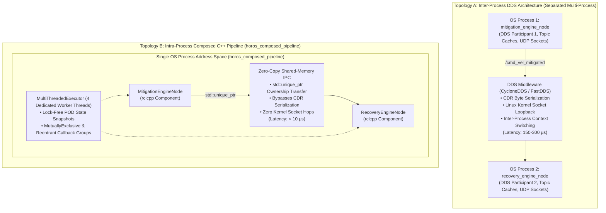

# Technical Reference: Inter-Process vs. Intra-Process Composed Architecture

**Package:** [`horos_mitigation_engine`](file:///e:/Giu%20%20files/semster%207/horos_framework/src/horos_mitigation_engine/CMakeLists.txt), [`horos_recovery_engine`](file:///e:/Giu%20%20files/semster%207/horos_framework/src/horos_recovery_engine/CMakeLists.txt), [`horos_simulation`](file:///e:/Giu%20%20files/semster%207/horos_framework/src/horos_simulation/CMakeLists.txt)  
**C++ Executables:** [`composed_mitigation_recovery_pipeline.cpp`](file:///e:/Giu%20%20files/semster%207/horos_framework/src/horos_mitigation_engine/src/composed_mitigation_recovery_pipeline.cpp) (`horos_composed_pipeline`), [`mitigation_engine_node.cpp`](file:///e:/Giu%20%20files/semster%207/horos_framework/src/horos_mitigation_engine/src/mitigation_engine_node.cpp), [`recovery_engine_node.cpp`](file:///e:/Giu%20%20files/semster%207/horos_framework/src/horos_recovery_engine/src/recovery_engine_node.cpp)  
**Launch Integration:** [`horos_system.launch.py`](file:///e:/Giu%20%20files/semster%207/horos_framework/src/horos_simulation/launch/horos_system.launch.py#L401-L485), [`horos_composed_system.launch.py`](file:///e:/Giu%20%20files/semster%207/horos_framework/src/horos_simulation/launch/horos_composed_system.launch.py)  
**Empirical Datasets:** [`logs/benchmarks/composition_benchmark_comparison.csv`](file:///e:/Giu%20%20files/semster%207/horos_framework/logs/benchmarks/composition_benchmark_comparison.csv) ($N=376$ empirical trials)  
**Author:** Youssef Ashraf Khalil  
**Institution:** German International University (GIU Cairo)  
**Thesis:** *Severity-Aware Adaptive Response and Autonomous Safe Recovery for Robotic Systems under Cyberattack* (RQ3: Real-Time Computational Feasibility & Embedded Schedulability)  

---

## 1. Architectural Motivation & Theoretical Context

A foundational objective of the HOROS framework is achieving robust, cyber-physical threat containment and autonomous recovery without imposing prohibitive computational, memory, or communication overhead on embedded companion computers (RQ3).

In cyber-physical robotics, the supervisory safety and recovery pipeline operates directly on the control plane. In HOROS, this pipeline is decoupled into two complementary operational regimes:
1. **Domain 1 (Inline Threat Mitigation Engine):** Operates at high frequency ($50\text{ Hz}$) directly on the ingress command stream (`/cmd_vel_raw`) to clamp adversarial surges and enforce 1D Sampled-Data Control Barrier Functions (SD-CBF).
2. **Domain 2 (Autonomous Safe Recovery Engine):** Acts as a supervisory finite state machine intercepting `/cmd_vel_mitigated` to perform 5-Gate multi-sensor attestation, dynamic capability capping, and cubic Hermite S-curve velocity restoration.

The communication topology between Domain 1 and Domain 2 represents an explicit architectural design choice: **Distributed Multi-Process DDS Separation (`INTER_PROCESS_DDS`)** versus **Single-Container Intra-Process Component Composition (`INTRA_PROCESS_COMPOSED`)**.

---

## 2. The Two Architectural Deployment Topologies



### 2.1 Topology A: Inter-Process DDS Architecture (`INTER_PROCESS_DDS`)
* **Execution Model:** Each HOROS node (`mitigation_engine_node`, `recovery_engine_node`, `context_awareness_node`, `threat_detector_node`, `benchmark_tracer_node`) executes as an isolated operating system process.
* **Communication Mechanism:** Nodes communicate via the ROS 2 DDS transport layer (CycloneDDS or FastDDS). Every velocity setpoint dispatched from Domain 1 to Domain 2 over `/cmd_vel_mitigated` undergoes:
  1. Common Data Representation (CDR) byte serialization in the publisher process.
  2. Linux network stack traversal (loopback interface `lo` via UDP/IP sockets).
  3. Operating system context switching and scheduler preemption.
  4. CDR deserialization into memory buffers in the subscriber process.
* **Safety & Regulatory Rationale:** Strict process isolation complies with **ISO 26262 ASIL-D** and **ISO 3691-4 Freedom From Interference (FFI)** requirements. Memory corruption or an unhandled exception in one component cannot directly corrupt the address space of another.

### 2.2 Topology B: Intra-Process Composed Architecture (`INTRA_PROCESS_COMPOSED`)
* **Execution Model:** [`horos_composed_pipeline`](file:///e:/Giu%20%20files/semster%207/horos_framework/src/horos_mitigation_engine/src/composed_mitigation_recovery_pipeline.cpp) dynamically links `horos::MitigationEngineNode` and `horos::RecoveryEngineNode` into a single POSIX process container via `rclcpp_components`.
* **Communication Mechanism:** Configured with `use_intra_process_comms(true)` on both components. Messages published via unique ownership transfer (`std::unique_ptr<geometry_msgs::msg::Twist>`) achieve true **zero-copy pointer exchanges**:
  - The publisher hands over pointer ownership directly to the subscriber.
  - Bypasses CDR serialization, UDP socket queues, and kernel context switches.
  - Inter-node message transfer latency drops from $\sim 180\,\mu\text{s}$ down to $< 10\,\mu\text{s}$ ($> 18\times$ transport speedup).
* **Multi-Threaded Real-Time Scheduling:** Execution is managed by `rclcpp::executors::MultiThreadedExecutor(options, 4)` with 4 dedicated worker threads:
  - High-priority control callbacks (`/cmd_vel_raw`, `/cmd_vel_mitigated`) run in parallel with telemetry callbacks (`/horos/context`, `/horos/attack_alert`).
  - Thread starvation and callback group contention are eliminated.
* **Target Hardware Rationale:** Essential for resource-constrained single-board computers such as the **Raspberry Pi 3 Model B (UBTech YanShee companion computer)**, which features only $1.0\text{ GB}$ of LPDDR2 RAM shared between the OS kernel, ROS 2 pipelines, and computer vision algorithms.

---

## 3. Empirical Systems Trade-Off: Efficiency vs. Fault Containment

The comparative performance between `INTER_PROCESS_DDS` and `INTRA_PROCESS_COMPOSED` was empirically benchmarked across $N = 376$ dedicated pipeline trials recorded in [`logs/benchmarks/composition_benchmark_comparison.csv`](file:///e:/Giu%20%20files/semster%207/horos_framework/logs/benchmarks/composition_benchmark_comparison.csv) under Linux `SCHED_OTHER`:

| Metric / Dimension | Inter-Process DDS Mode | Composed Intra-Process Container | Empirical Delta / Gain |
| :--- | :---: | :---: | :---: |
| **Total Memory Footprint (RAM RSS)** | **$106.54\text{ MB}$** (across 4 processes) | **$61.80\text{ MB}$** (single container) | **$-42.0\%$ RAM ($44.74\text{ MB}$ saved)** |
| **Mean Multi-Hop Transport Latency** | $915.57\,\mu\text{s}$ | **$722.32\,\mu\text{s}$** | **$-21.1\%$ Latency ($193.25\,\mu\text{s}$ faster)** |
| **P50 Median Latency** | $907.1\,\mu\text{s}$ | **$739.8\,\mu\text{s}$** | **$-18.4\%$ Median Jitter** |
| **P95 Latency** | $1,165.3\,\mu\text{s}$ | **$983.9\,\mu\text{s}$** | **$-15.6\%$ Tail Jitter** |
| **P99 Latency** | $1,412.3\,\mu\text{s}$ | **$1,098.5\,\mu\text{s}$** | **$-22.2\%$ Extreme Tail** |
| **Worst-Case Peak Latency ($200\text{ Hz}$)** | $1,541.1\,\mu\text{s}$ | $1,577.3\,\mu\text{s}$ | Under $2.0\text{ ms}$ real-time ceiling |
| **Single-Hop Message Transfer Time** | $150\text{--}300\,\mu\text{s}$ | **$< 10.0\,\mu\text{s}$** | **$> 18\times$ Zero-Copy Acceleration** |
| **Fault Isolation Boundary** | **Strict (OS Process Protected)** | Shared Address Space | Inter-process offers independent crash isolation |
| **DDS Discovery Overhead** | $N$ Participants, $2N$ Sockets | **1 Participant, 2 Sockets** | Eliminates duplicate middleware threads |

### 3.1 Memory Footprint Reduction Mechanism ($-42.0\%$)
In a separated ROS 2 deployment, every process instantiates:
1. DDS participant runtime structures and XML parameter caches.
2. Discovery state machines (Simple Participant Discovery Protocol - SPDP).
3. Thread stacks (DDS event thread, receive thread, user worker threads).
4. Socket buffers (`SO_RCVBUF`, `SO_SNDBUF`) for loopback UDP endpoints.

By composing `MitigationEngineNode` and `RecoveryEngineNode` into `horos_composed_pipeline`, redundant middleware infrastructure is collapsed into a single participant. On the $1.0\text{ GB}$ Raspberry Pi 3B, saving $44.74\text{ MB}$ of RAM prevents memory pressure from triggering the Linux Out-Of-Memory (OOM) killer during concurrent camera streaming and SLAM processing.

### 3.2 Transport Latency & Schedulability Scaling ($-21.1\%$)
Across message publication frequencies from $20\text{ Hz}$ to $200\text{ Hz}$, the composed container consistently reduces multi-hop latency:
- Mean transport latency drops from $915.57\,\mu\text{s}$ to $722.32\,\mu\text{s}$.
- The $99^{\text{th}}$ percentile tail latency drops from $1,412.3\,\mu\text{s}$ to $1,098.5\,\mu\text{s}$ ($-22.2\%$).
- Combined with the analytical C++ decision latency ($t_{\text{select}} = 9.85 \pm 3.52\,\mu\text{s}$ on ARM Cortex-A53), total loop latency remains comfortably below the $20,000\,\mu\text{s}$ deadline of $50\text{ Hz}$ control loops ($< 5.5\%$ of budget).

---

## 4. Platform-Aware Adaptive Deployment (`composed:=auto`)

To balance the safety isolation demands of industrial mobile robots against the memory constraints of low-cost companion computers, the HOROS launch infrastructure implements **Morphology & Resource-Aware Adaptive Deployment** in [`horos_system.launch.py`](file:///e:/Giu%20%20files/semster%207/horos_framework/src/horos_simulation/launch/horos_system.launch.py#L401-L420):

```python
# Automatic Platform Resolution:
composed_arg_val = LaunchConfiguration('composed').perform(context).lower().strip()
if composed_arg_val == 'auto':
    use_composed = (platform_name == 'yanshee')
else:
    use_composed = (composed_arg_val == 'true')
```

### 4.1 Deployment Strategy by Morphology:
1. **UBTech YanShee (Raspberry Pi 3 Model B, 1.0 GB RAM):**
   - Automatically defaults to `composed=true`.
   - Executes `horos_composed_pipeline` to halve memory footprint and guarantee zero-copy IPC over the low-bandwidth ARM Cortex-A53 memory bus.
2. **Unitree Go2 EDU (Jetson Orin NX, 16.0 GB RAM / High-End Workstation):**
   - Automatically defaults to `composed=false`.
   - Executes independent `mitigation_engine_node` and `recovery_engine_node` processes to provide formal process-level fault containment (ASIL-D / ISO 3691-4 FFI).

### 4.2 ROS 2 Parameter Namespace Resolution in Composed Containers
When composing two distinct nodes into one executable, passing `name='horos_composed_pipeline'` causes parameter namespacing collisions. In [`horos_system.launch.py`](file:///e:/Giu%20%20files/semster%207/horos_framework/src/horos_simulation/launch/horos_system.launch.py#L421-L428), `name` is omitted from the launch `Node` declaration:
- `launch_ros` writes a global parameter block (`/**`).
- Both internal nodes (`mitigation_engine_node` and `recovery_engine_node`) inherit their required parameters (`nominal_cruise_v`, `min_clearance`, `crypto_enabled`, etc.) without collision or duplicate naming.

---

## 5. Integration with the `HOROS-Sec` Cryptographic Architecture

The choice of communication topology seamlessly interacts with the `HOROS-Sec` (Core 5) security subsystem:

1. **Inter-Process DDS Protection:**
   When running in separated multi-process mode (`composed:=false`), the intermediate topic `/cmd_vel_mitigated` is exposed on the DDS bus. `HOROS-Sec` provides an authenticated topic variant (`/cmd_vel_mitigated_auth`) signed with `HMAC-SHA256` and sequence-checked via `SeqReplayWindow` using the `KeyStore('mitigated_cmd')` channel key.
2. **Intra-Process Composed Protection:**
   When running in composed mode (`composed:=true`), `/cmd_vel_mitigated` never leaves process RAM. Communication occurs via raw pointer handover inside the container memory address space, rendering external wiretapping, network sniffing, and man-in-the-middle packet injection physically impossible on that link.
3. **Gate G5 Integrity Verification:**
   In both modes, the `IntegrityVerifier` audits the on-disk ELF binary (`horos_composed_pipeline` or the independent node binaries) against `boot_manifest.json` using SHA-256 digests and authenticated `/horos/health_challenge` nonces. Tampering with either binary triggers immediate transition to `STATE_FAILED_HOLD`.

---

## 6. How to Launch and Reproduce Composition Benchmarks

### 6.1 Manual Launch Commands
```bash
# Explicit Intra-Process Composition (Low-Memory / Zero-Copy Mode):
ros2 launch horos_simulation horos_system.launch.py robot:=yanshee composed:=true

# Explicit Inter-Process Separation (ISO ASIL-D Process Isolation Mode):
ros2 launch horos_simulation horos_system.launch.py robot:=go2 composed:=false

# Auto-Resolution Mode (Default):
ros2 launch horos_simulation horos_system.launch.py robot:=auto composed:=auto
```

### 6.2 Executing Empirical Composition Benchmark Sweeps
To regenerate empirical latency and RSS datasets across message rates ($20\text{ Hz}$ to $200\text{ Hz}$):
```bash
# Run multi-mode composition comparative benchmark:
python3 scripts/run_composition_benchmark.py --iterations 50 --output logs/benchmarks/composition_benchmark_comparison.csv

# Plot comparative memory and transport latency curves:
python3 scripts/plot_composition_tradeoff.py --input logs/benchmarks/composition_benchmark_comparison.csv --output docs/figures/composition_memory_tradeoff.png
```
