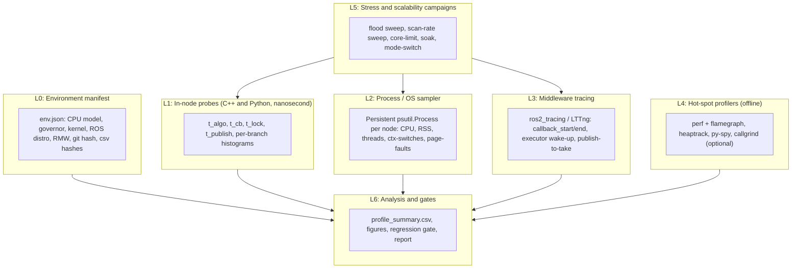

# HOROS Comprehensive Profiling System — Design Specification

**Document ID:** `PROF-01`
**Status:** Design specification (documentation only, no code is implemented by this document)
**Scope:** Items 1 and 3 of the next-phase request: *a comprehensive profiling system* and *in-node algorithm latency inside the profile*
**Research alignment:** **RQ3** (bounded real-time latency, resource-friendly deployment). It also supports RQ1/RQ2 by proving that the added features (fallback modes, scheduler) do not break the latency budget.
**Related documents:** [`spike_latency_investigation_and_optimization.md`](spike_latency_investigation_and_optimization.md) · [`t_recover_metric_specification.md`](t_recover_metric_specification.md) · [`sensor_fallback_modes.md`](sensor_fallback_modes.md) · [`../architcutre/next_phase_scheduler_ecosystem_comparison.md`](../architcutre/next_phase_scheduler_ecosystem_comparison.md)

---

## 0. Why this document exists (what is wrong today)

Evidence from the current benchmark data (79 episodes, `EP_034`–`EP_112`) and the code:

| # | Observation | Consequence |
|---|---|---|
| P1 | `cpu_percent` is `0.0` in all 79 episodes (std = 0) and `ram_mb` is about 23.6 in every mode. | No resource claim in the thesis is currently supported. |
| P2 | Root cause of P1: [`get_mitigation_process_stats`](file:///e:/Giu%20%20files/semster%207/horos_framework/src/horos_attack_injector/horos_attack_injector/benchmark_tracer_node.py#L658-L675) calls `psutil.process_iter()` at every 10 Hz tick. That creates a *new* `Process` object each time, and `cpu_percent(interval=None)` returns `0.0` on the first call of a new object. | CPU is structurally always 0. It is a measurement bug, not a result. |
| P3 | Only the mitigation process is sampled. The recovery engine, context node, injector and tracer are never sampled. | Total system footprint is unknown. |
| P4 | The only latency recorded is `t_select_ms`. It is a cross-process, graph-level, 10 Hz-quantized latency that includes DDS, executor wake-up and Python scheduling. | It says nothing about the cost of the algorithm (RQ3 claim of `< 0.5 ms` is unproven). |
| P5 | `t_select_ms` has a heavy tail. The ADAPTIVE mean is 220 ms but the median is 38 ms, and 2 of 25 episodes (3.56 s and 0.97 s) drive the mean. | Means are misleading. Distribution statistics are mandatory. |
| P6 | The SPIKE document claims `AdaptiveStrategy::evaluate()` has "0 dynamic heap allocations". But `MitigationDecision::applied_action` is a `std::string`, and labels such as `"ADAPTIVE_EMERGENCY_PROXIMITY_HALT"` (33 chars) exceed the small-string-optimization capacity (about 15 chars on libstdc++). | A heap allocation likely occurs on every non-passthrough evaluation. This is a **hypothesis the profiler must confirm or refute**. |
| P7 | The claimed 8.4–14.2 µs WCET is analytical, not measured. No `algo_latency` field exists in [`MitigationStatus.msg`](file:///e:/Giu%20%20files/semster%207/horos_framework/src/horos_interfaces/msg/MitigationStatus.msg). | RQ3 currently has no measured evidence for the algorithm itself. |

**Goal of the profiling system:** replace every one of P1–P7 with a reproducible, statistically defensible measurement, and keep that measurement from perturbing the system it measures.

---

## 1. Design principles

1. **Observer-effect control.** Every probe has a measured cost, and every claim is backed by a probes-ON versus probes-OFF A/B run (§11).
2. **Distributions, not means.** Report p50, p95, p99, p99.9 and max, with bootstrap confidence intervals. No outlier is silently dropped (P5).
3. **Separation of tiers.** Only Tier A (the deployed system) is held to budgets. Tier B (test harness) and Tier C (simulator) are profiled separately and excluded from budgets (Table 1).
4. **Zero console spam** (AGENTS.md Rule 3). Probes accumulate silently in preallocated memory. Results are emitted at 1 Hz at most, or at episode end, and are logged to CSV.
5. **Matched conditions** (AGENTS.md §3.6). Profiling runs use the same scenario, seed, attack, severity and duration across all compared configurations.
6. **Definition before measurement.** Five latencies are named and kept strictly distinct (§4.1), so "latency" never again means two different things.
7. **Reproducibility.** Every profiling run stores an environment manifest (kernel, CPU governor, ROS and RMW versions, git hash) next to its data.

**Table 1: Profiling tiers**

| Tier | Contents | Held to budget? |
|---|---|---|
| **A: Deployed** | `mitigation_engine_node`, `recovery_engine_node`, `context_awareness_node` (perception), future `scheduler`, future `sensor_health` | **Yes** |
| **B: Harness** | `attack_injector_node`, `nominal_driver`, `benchmark_tracer_node`, `human_tracker`, profiling collector | No (but must not distort Tier A; see §5.4) |
| **C: Simulator** | Gazebo, `pedestrian_simulator_node`, `robot_state_publisher` | No |

---

## 2. System architecture of the profiling system



| Layer | Question it answers | Overhead class |
|---|---|---|
| L1 | How long does the algorithm itself take? (the RQ3 core claim) | Low, nanoseconds per probe |
| L2 | How many CPU, memory and thread resources does each node use? | Low, 1 Hz sampling |
| L3 | Where does time go between nodes (middleware, executor)? | Medium, run separately from L1 |
| L4 | Which function or allocation is responsible? | High, offline, never combined with L1 data |
| L5 | Does it hold up under flood, slow hardware, long runs? | Depends on campaign |
| L6 | Is the result defensible and does it regress? | Offline |

---

## 3. Metric catalogue

| ID | Metric | Definition | Unit | Layer | Tier-A target (Jetson Orin NX) | Tier-A target (Pi-class, for portability study) |
|---|---|---|---|---|---|---|
| M-A1 | `t_algo` | Wall time of `MitigationStrategy::evaluate()` only | µs | L1 | p99 < 50 µs, max < 0.5 ms | p99 < 200 µs |
| M-A2 | `t_cb` | Total callback time of `on_cmd_vel_raw` (rate limiter, lock, copies, evaluate, publishes) | µs | L1 | p99 < 0.5 ms | p99 < 1 ms |
| M-A3 | `t_lock` | Time spent acquiring and holding `state_mutex_` inside the callback | µs | L1 | p99 < 20 µs | p99 < 50 µs |
| M-A4 | `t_pub` | Cost of the `publish()` calls (command and status) | µs | L1 | p99 < 100 µs | p99 < 300 µs |
| M-A5 | `t_fallback` | Cost of sensor-health and fallback arbitration ([`sensor_fallback_modes.md`](sensor_fallback_modes.md)) | µs | L1 | p99 < 20 µs | p99 < 80 µs |
| M-A6 | `t_fsm` | Cost of one recovery FSM tick | µs | L1 | p99 < 50 µs | p99 < 200 µs |
| M-A7 | `t_ctx` | Cost of context computation per `/scan` (min-range extraction, classification) | µs | L1 | p99 < 0.5 ms | p99 < 2 ms |
| M-B1 | `t_hop` | Source-stamp to take-time of a message across one DDS hop | ms | L3 | p99 < 2 ms | p99 < 5 ms |
| M-B2 | `t_e2e` | `/cmd_vel_raw` stamp to `/cmd_vel` publish (full pipeline) | ms | L3 | p99 < 5 ms | p99 < 15 ms |
| M-B3 | `t_select` | Attack-alert to first mitigation action (existing tracer metric; end-to-end) | ms | tracer | report p50/p95/p99; never mean alone | same |
| M-C1 | CPU | Per-process and per-thread CPU time share (normalised to one core) | % | L2 | nominal < 5% per node | < 10% per node |
| M-C2 | RSS / PSS | Resident and proportional set size | MB | L2 | < 50 MB per C++ node | < 50 MB |
| M-C3 | Context switches | Voluntary and involuntary per second | 1/s | L2 | report | report |
| M-C4 | Page faults | Minor and major per second | 1/s | L2 | major = 0 after warm-up | same |
| M-C5 | Heap allocations in hot path | `malloc` calls per `on_cmd_vel_raw` after warm-up | count | L4 | 0 | 0 |
| M-C6 | Bandwidth | Bytes per second per topic | kB/s | L2 | report | report |
| M-D1 | Drop count | Commands dropped by rate limiter and queue overruns | count | L1 | consistent with design | same |
| M-D2 | Jitter | Standard deviation and p99 minus p50 of the inter-callback period at 50 Hz | µs | L1/L3 | p99 jitter < 1 ms | < 3 ms |

> [!NOTE]
> Targets are *proposals to be validated*, not measured results. The first profiling campaign establishes the real baseline. Targets are then frozen and used as regression gates (§10).

---

## 4. In-node algorithm latency (user item 3)

### 4.1 The five distinct "latencies" (never mix them)

| Name | What it covers | Where measured | Why it matters |
|---|---|---|---|
| **`t_algo`** | `strategy->evaluate(raw, alert, ctx)` only. Pure decision-surface cost. | Inside the node, with two `steady_clock` reads around the call | The **RQ3 claim** (`< 0.5 ms`, ideally `< 50 µs`) |
| **`t_cb`** | Entire subscription callback: limiter, mutex, copies, kinematic check, `evaluate`, two publishes | Inside the node, at callback entry and exit | The **real cost to the control loop** (RQ3 budget `< 2.0 ms`) |
| **`t_hop`** | One message crossing one DDS hop (publisher stamp to subscriber take) | L3 tracing or header stamps | Middleware cost, relevant for the scheduler (doc 5) and composition |
| **`t_e2e`** | Raw command in to final command out through mitigation, recovery and any scheduler/fallback | Stamps carried through the pipeline | Total control-path delay |
| **`t_select`** | Alert published to first non-passthrough action observed by the tracer | `benchmark_tracer_node` (existing) | Existing thesis metric; remains, but is reported as a *graph-level* metric |

**Rule:** the thesis may only say "the algorithm executes in X µs" about `t_algo`. It may only say "the control path adds Y ms" about `t_cb` or `t_e2e`. `t_select` must never be quoted as algorithm time (currently done in [`thesis_evaluation_results.md`](../report/thesis_evaluation_results.md) §4 RQ3).

### 4.2 Instrumentation points (IP table)

| IP | Location (current code) | Measures | Metric |
|---|---|---|---|
| IP-1 | [`on_cmd_vel_raw` entry/exit](file:///e:/Giu%20%20files/semster%207/horos_framework/src/horos_mitigation_engine/src/mitigation_engine_node.cpp#L296-L364) | Whole callback | `t_cb` |
| IP-2 | Immediately around `active_strategy_->evaluate(...)` ([L333](file:///e:/Giu%20%20files/semster%207/horos_framework/src/horos_mitigation_engine/src/mitigation_engine_node.cpp#L333)) | Decision surface | `t_algo` |
| IP-3 | Around `check_rate_limiter()` ([L299](file:///e:/Giu%20%20files/semster%207/horos_framework/src/horos_mitigation_engine/src/mitigation_engine_node.cpp#L299)) | Token-bucket plus per-call `get_parameter` | `t_limiter` |
| IP-4 | Around the two `state_mutex_` critical sections ([L303-L315](file:///e:/Giu%20%20files/semster%207/horos_framework/src/horos_mitigation_engine/src/mitigation_engine_node.cpp#L303-L315)) | Lock wait plus message copies | `t_lock` |
| IP-5 | Around `cmd_mitigated_pub_->publish` and `status_pub_->publish` ([L336-L347](file:///e:/Giu%20%20files/semster%207/horos_framework/src/horos_mitigation_engine/src/mitigation_engine_node.cpp#L336-L347)) | Publication cost incl. serialization | `t_pub` |
| IP-6 | `on_dds_watchdog_timer` ([L205](file:///e:/Giu%20%20files/semster%207/horos_framework/src/horos_mitigation_engine/src/mitigation_engine_node.cpp#L205-L273)) | Watchdog path (a second place where `evaluate` is called) | `t_algo`, `t_cb` (path = WATCHDOG) |
| IP-7 | Recovery FSM tick and command scaling in [`recovery_engine_node.cpp`](file:///e:/Giu%20%20files/semster%207/horos_framework/src/horos_recovery_engine/src/recovery_engine_node.cpp) and [`recovery_state_machine.hpp`](file:///e:/Giu%20%20files/semster%207/horos_framework/src/horos_recovery_engine/include/horos_recovery_engine/recovery_state_machine.hpp) | FSM + attestation | `t_fsm` |
| IP-8 | [`on_laser_scan`](file:///e:/Giu%20%20files/semster%207/horos_framework/src/horos_simulation/horos_simulation/context_awareness_node.py#L124-L150) and `publish_context` | Python per-beam loop | `t_ctx` |
| IP-9 (future) | Sensor-health monitor and fallback arbiter | Fallback decision | `t_fallback` |
| IP-10 (future) | Scheduler intake, priority, dispatch | Scheduler overhead | `t_sched` |

Every IP also records the **branch label** (enum of `applied_action`) so cost can be attributed to each decision path (see §4.4).

### 4.3 Probe design

**Clock.** Use a monotonic clock that is immune to NTP and wall-clock jumps (`std::chrono::steady_clock`, which maps to `CLOCK_MONOTONIC`). Never use the ROS wall or simulation clock for durations. On the Python side use `time.perf_counter_ns()`.

**Probe cost.** Calibrate once per run by timing 10^6 empty probe pairs. Typical cost is about 20–40 ns on Linux with the vDSO. The calibrated cost is stored in `env.json` and is subtracted when reporting very short intervals (`t_algo`).

**Storage (no allocation, no logging in the hot path).**
- A fixed-size, preallocated, log-linear histogram per (IP, branch), in the style of HdrHistogram: range 10 ns to 100 ms with 3 significant digits. Each sample is one bucket increment.
- A bounded raw-sample ring buffer (for example 65 536 samples per IP) for the first N seconds after attack onset, so tail events can be inspected individually. Overflow overwrites oldest.
- No `std::string`, no `std::vector::push_back`, no stream output inside the probe.

**Emission.**
- Aggregates are emitted at **≤ 1 Hz** on a dedicated low-rate topic (proposed `ProfileStats`, see §4.5), published from the telemetry (reentrant) callback group, never from the control group.
- At episode end, a full snapshot (histograms plus ring-buffer dump) is written to `profile_samples.csv` by the collector in Tier B. This keeps CSV I/O off the control path.

**Branch attribution.** The action label is mapped once at construction to a small integer, so the probe never touches strings. The branches to track for the adaptive strategy:

| Branch ID | Action label (current code) |
|---|---|
| 0 | `PASSTHROUGH` |
| 1 | `ADAPTIVE_EMERGENCY_PROXIMITY_HALT` |
| 2 | `ADAPTIVE_ACTIVE_DISENGAGEMENT_REVERSE` |
| 3 | `ADAPTIVE_DDS_PROXIMITY_SAFE_HOLD` / `ADAPTIVE_DDS_CONTROLLED_CRAWL` |
| 4 | `ADAPTIVE_ISO3691_HUMAN_PROXIMITY_DECELERATION` |
| 5 | `ADAPTIVE_MISSION_STATIONARY_HOLD` |
| 6 | `ADAPTIVE_CONFINED_CLEARANCE_REGULATION` |
| 7 | `ADAPTIVE_ZERO_COMMAND_HOLD` / `ADAPTIVE_OPEN_CRUISE_PATROL` |
| 8+ | Future fallback branches (`FALLBACK_TO_DYNAMIC`, `FALLBACK_TO_STATIC`, `SAFE_HOLD_LATCHED`) |

### 4.4 Required per-branch and per-mode reporting

The profile must report `t_algo` and `t_cb` **per mode and per branch**, because the strategies have very different costs:

| Mode | Expected character | What to look for |
|---|---|---|
| `BYPASS` | Floor / reference cost (copy only) | Defines the **framework overhead floor** (callback plus publish with no logic) |
| `STATIC` | Near-floor | Cheap branch |
| `DYNAMIC` | Table lookup | Policy-matrix cost |
| `ADAPTIVE` (FULL) | Multiple branches | Worst branch becomes the WCET candidate |
| `ADAPTIVE_NO_LIDAR/NO_LOC/NO_VEL/SEVERITY_ONLY` | Ablations | Marginal cost of each context dimension (supports the ablation study) |
| `ADAPTIVE + fallback` | Adds health and arbitration | `t_fallback` marginal cost |

**Net algorithm cost** of any mode is `t_algo(mode) − t_algo(BYPASS)`. This isolates algorithm cost from harness overhead.

### 4.5 Proposed data contract (documentation of fields only)

**`ProfileStats` message (proposal, 1 Hz per node):**

| Field | Type | Meaning |
|---|---|---|
| `stamp` | time | Emission time |
| `node` | string | Node name (set once; not in the hot path) |
| `mode` | string / uint8 | Active mitigation mode |
| `window_s` | float32 | Window length |
| `n_evals` | uint32 | Count of `evaluate()` calls in window |
| `algo_p50_us`, `algo_p95_us`, `algo_p99_us`, `algo_max_us` | float32 | `t_algo` distribution |
| `cb_p50_us`, `cb_p99_us`, `cb_max_us` | float32 | `t_cb` distribution |
| `lock_p99_us`, `pub_p99_us` | float32 | Sub-costs |
| `dropped_cmds` | uint32 | Rate-limiter drops |
| `queue_overruns` | uint32 | Subscription overruns |
| `probe_overhead_ns` | uint32 | Calibrated probe cost |

**Additional columns for `benchmark_summary.csv` (appended, so existing schema is preserved):**

| Column | Meaning |
|---|---|
| `algo_p50_us`, `algo_p99_us`, `algo_max_us` | `t_algo` over the episode |
| `cb_p99_us` | `t_cb` p99 over the episode |
| `n_evals` | Number of evaluations in the episode |
| `cpu_mit_pct`, `cpu_rec_pct`, `cpu_ctx_pct` | Per-node CPU (Tier A) |
| `rss_mit_mb`, `rss_rec_mb`, `rss_ctx_mb` | Per-node RSS |
| `profile_run_id` | Join key to the profiling campaign directory |

### 4.6 Heap-allocation hypothesis (P6) — how to test

| Step | Action | Expected evidence |
|---|---|---|
| 1 | Run `heaptrack` (or `ltrace -e malloc`) on `mitigation_engine_node` for 60 s of PASSTHROUGH and 60 s of ATTACK | Allocation count per callback after warm-up |
| 2 | Attribute allocations to call sites (`MitigationDecision::applied_action` assignment, `AttackAlert`/`RobotContext` copies, `MitigationStatus` construction) | Per-site counts |
| 3 | Compare `t_algo` for branches whose labels are ≤ 15 chars (SSO, no allocation) versus > 15 chars | Measurable gap confirms the hypothesis |
| 4 | Record the result in the profiling report and update the SPIKE document claim ("0 allocations") accordingly | Honest correction of the thesis claim |

### 4.7 Acceptance criteria for the in-node latency feature

1. `t_algo` is reported with p50/p95/p99/p99.9/max **for each mode and branch**, with N ≥ 10^5 samples per cell after discarding the first 5 s warm-up.
2. The probe overhead is reported and is **< 1% of the median `t_cb`**.
3. The report states `t_algo` and `t_cb` against the thesis budgets (`< 0.5 ms` and `< 2.0 ms`) with the *exceedance probability* (fraction of samples above budget), not only the maximum.
4. The report explicitly separates `t_algo` from `t_select`, and the thesis RQ3 text is updated to cite `t_algo`/`t_cb`.

---

## 5. Process and OS-level sampling (L2) — fixing P1–P3

### 5.1 Required behaviour of the sampler

| Requirement | Reason |
|---|---|
| Keep one **persistent** `psutil.Process` object per target PID for the whole run | `cpu_percent()` needs a previous call on the same object; this removes the structural 0.0 (P2) |
| Prime each object with one discarded `cpu_percent(None)` call at start-up | First reading is meaningless |
| Sample at 1 Hz (not 10 Hz) over windows of ≥ 1 s | CPU percent over very short windows is noisy |
| Sample **all** Tier-A processes (mitigation, recovery, context, future scheduler/health) individually, and Tier B/C processes in a separate group | Fixes P3; keeps tiers separate |
| Record per-thread CPU (`/proc/<pid>/task/*/stat`) | Needed to see callback-group thread behaviour |
| Record `voluntary_ctx_switches`, `involuntary_ctx_switches`, `num_threads`, `memory_full_info().pss`, page faults | Metrics M-C2 to M-C4 |
| Normalise CPU to **percent of one core** and also record the core ID distribution (`cpu_num`) | Needed for the multi-core and pinning studies |
| Identify processes by launch-assigned **PID registry** (written by the launch file), not by substring match on process name | Avoids picking the wrong process (e.g. Gazebo helper) |

### 5.2 Independent OS tools (cross-check)

| Tool | Purpose | Cross-check against |
|---|---|---|
| `pidstat -u -r -w -t -p <pids> 1` | CPU, memory, ctx switches per thread | Python sampler |
| `/proc/<pid>/smaps_rollup` | PSS | `memory_full_info` |
| `pidstat -d` | Disk I/O (CSV writing by the tracer) | Tier-B distortion check |
| `sar -n DEV 1` / `iftop` (loopback) | Network bandwidth | `ros2 topic bw` |

The Python sampler and `pidstat` must agree within 10% on CPU for the same window. A disagreement invalidates the run.

### 5.3 Platform-specific counters (embedded targets)

| Platform | Tool | What to record |
|---|---|---|
| Jetson Orin NX | `tegrastats` | CPU frequency, GPU load (should be ~0), EMC, temperature, power rails |
| Raspberry Pi-class | `vcgencmd measure_temp`, `vcgencmd get_throttled` | Temperature and throttling flags |
| Any | `cat /sys/devices/system/cpu/cpu*/cpufreq/scaling_cur_freq` | Frequency scaling during the run |

A run in which thermal throttling or frequency change occurs is flagged **INVALID-THERMAL** and repeated.

### 5.4 Tier-B distortion control (the tracer must not distort Tier A)

The benchmark tracer is a 31 KB Python node that writes CSV rows from callbacks. Requirements:

1. Run the tracer in a **separate process pinned to a different core** from Tier A.
2. Buffer CSV rows in memory and flush at episode end (no per-sample `open()`/`close()`; the current code opens the file on every 10 Hz row).
3. Report the tracer's own CPU and RSS so its contribution to the machine load is known.
4. **Distortion test:** run the same scenario with the tracer enabled and disabled (using a lighter recorder such as `ros2 bag` or only the in-node probes) and verify that Tier-A `t_cb` p99 differs by less than 5%.

---

## 6. Tracing and hot-spot profiling (L3 and L4)

| Technique | Tool | Output | When |
|---|---|---|---|
| Callback and executor tracing | `ros2_tracing` (LTTng) with `tracetools_analysis` | callback durations, executor wake-up latency, publish-to-take times | Separate runs, never combined with L1 data |
| CPU hot-spots (C++) | `perf record -F 999 -g --call-graph dwarf` plus FlameGraph | Flamegraph per node | After L1 identifies a slow branch |
| Hardware counters | `perf stat -e cycles,instructions,cache-misses,context-switches` | IPC, cache behaviour | Explains variance |
| Allocations | `heaptrack` | Allocation count and call sites | §4.6 |
| Python hot-spots | `py-spy record --native -r 100` | Flamegraph for context node, injector, tracer | Context node rewrite decision |
| Scheduling latency of the machine | `cyclictest -p 80 -t 1 -i 1000` while the system runs | Baseline OS jitter | Separates OS jitter from application jitter |
| Lock contention (optional) | `perf lock` / `valgrind --tool=helgrind` | Mutex hot spots | If `t_lock` is high |

**Rule:** L3/L4 tooling changes timing. Their runs are used to *explain* L1 numbers, never to produce them.

---

## 7. Stress and scalability campaigns (L5)

| ID | Campaign | Independent variable | Measured | Purpose |
|---|---|---|---|---|
| S1 | **Flood sweep (V2)** | 50, 100, 250, 500, 1000 Hz on `/cmd_vel_raw` | `t_cb`, CPU, drops, queue overruns | Does flooding exhaust the engine? Does the limiter bound the cost? |
| S2 | **Scan-rate sweep** | `/scan` at 5, 10, 30, 60 Hz and 360/720/1440 beams | `t_ctx`, context CPU | Perception cost scaling, justifies a C++ rewrite |
| S3 | **Core limit (embedded emulation)** | `taskset` to 1, 2, 4, 8 cores; `cgroup cpu.max` to 25/50/100% of one core | `t_cb` p99, deadline-miss rate | Emulates a Raspberry Pi-class robot (portability study) |
| S4 | **Soak (30 min)** | Duration | RSS growth (slope), CPU drift, handle count | Memory leaks and unbounded queues |
| S5 | **Mode-switch storm** | Switch mode at 1, 5, 10 Hz via service | `t_algo` after switch, allocations in `set_strategy` | `set_strategy` allocates under a lock |
| S6 | **Attack burst train** | 1 to 4 repeated bursts | Recovery FSM cost, `t_fsm` | Flapping-defense overhead |
| S7 | **Feature-overhead matrix** | Add fallback, scheduler, intra-process composition | `t_cb`, `t_e2e`, CPU | With-vs-without comparison (§11) |
| S8 | **Message-size sweep** | `/scan` beam count, `RobotContext` growth (sector array) | `t_hop`, bandwidth | Cost of the directional-clearance extension |

Each campaign uses at least **N = 10 repetitions** per cell, a fixed seed, and the same warm-up policy.

---

## 8. Experimental design and statistics

### 8.1 Run protocol

1. **Pin the environment (L0):** CPU governor `performance`, GUI off (`gui:=false`), fixed RMW (`rmw_cyclonedds_cpp`), recorded kernel and ROS version, no other heavy processes. Write `env.json`.
2. **Warm-up:** discard the first 5 s and the first 100 samples of every probe.
3. **Idle baseline:** 60 s idle Tier A (no commands) for the memory and CPU floor.
4. **Nominal run:** 5 min patrol, no attack.
5. **Attack runs:** same matrix as the benchmark (modes × scenarios × attacks), N ≥ 10, matched seeds.
6. **Stress runs:** S1–S8.
7. **Teardown:** record final RSS, thread count, open file descriptors.

### 8.2 Statistical treatment

| Question | Method |
|---|---|
| Distribution summary | p50/p95/p99/p99.9/max, histogram, ECDF; mean ± std only as a secondary column |
| Confidence on a percentile | Bootstrap (10 000 resamples) CI for p99 |
| Compare two configurations (with vs without a feature) | Mann–Whitney U on per-run p99 values (non-parametric); effect size as Hodges–Lehmann shift or Cliff's delta |
| Compare more than two modes | Kruskal–Wallis with Dunn post-hoc (Holm correction) |
| Probe-effect A/B | Paired difference of per-run median `t_cb` with 95% CI; equivalence margin ±5% (TOST) |
| Deadline claim | Report exceedance probability P(t > budget) with a Wilson 95% interval |
| WCET estimate (optional) | Measurement-based probabilistic WCET with extreme-value (Gumbel) fit to block maxima; reported as *pWCET at 10^-6 exceedance*, labelled as an estimate, not a proof |
| Outliers | **Never removed.** Tail events are reported, explained (OS jitter, GC, first-call effects) and, if caused by a known transient, tagged but kept in the dataset |
| Coordinated omission | Probes record every callback, including those that run late; do not sample only fast ones |

### 8.3 Validity checklist (every run must pass)

- [ ] `env.json` present and complete
- [ ] No thermal throttling or frequency change
- [ ] Probe calibration recorded
- [ ] Python sampler and `pidstat` agree within 10%
- [ ] Number of samples per cell ≥ 10^5 (L1) or ≥ 30 windows (L2)
- [ ] Matched seed, scenario, attack and severity across compared configurations
- [ ] Tier-B distortion test passed (§5.4)

---

## 9. Output artifacts and schemas

```
profiling/
  <YYYYMMDD>_<githash>_<campaign>/
    env.json                  # hardware, kernel, ROS/RMW, governor, probe calibration, csv hashes
    profile_samples.csv       # raw ring-buffer dumps (episode_id, ip_id, branch_id, t_ns, dur_ns)
    profile_summary.csv       # one row per (run, node, mode, branch): n, p50, p95, p99, p999, max, mean, std
    process_samples.csv       # 1 Hz L2 samples per process and thread
    traces/                   # LTTng sessions (L3), not mixed with L1
    flamegraphs/              # SVGs (L4)
    report.md                 # auto-generated from the CSVs only (no hand-typed numbers)
```

- `profiling/` is excluded from git if large (AGENTS.md Rule 4); `env.json`, `profile_summary.csv` and `report.md` are kept.
- `report.md` must be generated from the CSVs. Hand-typed numbers are not allowed (see the audit in [`explore_benchmarks_audit.md`](../report/explore_benchmarks_audit.md) for what happens otherwise).

---

## 10. Resource budgets and regression gates

| Resource | Jetson Orin NX budget | Pi-class budget (portability study) |
|---|---|---|
| CPU, Tier A total, nominal | < 10% of one core | < 15% of one core |
| CPU, Tier A total, V2 flood | < 25% of one core | < 40% of one core |
| RSS, Tier A total | < 100 MB | < 100 MB |
| `t_algo` p99 | < 50 µs | < 200 µs |
| `t_cb` p99 | < 0.5 ms | < 1.0 ms |
| `t_e2e` p99 | < 5 ms | < 15 ms |
| Major page faults after warm-up | 0 | 0 |
| Log lines at 50 Hz | 0 per second (AGENTS.md Rule 3) | same |
| RSS growth over 30 min soak | slope < 0.1 MB/min | same |

**Regression gate (CI-style script, specified here, not implemented):** fail the build if any of the following holds versus the last accepted baseline:
- `t_algo` p99 > baseline × 1.25
- `t_cb` p99 > baseline × 1.25
- RSS > baseline × 1.10
- any heap allocation is detected in the hot path (M-C5 > 0)

---

## 11. With-versus-without comparison matrix (thesis requirement)

Every added feature must be profiled with and without it, at matched conditions.

| # | Feature under test | Configuration A (without) | Configuration B (with) | Primary profiling metrics | Hypothesis (H1) |
|---|---|---|---|---|---|
| F1 | **In-node probes** | Probes compiled out or disabled | Probes ON | `t_cb` median, CPU | Probe overhead < 1% of `t_cb` median |
| F2 | **Status throttling and enum labels** | Status published on every command, string labels | ≤ 10 Hz, enum labels | `t_pub`, `t_cb`, bandwidth, CPU | `t_cb` p99 and bandwidth are reduced |
| F3 | **Cached rate-limiter parameter** | `get_parameter` per command | Cached `bool` | `t_limiter`, `t_cb` under flood (S1) | Cost no longer scales with flood rate |
| F4 | **Lock-free or scalar context snapshot** | Full message copies under mutex | Atomic snapshot of scalars | `t_lock`, allocations | `t_lock` p99 reduced, allocations → 0 |
| F5 | **C++ event-driven context node** | Python 10 Hz timer, per-beam loop | C++ event-driven on `/scan` | `t_ctx`, CPU, `t_e2e`, `t_select` median | Lower `t_ctx` and lower end-to-end latency |
| F6 | **Intra-process composition** | Separate processes (DDS between mitigation and recovery) | Same process, intra-process comms | `t_hop`, `t_e2e`, CPU, RSS | `t_e2e` reduced by about one DDS hop |
| F7 | **Sensor-health + fallback ladder** ([doc 6](sensor_fallback_modes.md)) | `ADAPTIVE` without fallback | `ADAPTIVE` with fallback | `t_fallback`, `t_cb`, CPU | Added cost < 20 µs p99; `t_cb` budget still met |
| F8 | **Scheduler** ([doc 5](../architcutre/next_phase_scheduler_ecosystem_comparison.md)) | Ecosystem without scheduler | Ecosystem with scheduler | `t_sched`, `t_e2e`, CPU, RSS, bandwidth | Overhead bounded; `t_e2e` within budget |
| F9 | **Tracer distortion** | Tracer on | Tracer off / light recorder | Tier-A `t_cb` p99 | < 5% difference |

Each row is analysed with the tests in §8.2 and reported as: *median difference, 95% CI, effect size, p-value, practical significance versus the budget*.

---

## 12. Threats to validity

| Threat | Mitigation |
|---|---|
| Simulation clock differs from wall time (Gazebo real-time factor) | Probes use monotonic wall-clock durations (they measure compute, not simulated time); the tracer's behavioural metrics use the ROS clock with `use_sim_time` (see [`t_recover_metric_specification.md`](t_recover_metric_specification.md)) |
| WSL2 scheduling noise | Prefer native Linux for the final campaign; if WSL2 is used, record it and report with a separate noise baseline (`cyclictest`) |
| Jetson not available during the thesis | Run the Pi-class emulation (S3) and clearly label the Jetson targets as *not measured* |
| Probe effect | A/B test F1; calibrated probe cost |
| Single-run conclusions | N ≥ 10 and bootstrap CIs |
| Cherry-picking an episode for a figure | Select by rule (median-p99 episode), not by hand |
| Python GIL and executor effects hide C++ cost | Per-process measurement; Python nodes are not in the `t_algo` path |

---

## 13. Implementation roadmap (tasks only; each is a later, separate code change)

| Task | Description | Depends on | Output |
|---|---|---|---|
| PROF-T1 | Define `ProfileStats` message and extend `MitigationStatus` with `algo_latency_ns` | none | interface spec |
| PROF-T2 | Add probes IP-1 to IP-6 in the mitigation node (histograms, ring buffer, 1 Hz emission) | T1 | `t_algo`, `t_cb` data |
| PROF-T3 | Replace tracer CPU sampler with persistent `Process` objects; sample all Tier-A processes | none | M-C1, M-C2 data |
| PROF-T4 | Add probes IP-7, IP-8 (recovery FSM, context node) | T1 | `t_fsm`, `t_ctx` |
| PROF-T5 | `env.json` manifest writer and probe calibration | none | L0 |
| PROF-T6 | Campaign runner script and result directory layout (§9) | T2-T5 | reproducible runs |
| PROF-T7 | Analysis script producing `profile_summary.csv` and `report.md` from CSVs only | T6 | L6 |
| PROF-T8 | Heap-allocation study (§4.6) and update of the SPIKE document | T6 | M-C5, corrected claim |
| PROF-T9 | Stress campaigns S1–S8 | T6 | L5 |
| PROF-T10 | Regression gate (§10) | T7 | CI script |
| PROF-T11 | Add `t_fallback` and `t_sched` probes when those features exist | docs 5, 6 | F7, F8 rows |

---

## 14. Summary

| Before | After this specification |
|---|---|
| CPU = 0.0 everywhere (sampler bug) | Persistent per-process sampling, all Tier-A nodes, cross-checked with `pidstat` |
| One mixed "latency" (`t_select`, mean 220 ms) | Five named latencies; `t_algo` and `t_cb` measured in-node in nanoseconds with percentiles |
| RQ3 supported by an analytical estimate | RQ3 supported by measured `t_algo`/`t_cb` distributions with exceedance probabilities |
| "0 allocations" claim unverified | Allocation study with `heaptrack`; claim corrected if needed |
| No comparison of added features | With-versus-without matrix F1–F9 with matched protocol and statistics |
