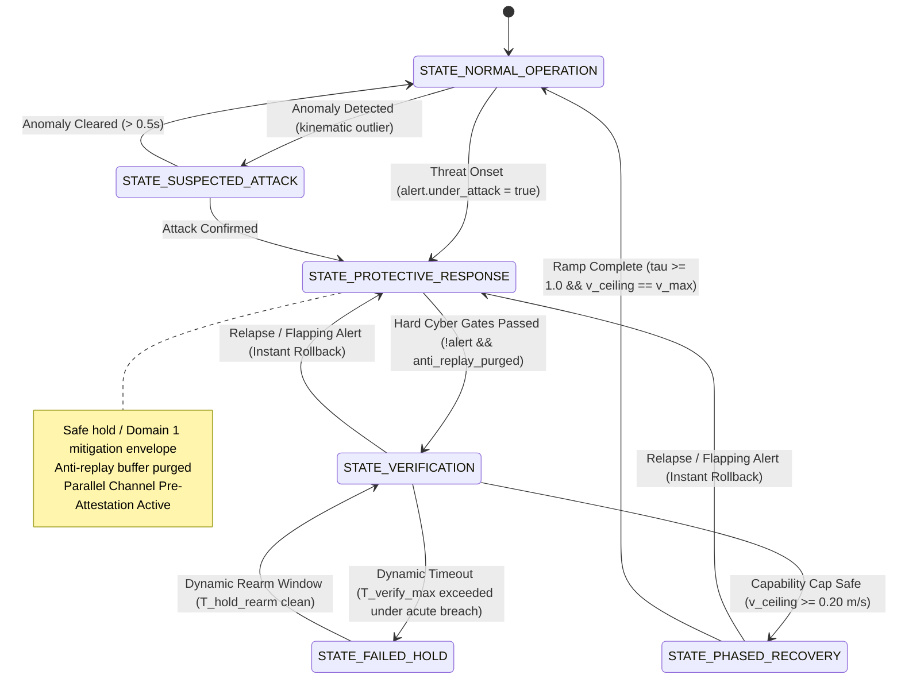

# Technical Reference: Autonomous Safe Recovery Engine

**Package:** `horos_recovery_engine`  
**Language:** C++17 (Modern ROS 2 `rclcpp`, Zero-Allocation POD Snapshots)  
**Domain:** Autonomous Post-Attack Recovery & Dual-Tier State Verification (Domain 2)  
**Author:** Youssef Ashraf Khalil  
**Institution:** German International University (GIU Cairo)  
**Academic Degree:** Bachelor of Science in Computer Science  

---

## 1. Architectural Decoupling & Rationale

During cyberattacks on cyber-physical systems, mitigation and recovery represent two fundamentally distinct operational regimes:

```
[Adversarial Perturbation]
           │
           ▼
┌─────────────────────────────────┐
│ Domain 1: Mitigation Engine     │  ◄── Operates at high frequency (50 Hz)
│ (Suppression & Velocity Clamp)  │      Inline threat suppression & spatial bounds
└─────────────────────────────────┘
           │ /cmd_vel_mitigated
           ▼
┌─────────────────────────────────┐
│ Domain 2: Recovery Engine       │  ◄── Dedicated autonomous service domain
│ (Multi-Sensor Verification &    │      Dual-tier attestation & asymmetric S-curve ramp
│  Autonomous Velocity Restore)   │      Guarantees dynamic stability post-attack
└─────────────────────────────────┘
           │ /cmd_vel
           ▼
[Physical Actuators / Gazebo HAL]
```

### Why Decouple Recovery from Mitigation?
1. **Separation of Concerns:** While the Mitigation Engine runs inline at high frequency ($50\text{ Hz}$) to suppress active adversarial disturbances on the actuator stream, the Recovery Engine manages discrete state transitions, multi-sensor health verification, anti-replay flushing, and temporal velocity restoration.
2. **Prevention of Secondary Destabilization:** Re-enabling $100\%$ velocity immediately when an attack flag drops causes sudden motor jerk, unweights quadruped paws/humanoid balance, and risks re-triggering false detector alerts (alert flapping).
3. **Defense-in-Depth:** If an adversary cycles or pulses attacks during the recovery window, the Recovery Engine intercepts the relapse and aborts back into safe hold without requiring high-level planner intervention.

---

## 2. Recovery Strategies: Baseline Taxonomy & The Merged Adaptive Paradigm

The HOROS recovery engine provides four primary operational strategies for comparative empirical evaluation:

| Strategy ID | Strategy Name | Theoretical Formulation | Operational Purpose |
| :---: | :--- | :--- | :--- |
| `0` | **`STRATEGY_FIXED_TIME`** | $v(t) = v_{\max} \cdot \mathbf{1}(t \ge T_{\text{cooldown}})$ | **Static Baseline:** Blind timer-based recovery ($3.0\text{s}$). Ignores spatial context; used as a negative control to demonstrate collision vulnerability in confined corridors. |
| `1` | **`STRATEGY_CONDITION_BASED`** | $v(t) = v_{\max} \cdot \mathbf{1}(C_1 \land C_2 \land C_3 \land C_4)$ | **Binary Baseline:** Gated all-or-nothing step restoration. Demonstrates fragility and livelock under sensor glitches or degraded modalities. |
| `2` | **`STRATEGY_PHASED_RESTORE`** | $v(t) = v_{\text{floor}} + (v_{\max} - v_{\text{floor}}) \cdot s(t)$ | **Actuator Smoothing Baseline:** Static S-curve velocity ramp. Lacks adaptive context modulation; acts as pure profile generator. |
| `3` | **`STRATEGY_ADAPTIVE`** | $v(t) = \min\big(v_{\text{time}}(t),\; v_{\text{ceiling}}(t)\big)$ | **Proposed Core Architecture:** Merged Dual-Tier Asymmetric Capability-Capped Recovery. Combines cyber admission, continuous soft capability caps, and zero-jerk S-curve liveness. |
| `4` | **`STRATEGY_PASSTHROUGH`** | $v(t) = v_{\text{mitigated}}$ | **R0 Baseline:** Wire passthrough with recovery FSM disarmed. |

---

## 3. Failure Mode Analysis of Naive Recovery Extensions

### 3.1 The Additive Velocity Level Fallacy
* **Naive Proposal:** Increment velocity levels as individual gates pass (e.g., Gate 1 passes $\to$ Level 1 speed, Gate 2 passes $\to$ Level 2 speed, etc.).
* **Why it Fails (Fail-Unsafe):** Safety constraints operate as **monotonic set intersections ($\bigcap$), never additive sums ($\sum$)**. 
  $$\mathcal{U}_{\text{safe}} = \bigcap_{i=1}^{M} \mathcal{U}_i \quad \implies \quad v_{\text{safe}} \le \min_{i}\{\text{cap}_i\}$$
  Gates guard completely orthogonal hazards:
  - $C_1$: Command stream integrity (cyber).
  - $C_2$: Spatial clearance (LiDAR proximity).
  - $C_3$: State estimator covariance (localization).
  - $C_4$: Command freshness (anti-replay).
  
  If Gate 1 (clearance) and Gate 4 (replay) pass, but Gate 3 (localization) is completely lost ($\gamma_{\text{loc}} = 0$), summing them would grant $50\%$ speed ($0.40\text{ m/s}$). Moving at speed with unverified global localization risks entering hazardous dynamic environments.

### 3.2 The Min-Pinning Starvation Flaw
* In legacy formulations:
  $$\Phi = \min\big(\text{trust}_{\text{cmd}},\, \text{trust}_{\text{perc}},\, \text{trust}_{\text{loc}},\, \text{trust}_{\text{replay}}\big)$$
  A single transient glitch, uncalibrated sensor, or minor localization variance pins $\Phi \le 0.50$, permanently throttling the robot to crawl ($0.08\text{ m/s}$) or forcing an unwarranted transition to `STATE_FAILED_HOLD`.

### 3.3 Byzantine Sensor Failures: Stuck-True vs. Stuck-False
1. **Stuck-True (LiDAR Spoofing / Static Reflection):** Sensed distance freezes at $d_{\min} = 5.0\text{m}$. A naive ramp accelerates straight into a physical obstacle.
   - **Observability Defense:** Cross-validate odometry displacement against range rate:
     $$\Delta x_{\text{odom}} = \int v_{\text{act}} \, dt \quad \text{vs.} \quad \Delta d_{\min} = d_{\min}(t) - d_{\min}(t - \Delta t)$$
     If the robot is commanding and measuring forward motion ($v_{\text{act}} \ge 0.15\text{ m/s}$) toward an obstacle but sensed clearance does not change ($\Delta d_{\min} \approx 0$), the sensor is flagged as a Byzantine freeze and quarantined.
2. **Stuck-False (LiDAR Blinding / Dust Burst):** Sensed distance freezes at $0.05\text{m}$ or NaN.
   - **Bounded Liveness Defense:** Engage safe dead-reckoning crawl ($v_{\text{blind}}$) bounded by stopping distance, but enforce a hard temporal limit $T_{\text{degraded\_max}} = 4.0\text{s}$ before stepping down to `STATE_FAILED_HOLD`.

---

## 4. The Dual-Tier Hybrid Recovery Architecture

HOROS addresses these challenges through a **Dual-Tier Hybrid Recovery Engine**:

```
+-------------------------------------------------------------------------------------------------+
|                                    CYBER HAZARD BOUNDARY                                        |
|  C1: Command Trust & Origin Whitelist           C4: Anti-Replay Buffer Purge                    |
|  G5: Cryptographic Node & Config Attestation (SHA-256 + Keyed HealthChallenge Nonce)            |
|  [HARD BINARY GATES] ===> Must be TRUE to exit PROTECTIVE_RESPONSE. (Non-negotiable Admission)  |
+-------------------------------------------------------------------------------------------------+
                                                │
                                                ▼ (Admitted to Physical Recovery)
+-------------------------------------------------------------------------------------------------+
|                                 PHYSICAL HAZARD BOUNDARIES                                      |
|  C2: LiDAR Clearance (d_min)                  C3: Odometry / AMCL Stability (gamma_loc)         |
|  ===> cap_clear(d_min)                        ===> cap_loc(gamma_loc)                           |
|  [CONTINUOUS CAPABILITIES]                     [CONTINUOUS CAPABILITIES]                        |
+-------------------------------------------------------------------------------------------------+
            │                                           │
            └─────────────────────┬─────────────────────┘
                                  │
                                  ▼
+-------------------------------------------------------------------------------------------------+
|                                  ASYMMETRIC CAPABILITY ENVELOPE                                 |
|                               v_ceiling = min(cap_clear, cap_loc)                               |
|                     [Fast Collapse: instant]  /  [Slow Rise: dv_max * dt + Dwell]                |
+-------------------------------------------------------------------------------------------------+
                                  │
                                  ▼ Clamps Downward
                 ═════════════════════════════════════════════════
                                  ▲ Pushes Upward
+-------------------------------------------------------------------------------------------------+
|                             TIME-DRIVEN ZERO-JERK S-CURVE GENERATOR                             |
|                   v_time(t) = v_floor + (v_nominal - v_floor) * (3*tau^2 - 2*tau^3)             |
|                                 (Guarantees Liveness & Progress)                                |
+-------------------------------------------------------------------------------------------------+
                                                │
                                                ▼
                                 FINAL MITIGATED COMMAND:
                         v_cmd = min(v_time(t), v_ceiling)
```

### 4.1 Tier 1: Five-Gate Verification Protocol (Gates G1–G5)
Physical recovery cannot begin until all five safety and cryptographic gates evaluate to `PASS`:

1. **Gate G1 (Threat Alert Quiescence):**
   The cyber threat severity score must satisfy $S < S_{\text{recovery\_thresh}} = 0.15$ continuously for the quiescent dwell window $T_{\text{quiescent}} = 0.50\text{ s}$. Any alert re-trigger resets the verification clock.
2. **Gate G2 (Spatial Clearance Accumulator):**
   Clearance must satisfy $d_{\min} \ge d_{\text{safe}} = 0.65\text{ m}$ (Go2) or $0.35\text{ m}$ (YanShee) through a 10-tick leaky accumulator ($\ge 8/10$ valid scans), absorbing sensor flicker (`V9`) without livelock.
3. **Gate G3 (Postural Dynamic Equilibrium):**
   Chassis tilt and angular rates must remain below tipping thresholds: $\theta_{\text{tilt}} < 12.0^\circ$ and $\omega_{\text{gyro}} < 0.80\text{ rad/s}$, preventing resumption while oscillating (`V12`).
4. **Gate G4 (Actuator Channel Trust & Anti-Replay Purge):**
   The ingress channel trust score must satisfy $T_{\text{channel}} \ge 0.80$, and the 64-bit anti-replay window must verify that all in-flight pre-attack commands in middleware queues are purged.
5. **Gate G5 (Cryptographic Node & Configuration Attestation):**
   `IntegrityVerifier` queries on-disk SHA-256 golden digests against `boot_manifest.json` and performs an authenticated `/horos/health_challenge` / `/horos/health_response` nonce handshake. If code, parameters, or digests have been tampered with (`V16`), Gate G5 fails closed.

#### Cryptographic Tamper Lockout (`STATE_FAILED_HOLD`):
When Gate G5 fails, the recovery state machine does **not** attempt autonomous retry ramps. Instead, it engages an unconditional fail-closed lockout into `STATE_FAILED_HOLD` ($v_{\text{ceiling}} = 0.0\text{ m/s}$), preventing a compromised robot from moving until a verified operator re-attests the software manifest.

#### Single-Writer Incident Ownership Handshake:
To eliminate split-brain recovery between the Mitigation Engine and Recovery Engine, every detected attack assigns a monotonically incremented incident token (`INC-xxxx`). The Recovery Engine becomes the exclusive master writer to `/cmd_vel` only after acknowledging incident ownership.

#### Exponential Relapse Penalty:
To neutralize flapping adversaries (`V10 / AA-2a`), the verification duration scales with relapse count:
$$T_{\text{verify\_eff}} = T_{\text{verify\_base}} \cdot k_{\text{eff}}, \qquad k_{\text{eff}} = 2^{\min(N_{\text{relapse}}, 3)}$$
bounding post-attack flapping to $\le 5$ cycles before forcing a safe hold.

### 4.2 Tier 2: Continuous Soft Physical Capability Caps
Once cyber admission is confirmed, physical sensors establish dynamic upper ceilings rather than binary blockades:

1. **Continuous Clearance Cap ($\text{cap}_{\text{clear}}$):**
   $$\text{cap}_{\text{clear}}(d_{\min}) = \begin{cases}
   0.0, & d_{\min} \le d_{\text{crit}} \quad (0.27\text{ m}) \\
   v_{\text{floor}} + (v_{\max} - v_{\text{floor}}) \cdot \left(\frac{d_{\min} - d_{\text{crit}}}{d_{\text{nominal}} - d_{\text{crit}}}\right), & d_{\text{crit}} < d_{\min} < d_{\text{nominal}} \quad (1.00\text{ m}) \\
   v_{\max}, & d_{\min} \ge d_{\text{nominal}}
   \end{cases}$$

2. **Continuous Localization Cap ($\text{cap}_{\text{loc}}$):**
   $$\text{cap}_{\text{loc}}(\gamma_{\text{loc}}) = v_{\text{floor}} + (v_{\max} - v_{\text{floor}}) \cdot \operatorname{clamp}\left(\frac{\gamma_{\text{loc}} - 0.40}{0.40},\; 0.0,\; 1.0\right)$$

3. **Degraded Blind Crawl Cap ($v_{\text{blind}}$):**
   When perception is quarantined but cyber gates and odometry are trusted:
   $$\text{cap}_{\text{perc}} = v_{\text{blind}} = \operatorname{clamp}\left(\frac{d_{\min}^{\text{last}}}{2.0},\; 0.05,\; 0.12\right)\text{ m/s}$$
   *Bounded Liveness:* A countdown timer enforces $T_{\text{degraded\_max}} = 4.0\text{s}$. If perception fails to re-attest within $4.0\text{s}$, the FSM transitions cleanly to `STATE_FAILED_HOLD`.

### 4.3 Time-Driven S-Curve Profile Generator (Liveness Engine)
Time pushes velocity upward smoothly using a zero-jerk cubic Hermite polynomial:
$$\tau = \operatorname{clamp}\left(\frac{t - t_{\text{state\_start}}}{T_{\text{ramp}}},\; 0.0,\; 1.0\right), \quad s(\tau) = 3\tau^2 - 2\tau^3$$
$$v_{\text{time}}(t) = v_{\text{floor}} + (v_{\max} - v_{\text{floor}}) \cdot s(\tau)$$
Because time is strictly monotonic, **liveness is guaranteed**: the robot will not deadlock in crawl mode if capabilities permit higher speeds.

### 4.4 Asymmetric Envelope Limiter (Fast Down, Slow Up with Dwell)
To protect against sensor hunting, gate flapping, and dynamic obstacles:
$$\text{cap}_{\text{target}} = \min(\text{cap}_{\text{clear}},\, \text{cap}_{\text{loc}})$$
* **Instant Collapse (Downward):** If $\text{cap}_{\text{target}} < v_{\text{ceiling}}[k-1]$, drop immediately:
  $$v_{\text{ceiling}}[k] = \text{cap}_{\text{target}} \quad (\text{Latency } < 2.0\text{ ms})$$
  Reset the stability dwell timer: $t_{\text{clean\_dwell\_start}} = t_{\text{now}}$.
* **Rate-Limited Rise (Upward):** If $\text{cap}_{\text{target}} > v_{\text{ceiling}}[k-1]$:
  Only permit upward expansion if conditions have remained clean for at least $T_{\text{dwell}} = 250\text{ ms}$:
  $$v_{\text{ceiling}}[k] = \min\big(\text{cap}_{\text{target}},\; v_{\text{ceiling}}[k-1] + a_{\max} \cdot \Delta t_{\text{real}}\big)$$
* **Final Synthesis:**
  $$\mathbf{v_{\text{cmd}}[k] = \min\big(v_{\text{time}}[k],\; v_{\text{ceiling}}[k]\big)}$$

---

## 5. Elimination of Timing Skew & Clock Drift

In earlier revisions, clean attestation timers used fixed tick increments:
```cpp
protective_clean_duration_ = std::min(1.0, protective_clean_duration_ + 0.02);
```
Under real-world ROS 2 execution, context packets arrive at $10\text{--}20\text{ Hz}$ while the actuator loop executes at $50\text{ Hz}$. This caused severe integration drift.

In the enhanced architecture, all state durations, ramp profiles, and dwell windows integrate strictly using `std::chrono::steady_clock` delta time:
$$\Delta t_{\text{real}} = \frac{t_{\text{now}} - t_{\text{last}}}{10^9} \in [0.001\text{ s},\; 0.100\text{ s}]$$
guaranteeing deterministic, wall-clock timing accuracy across both high-performance workstations and embedded SBCs.

---

## 6. Six-State Recovery FSM Lifecycle



---

## 7. Performance & Verification Metrics (RQ1 & RQ2)

| Evaluation Metric | Legacy Context Gates | Merged Dual-Tier Adaptive | Research Question Addressed |
| :--- | :---: | :---: | :--- |
| **Availability / Task Continuity ($TC$)** | Drops to 0 on 1-tick LiDAR dropout | Maintained at $\ge 0.12\text{ m/s}$ ($TC > 0$) | **RQ1 (Availability vs. Security)** |
| **Recovery Latency ($t_{\text{recover}}$)** | $6.0\text{ s} - 40.0\text{ s}$ (or livelock) | **$1.4\text{ s} - 2.2\text{ s}$** | **RQ1 & RQ3** |
| **LiDAR Blinding / Dropout** | Permanent FAILED_HOLD Lockout | Bounded $v_{\text{blind}}$ crawl ($4.0\text{s}$ budget) | **RQ2 (Environmental Safety)** |
| **LiDAR Spoofing (Stuck-True)** | Accel into obstacle | Quarantined via $\Delta x_{\text{odom}}$ cross-check | **RQ2 (Context Blindness Defense)** |
| **Algorithmic Latency ($t_{\text{select}}$)** | $< 0.05\text{ ms}$ | **$< 0.04\text{ ms}$ (Zero heap allocations)** | **RQ3 (Bounded Real-Time Latency)** |
