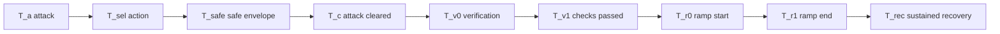

# `t_recover` — Metric Specification, Defect Analysis and Evaluation Protocol

**Document ID:** `METRIC-TR-01`
**Status:** Specification (documentation only, no code is implemented by this document)
**Research alignment:** RQ1 (availability after an attack), RQ2 (safe autonomous recovery); AGENTS.md §3.4 (three distinct temporal metrics)
**Related documents:** [`profiling_system.md`](profiling_system.md) · [`recovery_engine.md`](recovery_engine.md) · [`sensor_fallback_modes.md`](sensor_fallback_modes.md) · [`../architcutre/next_phase_scheduler_ecosystem_comparison.md`](../architcutre/next_phase_scheduler_ecosystem_comparison.md) · [`../report/explore_benchmarks_audit.md`](../report/explore_benchmarks_audit.md)

---

## 1. Purpose

AGENTS.md mandates three **distinct** temporal metrics:

| Metric | Required meaning |
|---|---|
| `t_select` | Algorithmic policy-selection latency (`< 0.5 ms`) |
| `t_safe` | Time to reach the safe state (physical deceleration to the bounded velocity envelope) |
| **`t_recover`** | **Resumption of ≥ 90% nominal patrol speed following verification** |

This document defines `t_recover` precisely, audits how it is computed today, shows what the current data actually says, and specifies a corrected measurement and a with/without evaluation protocol.

---

## 2. Current implementation (as found in code)

| Aspect | Current behaviour | Location |
|---|---|---|
| Recovery condition | `actual_linear_v >= 0.30` m/s (absolute constant) | [`benchmark_tracer_node.py#L516`](file:///e:/Giu%20%20files/semster%207/horos_framework/src/horos_attack_injector/horos_attack_injector/benchmark_tracer_node.py#L514-L517) |
| Comment above it | "≥ 90% of nominal patrol speed (0.35 × 0.90 = 0.315 m/s)" | same lines |
| Time reference | `now − attack_end_time` (wall clock `time.time()`) | [L302](file:///e:/Giu%20%20files/semster%207/horos_framework/src/horos_attack_injector/horos_attack_injector/benchmark_tracer_node.py#L300-L306), [L517](file:///e:/Giu%20%20files/semster%207/horos_framework/src/horos_attack_injector/horos_attack_injector/benchmark_tracer_node.py#L517) |
| Observation window | Fixed **3.5 s** after attack end (`post_attack_end_time = attack_end_time + 3.5`) | [L303](file:///e:/Giu%20%20files/semster%207/horos_framework/src/horos_attack_injector/horos_attack_injector/benchmark_tracer_node.py#L303) |
| "Not recovered" | Sentinel value `-1.0` written to the CSV | [L90](file:///e:/Giu%20%20files/semster%207/horos_framework/src/horos_attack_injector/horos_attack_injector/benchmark_tracer_node.py#L90), [L613](file:///e:/Giu%20%20files/semster%207/horos_framework/src/horos_attack_injector/horos_attack_injector/benchmark_tracer_node.py#L613) |
| Sampling rate | 10 Hz timer (`timer_tick_evaluation`), i.e. 100 ms resolution | [L459](file:///e:/Giu%20%20files/semster%207/horos_framework/src/horos_attack_injector/horos_attack_injector/benchmark_tracer_node.py#L456-L459) |
| Criterion type | First-crossing (one sample at or above threshold ends the measurement) | [L516](file:///e:/Giu%20%20files/semster%207/horos_framework/src/horos_attack_injector/horos_attack_injector/benchmark_tracer_node.py#L516) |
| Speed signal | Odometry `actual_linear_v` (physical), not the commanded speed | tracer |
| Related metric `t_safe` | First sample with `actual_v ≤ 0.05` (STATIC) or `≤ 0.38` (all other modes) | [L488-L493](file:///e:/Giu%20%20files/semster%207/horos_framework/src/horos_attack_injector/horos_attack_injector/benchmark_tracer_node.py#L488-L493) |

---

## 3. What the current data says

Source: `benchmark_summary.csv`, 79 episodes (EP_034–EP_112).

| Mode | Episodes | Episodes with a valid `t_recover` (not `-1`) | Recovery success within 3.5 s | Mean `t_recover` over valid only |
|---|---|---|---|---|
| BYPASS | 18 | 4 | 22% | 0.018 ± 0.010 s |
| STATIC | 18 | 8 | 44% | 3.075 ± 0.021 s |
| DYNAMIC | 18 | 3 | 17% | 0.834 ± 0.750 s |
| ADAPTIVE | 25 | 8 | **32%** | 1.982 ± 1.201 s |

Observations:

1. **ADAPTIVE recovered within the window in only 8 of 25 episodes (32%).** The thesis report states 100% recovery success. These two statements cannot both be true under the current measurement.
2. **STATIC = 3.075 ± 0.021 s** is simply the fixed 3 s timer plus the 100 ms sampling quantum. It measures the *timer*, not recovery quality. The very small standard deviation is the signature of a constant.
3. **BYPASS "recovers" in 0.018 s.** BYPASS never reduced speed, so the speed was already above the threshold the instant the attack ended. This is not recovery; it is the absence of an intervention.
4. The means exclude the `-1` episodes, so they are computed over **survivors only**. This is survivorship bias: the slower the strategy, the fewer episodes reach the threshold, and the *better* its average looks.
5. A negative recovery time (the report quotes `-0.05 s`) **cannot be produced** by the current tracer code, because `t = now − attack_end_time ≥ 0`. That figure comes from some other computation and must be traced or removed.

---

## 4. Defects in the current definition

| ID | Defect | Why it matters | Severity |
|---|---|---|---|
| R1 | **Absolute threshold (0.30 m/s) instead of 90% of a per-episode reference speed.** The comment says 0.315, the code says 0.30. | In `TIGHT_ROOM` and `CONFINED_SPACE` the nominal driver and the engines cap speed well below 0.30 m/s (for example the ADAPTIVE clearance-regulation branch limits to 0.10–0.25 m/s). The threshold is **unreachable by design** there, so "not recovered" is reported even for perfect behaviour. | High |
| R2 | **Right-censoring treated as failure with a sentinel.** `-1` means both "never recovered" and "ran out of window". | Cannot distinguish a failed strategy from an observation that ended too early. Averages and plots silently drop or mis-handle `-1`. | High |
| R3 | **3.5 s window is shorter than the strategies' own recovery mechanics.** The fixed-time strategy needs 3.0 s, the adaptive probation and ramp can exceed this. | The measurement ends before recovery can complete, artificially lowering success rates. | High |
| R4 | **First-crossing criterion.** One 100 ms sample at ≥ 0.30 ends the measurement. | A transient overshoot, a gait bounce or a pedestrian-induced blip counts as recovery. The robot may immediately re-stop. | Medium |
| R5 | **Reference is `attack_end_time`, not the recovery engine's own timeline.** | Mixes attack duration, verification time and ramp time into one number. A strategy cannot be diagnosed from it. | Medium |
| R6 | **Wall clock instead of ROS/simulation clock.** `time.time()` is used while the simulator may run at a real-time factor ≠ 1. | Durations are over- or under-stated depending on Gazebo load. | Medium |
| R7 | **Collisions are not excluded or flagged.** A crashed robot has speed ≈ 0 and shows `-1`, indistinguishable from a safe hold. | A safe hold and a crash look identical in `t_recover`. | High |
| R8 | **No distinction between command-level and physical recovery.** | The engine may restore the command in 1 s while the robot takes 2 s to accelerate. Both are legitimate but different. | Medium |
| R9 | **100 ms sampling resolution.** | Values under about 0.3 s (BYPASS 0.018, DYNAMIC 0.8) are at or below the quantum. | Medium |
| R10 | **The `t_safe` threshold (0.38 m/s) is above the nominal cruise speed (0.35 m/s).** | Any robot at nominal speed is already "safe", so `t_safe` of BYPASS is about 0.03 s. `t_safe` is not measuring deceleration to a safe envelope. | High (affects `t_recover` interpretation too) |
| R11 | **"Without recovery" modelled as `∞` or "~180 s manual reset".** | The 180 s figure is an assumption with no source or experiment. | Medium |

---

## 5. Corrected specification

### 5.1 Event timeline (all times on the ROS/simulation clock)

| Symbol | Event | Source |
|---|---|---|
| `T_a` | Attack alert asserted (`under_attack` goes true) | `/horos/attack_alert` |
| `T_sel` | First non-passthrough mitigation action | `/horos/mitigation_status` (`t_select = T_sel − T_a`) |
| `T_safe` | Robot first inside the safe velocity envelope (see §5.3) | odometry |
| `T_c` | Attack alert cleared (`under_attack` goes false) | `/horos/attack_alert` |
| `T_v0` | Recovery FSM enters `VERIFICATION` | `/horos/recovery_status` |
| `T_v1` | Recovery FSM leaves `VERIFICATION` (all checks passed) | `/horos/recovery_status` |
| `T_r0` | Recovery FSM enters `PHASED_RECOVERY` (ramp begins) | `/horos/recovery_status` |
| `T_r1` | Velocity scale factor reaches 1.0 (ramp complete) | `recovery_progress_pct` |
| `T_rec` | Physical speed sustained above recovery threshold (see §5.2) | odometry |
| `T_end` | Episode end (recovered, collided, FSM `FAILED_HOLD`, or `T_max`) | tracer |

### 5.2 Definition of recovery (replaces R1, R4)

A robot is **recovered** at the first time `T_rec ≥ T_c` such that, for a sustained hold of `τ_hold = 1.0 s`:

`v_actual(t) ≥ 0.90 · v_ref` for all `t ∈ [T_rec, T_rec + τ_hold]`

with the **per-episode reference speed**

`v_ref = min( v_pre , v_ceiling(context) )`

- `v_pre`: mean actual speed over the last 2 s before `T_a` in the *same episode* (already available as `pre_attack_mean_v`).
- `v_ceiling(context)`: the maximum speed the engine is permitted to command in the prevailing context after the attack (for example the clearance-regulated ceiling in `CONFINED_SPACE`). It is computed from the logged `obstacle_distance_m` and the published policy, so a strategy is not penalised for a speed limit that is part of its *correct* behaviour.

Rationale: this restores the intent of AGENTS.md ("≥ 90% nominal patrol speed") per environment and removes the unreachable-threshold failure (R1).

### 5.3 Companion fix for `t_safe` (replaces R10)

`T_safe` is the first time that, sustained for 0.5 s, `v_actual ≤ v_envelope(S, d_min)`, where `v_envelope` is the commanded speed bound for the current severity `S` and clearance `d_min`. If the robot is already inside the envelope at `T_a`, `t_safe` is recorded as `0` and **flagged `ALREADY_SAFE`**, so such episodes can be filtered when comparing deceleration performance.

### 5.4 The metric family (reported together)

| Metric | Definition | What it diagnoses |
|---|---|---|
| `t_recover_phys` | `T_rec − T_c` (physical, sustained, per §5.2) | **Main thesis metric** (AGENTS.md `t_recover`) |
| `t_recover_cmd` | Time from `T_c` until the *commanded* post-recovery speed first reaches 0.9·`v_ref` | Engine decision speed, separate from vehicle dynamics |
| `t_verify` | `T_v1 − T_v0` | Cost of the attestation checks |
| `t_ramp` | `T_r1 − T_r0` | Cost of the phased S-curve |
| `t_hold` | Time spent in `PROTECTIVE_RESPONSE` after `T_c` | Cost of conservatism |
| `RSR` | Recovery success rate: fraction of episodes with `T_rec ≤ T_max` and no collision | Replaces the sentinel (R2) |
| `n_relapse` | Number of rollbacks (flapping) during recovery | Flapping defense quality |
| `TC_post` | Mean task continuity from `T_rec` to `T_end` | Quality after recovery |
| `coll_post` | Collisions occurring after `T_c` (secondary collisions) | Safety of recovery itself |

### 5.5 Episode termination and window (replaces R3)

- `T_max = 15 s` after `T_c` (to be confirmed by a pilot so that the slowest legitimate strategy completes with margin). 
- The episode ends early when recovery is achieved, a collision occurs, or the FSM enters `FAILED_HOLD` for longer than 3 s.
- The previous 3.5 s window is retained **only** as a secondary metric, `RSR_3.5s`, for backwards comparison with earlier results.

### 5.6 Outcome taxonomy (replaces the `-1` sentinel, R2 and R7)

| Outcome code | Meaning | `t_recover_phys` value |
|---|---|---|
| `REC_OK` | Recovered within `T_max`, no collision | numeric |
| `REC_CENSORED` | Neither recovered nor failed by `T_max` (still safe hold) | **right-censored at `T_max`** |
| `REC_FAILED_HOLD` | FSM latched `FAILED_HOLD` | right-censored (strategy failure) |
| `REC_COLLISION` | Collision before recovery | not defined (excluded from time statistics, counted in `RSR` and safety) |
| `REC_NOT_APPLICABLE` | Attack never perturbed the robot (for example BYPASS speed never dropped) | not defined; flagged `NO_INTERVENTION` |
| `REC_INVALID` | Instrumentation fault (missing stamps, clock jump) | excluded, counted in a data-quality table |

The CSV must store the outcome code in its own column and store `NaN` (not `-1`) for undefined times.

### 5.7 Measurement pipeline requirements

| Requirement | Spec |
|---|---|
| Clock | ROS clock with `use_sim_time`, so durations are in simulated time (fixes R6). |
| Sampling | Odometry-driven at the native rate (about 50 Hz) with stamps, not a 10 Hz wall timer (fixes R9). Time-series logging remains 10 Hz in `benchmark_results.csv` to control size, but the metric is computed from the high-rate stream. |
| Filtering | Speed smoothed with a 0.2 s moving median before thresholding (removes gait bounce). |
| Collision | Single, documented definition used everywhere (currently `d_min ≤ 0.40` or sticky flag, while the report text uses 0.32 and 0.28). |
| Provenance | Each row carries `T_a`, `T_c`, `T_rec`, `v_ref`, `v_pre`, `outcome` so any value can be recomputed from the raw series. |

---

## 6. Statistical analysis (replaces "mean of survivors")

Because some episodes never recover within `T_max`, recovery time is **time-to-event data with right censoring**. Use survival analysis rather than a mean.

| Question | Method |
|---|---|
| Recovery-time distribution per configuration | **Kaplan–Meier** curves with 95% confidence bands |
| Typical recovery time | KM **median** (undefined if fewer than 50% recover; then report the restricted mean survival time up to `T_max`) |
| Compare two configurations (with vs without feature) | **Log-rank test**; hazard ratio from a Cox model (stratified by scenario) |
| Success rate | `RSR` with **Wilson 95% interval**; compare with Fisher's exact test (two groups) or Cochran–Mantel–Haenszel stratified by scenario |
| Safety of recovery | Count of `REC_COLLISION`; compare with Fisher's exact test; also report the **rule-of-three** upper bound (`3/N`) when zero events are observed |
| Effect size | Hazard ratio, risk difference with CI |
| Matched design | Paired by (scenario, attack, severity, seed); use stratification, not pooling across scenarios |

Minimum sample: N ≥ 10 per (strategy, scenario, attack) cell, and at least 25 episodes per strategy per scenario when a zero-failure claim is intended (rule of three gives an upper bound of about 12% at N = 25).

---

## 7. Evaluation protocol: with versus without (thesis requirement)

### 7.1 Recovery-engine ablation

| Config | Description | Purpose |
|---|---|---|
| **R0: no recovery engine** | Mitigation output goes straight to `/cmd_vel`; speed returns the instant the alert clears (instant passthrough) | Baseline for "without recovery" (replaces the invented ∞ or 180 s) |
| **R0-op: operator reset model** | R0 plus a configurable operator-intervention delay model (for example 30/60/180 s), clearly labelled as an **assumption** | Quantifies the cost of manual reset without claiming an unsupported number |
| **R1: fixed-time** | Blind 3.0 s timer | Existing baseline |
| **R2: condition-based** | Verification-gated instant restore | Existing baseline |
| **R3: phased restore** | Phased ramp without adaptive backoff | Existing |
| **R4: adaptive (current)** | Hierarchical tiers, verification, S-curve, flapping guard | Proposed |
| **R5: R4 + sensor fallback** | Adds [sensor-health fallback](sensor_fallback_modes.md) | Feature under test |
| **R6: R4 + scheduler** | Adds the [scheduler](../architcutre/next_phase_scheduler_ecosystem_comparison.md) incident ownership | Feature under test |

### 7.2 Hypotheses

| ID | Hypothesis | Test |
|---|---|---|
| H-R1 | R4 has a higher `RSR` than R0 with **no increase** in `coll_post` | Fisher (RSR), Fisher (collisions) |
| H-R2 | R4 has a lower `n_relapse` than R1 and R2 under multi-pulse attacks | Mann–Whitney on `n_relapse` |
| H-R3 | R4 trades a longer `t_recover_phys` than R2 for fewer secondary collisions | Log-rank (time), Fisher (collisions) |
| H-R4 | R5 does not increase `t_recover_phys` in clean (no sensor attack) runs by more than 10% | Equivalence test (TOST) on KM median or RMST |
| H-R5 | R6 reduces `t_verify` variance and `n_relapse` versus R4 | Levene's test, Mann–Whitney |

### 7.3 Test matrix

| Factor | Levels |
|---|---|
| Recovery configuration | R0, R1, R2, R3, R4, R5, R6 |
| Mitigation mode | ADAPTIVE (primary); DYNAMIC and STATIC as secondary comparators |
| Scenario | `OPEN_SPACE`, `CONFINED_SPACE`, `NEAR_HUMAN`, `TIGHT_ROOM` |
| Attack | all six attack types, plus single-pulse and 2-pulse and 4-pulse trains (flapping) |
| Seeds | N ≥ 10 matched seeds |

---

## 8. Data validation tests (specified as test vectors, no code)

| Test | Synthetic input | Expected |
|---|---|---|
| T1 | Speed 0.35 until `T_a`, 0 until `T_c`, linear ramp to 0.35 over 2 s | `t_recover_phys ≈ 1.8 s`, outcome `REC_OK` |
| T2 | Same, but speed overshoots to 0.35 for 0.2 s then falls to 0 | Must **not** register recovery (hold < 1 s) |
| T3 | Speed capped at 0.20 in a confined scenario with `v_pre = 0.20` | Recovery detected against `v_ref = 0.20`, not against 0.30 |
| T4 | Speed never drops during the attack (BYPASS) | `REC_NOT_APPLICABLE` / `NO_INTERVENTION` |
| T5 | Speed stays 0 to `T_max` with no collision | `REC_CENSORED`, `NaN` time |
| T6 | `d_min` reaches 0 during the episode | `REC_COLLISION` |
| T7 | `T_c` earlier than `T_a` (clock fault) | `REC_INVALID` |
| T8 | Monotonicity: `T_a ≤ T_sel ≤ T_c ≤ T_v0 ≤ T_v1 ≤ T_r0 ≤ T_r1` | All episodes satisfy it, else flagged |
| T9 | `t_recover_phys ≥ 0` and `t_recover_cmd ≤ t_recover_phys` (approximately) | Always |

---

## 9. Reporting template

For every configuration and scenario report:

| Item | Content |
|---|---|
| N | episodes, and counts per outcome code |
| `RSR` | proportion with Wilson 95% CI |
| `t_recover_phys` | KM median with 95% CI (or RMST up to `T_max`) |
| `t_verify`, `t_ramp`, `t_hold` | median and IQR |
| `n_relapse` | mean ± std and distribution |
| `coll_post` | count and rule-of-three bound if zero |
| Statistical tests | test name, statistic, p-value, effect size, correction method |
| Data-quality | `REC_INVALID` count and reasons |

---

## 10. Relationship to the existing report

| Existing statement | Status after this specification |
|---|---|
| "Autonomous recovery success 100%" (`thesis_evaluation_results.md` §2.1) | Not supported by current data (ADAPTIVE: 8/25 recovered within 3.5 s). Must be recomputed with §5. |
| "Mean time-to-recovery 1.13 s (0.42–1.84 s)" | Not derivable from the current CSV (ADAPTIVE valid mean is 1.98 ± 1.20 s, n = 8). Must be recomputed. |
| "Recovery Latency −0.05 s" | Impossible under the current code; remove or trace. |
| "~180 s manual reset" | Assumption; replace with the labelled operator-delay model (R0-op). |
| Hard-coded recovery tables in `explore_benchmarks.py` | See [`explore_benchmarks_audit.md`](../report/explore_benchmarks_audit.md) |

---

## 11. Implementation roadmap (tasks only)

| Task | Description |
|---|---|
| TR-T1 | Replace the sentinel with `NaN` plus an `outcome` column; add `v_ref`, `T_a`, `T_c`, `T_rec` columns |
| TR-T2 | Switch the tracer to the ROS/sim clock and odometry-rate sampling |
| TR-T3 | Implement the sustained-threshold criterion with per-episode `v_ref` (§5.2) and the corrected `t_safe` (§5.3) |
| TR-T4 | Extend the episode window to `T_max` with early termination (§5.5) |
| TR-T5 | Emit the sub-metrics (`t_verify`, `t_ramp`, `t_hold`, `n_relapse`) from the recovery status stream |
| TR-T6 | Implement R0 (no recovery) and R0-op as selectable configurations |
| TR-T7 | Survival-analysis module and the test vectors of §8 |
| TR-T8 | Re-run the matched campaign and regenerate all recovery figures from computed values |
