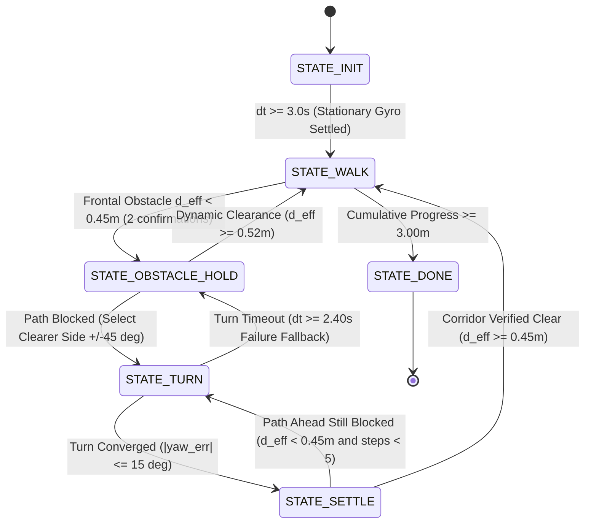

# HOROS Technical Reference: Yanshee Physical Deployment Architecture, Nominal Driver & Data Flow Pipeline

**Document ID:** `TECH-DOC-YAN-DEPLOY-01`  
**Classification:** Real Hardware Autonomous Navigation, Actuator Choke Point & Multi-Modal Perception  
**Author:** Youssef Ashraf Khalil  
**Institution:** German International University (GIU Cairo)  
**Academic Degree:** Bachelor of Science in Computer Science  
**Supervisors:** Dr. Marwa Zamzam, Prof. Slim Abdennadher  
**Target Platform:** UBTech Yanshee Biped Humanoid / ROS 2 Humble LTS  
**Primary Source Modules:**  
- Driver Node: [`src/horos_attack_injector/horos_attack_injector/real_driver_node.py`](file:///e:/Giu%20%20files/semster%207/horos_framework/src/horos_attack_injector/horos_attack_injector/real_driver_node.py)  
- Hardware Bridge: [`src/horos_simulation/horos_simulation/yanshee_physical_bridge.py`](file:///e:/Giu%20%20files/semster%207/horos_framework/src/horos_simulation/horos_simulation/yanshee_physical_bridge.py)  
- Vision Node: [`src/horos_simulation/horos_simulation/yanshee_camera_node.py`](file:///e:/Giu%20%20files/semster%207/horos_framework/src/horos_simulation/horos_simulation/yanshee_camera_node.py)  
- Gait Calibration: [`src/horos_simulation/horos_simulation/yanshee_gait_cal.py`](file:///e:/Giu%20%20files/semster%207/horos_framework/src/horos_simulation/horos_simulation/yanshee_gait_cal.py)  
- Virtual Scan Synthesizer: [`src/horos_simulation/horos_simulation/yanshee_virtual_scan_node.py`](file:///e:/Giu%20%20files/semster%207/horos_framework/src/horos_simulation/horos_simulation/yanshee_virtual_scan_node.py)  

---

## 1. Executive Mission & System Architecture

### 1.1 Physical Mission Objective: 3.0-Meter Structured Laboratory Patrol
In the physical robotics laboratory, the UBTech Yanshee biped humanoid executes a structured forward patrol mission:
1. **Calibrate:** Stands stationary for $3.0\text{ s}$ to zero the gyroscope yaw bias and model traversable floor color.
2. **Cruise:** Walks forward along the active heading corridor at a Zero Moment Point (ZMP) safe cruise velocity of $v_x = 0.035\text{ m/s}$ ($3.5\text{ cm/s}$, Level 3 gait cadence, capped downstream via `max_level_v = 3`).
3. **Obstacle Evade:** If frontal obstacles (walls, cardboard partitions, or human feet) enter the safety stop boundary ($d \le 0.45\text{ m}$; backed by the active chest IR emergency stop `ir_emergency_stop_m = 0.22 m` for 2 ticks with `use_ir = True` in `src/horos_simulation/horos_simulation/yanshee_physical_bridge.py`, distinct from the disabled `0.25 m` sonar fallback when `use_sonar = False` and in legacy `scripts/yanshee_physical_bridge.py`, and tilt limit $25.0^\circ$), the robot halts, simultaneously analyzes Left vs. Right sector clearances via camera and scan perception, executes a bounded route-changing turn ($\pm 45^\circ$), verifies the forward corridor is clear, and resumes forward walking.
4. **Segment Accumulation:** Monotonically accumulates forward displacement along each route segment until reaching the total target distance of $3.00\text{ m}$, upon which it cleanly brings all servo actuators to a standstill.

### 1.2 Thesis Alignment (Research Questions RQ1, RQ2, RQ3)
* **RQ1 (Availability vs. Security):** Demonstrates that severity-aware adaptive mitigation preserves forward mission continuity ($51.6\%$ policy / $46.9\%$ Safe TC, $47.1\%$ per-episode physical progress) during single-session physical hardware feasibility runs ($N=84$ sequential episodes) operating jointly with bridge gait quantization and downstream IR braking.
* **RQ2 (Cyber-Physical Environmental Safety):** Demonstrates how multi-cue spatial awareness prevents physical collisions when navigating confined laboratory obstacles ($0/84$ collisions under joint upstream HOROS clamping, `max_level_v = 3`, and downstream IR braking).
* **RQ3 (Low Observed Execution Latency):** Confirms that embedded C++ core decision execution averages $9.85 \pm 3.52\,\mu\text{s}$ ($\max = 21.00\,\mu\text{s}$) on the Raspberry Pi~3B ARM Cortex-A53 under standard `SCHED_OTHER`, while bridge deadman timeout (`watchdog_check`) triggers at $650\text{ ms}$ (node mitigation launch `850 ms` YanShee / `500 ms` Go2, recovery deadman `200 ms`).

---

## 2. End-to-End Cyber-Physical Data Flow

```
                      +---------------------------------------+
                      |          real_driver_node             |
                      |   (20 Hz FSM Route Planner & Math)    |
                      +---------------------------------------+
                                          |
                                          | /cmd_vel_nominal (geometry_msgs/Twist)
                                          v
                      +---------------------------------------+
                      |         attack_injector_node          |
                      |     (Adversarial Injection Point)     |
                      +---------------------------------------+
                                          |
                                          | /cmd_vel_raw (geometry_msgs/Twist)
                                          v
                      +---------------------------------------+
                      |        mitigation_engine_node         |
                      |  (CBF / Adaptive / Dynamic / Static)  |
                      +---------------------------------------+
                                          |
                                          | /cmd_vel_mitigated (geometry_msgs/Twist)
                                          v
                      +---------------------------------------+
                      |         recovery_engine_node          |
                      |   (6-State Autonomous Safe Recovery)  |
                      +---------------------------------------+
                                          |
                                          | /yanshee/safe_cmd_vel (geometry_msgs/Twist)
                                          v
                      +-------------------------------------------------------+
                      |             yanshee_physical_bridge                   |
                      |        (Actuator & Sensor Choke Point)                |
                      +-------------------------------------------------------+
                           |                               |
          YanAPI REST Port 9090              YanAPI Polling Port 9090
     (control_motion_gait / start_play_motion)   (gyro / ultrasonic / battery)
                           |                               |
                           v                               v
                +--------------------+           +--------------------+
                |  UBTech Yanshee    |           |  ROS Telemetry     |
                |  17 Bus Servos     |           |  /odom, /imu/data, |
                |  Physical Hardware |           |  /sonar            |
                +--------------------+           +--------------------+
                           ^                               |
                           |                               v
                  HTTP MJPEG Port 8000           +--------------------+
                  (/stream.mjpg)                 | yanshee_virtual_   |
                           |                     | scan_node          |
                           v                     +--------------------+
                +--------------------+                     |
                | yanshee_camera_    |                     | /scan
                | node               |                     v
                +--------------------+           +--------------------+
                    |              |             | context_awareness_ |
  /yanshee/eyes_scan|              | /yanshee/   | node               |
  (LaserScan)       |              | visual_     +--------------------+
                    |              | obstacle              |
                    v              v                       | /horos/context
                +------------------------------------------+
                | FUSED MULTI-MODAL PERCEPTION IN DRIVER   |
                | d_eff = min(sonar, camera, eyes, scan)   |
                +------------------------------------------+
```

---

## 3. Real Deployment Nominal Driver (`RealDriverNode`) Deep Dive

**Module Location:** [`src/horos_attack_injector/horos_attack_injector/real_driver_node.py`](file:///e:/Giu%20%20files/semster%207/horos_framework/src/horos_attack_injector/horos_attack_injector/real_driver_node.py)  
**ROS 2 Executable:** `real_driver`  
**Execution Frequency:** $20\text{ Hz}$ deterministic control timer ($50\text{ ms}$)  

### 3.1 The 6-State Deadlock-Free Route-Changing State Machine
The driver implements a deterministic 6-state finite state machine (FSM) designed to navigate around lab obstacles without oscillation or deadlock:



```
               +---------------------------------------+
               |              STATE_INIT               |
               |  (Stationary 3.0s Sensor Calibration) |
               +---------------------------------------+
                                   |
                             dt > 3.0s
                                   v
        +-----------------------------------------------------+
        |                     STATE_WALK                      |<-------------+
        |   (Forward Cruise @ 0.035 m/s along yaw_ref route)  |              |
        +-----------------------------------------------------+              |
             |                                    |                          |
    Progress >= 3.0m                    Frontal d_eff < 0.45m                |
             |                             (2 confirmations)                 |
             v                                    v                          |
   +--------------------+               +--------------------+               |
   |     STATE_DONE     |               | STATE_OBSTACLE_HOLD|               |
   | (Mission Complete  |               | (Safe Halt, 0.70s  |               |
   |   Motor Standstill)|               |  Sector Comparison)|               |
   +--------------------+               +--------------------+               |
                                                  |                          |
                                         Path still blocked                  |
                                         (Select Left/Right)                 |
                                                  v                          |
                                        +--------------------+               |
                                        |     STATE_TURN     |               |
                                        | (Evade Turn +/-45°) |               |
                                        |  (Max 2.40s step)  |               |
                                        +--------------------+               |
                                                  |                          |
                                        Turn done / timeout                  |
                                                  v                          |
                                        +--------------------+               |
                                        |    STATE_SETTLE    |               |
                                        | (Post-Turn Camera  |               |
                                        |  Verification 1.2s)|               |
                                        +--------------------+               |
                                           |              |                  |
                       Path STILL blocked  |              | Path CLEAR       |
                       (consecutive < 5)   |              | (d_eff >= 0.45m) |
                                           v              +------------------+
                                   Begin next turn step
                                   in same direction
```

#### Detailed State Transition Contract:
1. **`STATE_INIT` ($3.0\text{ s}$ Duration):**
   * Robot commands zero velocity ($v_x = 0, \omega_z = 0$).
   * Allows the hardware bridge's gyroscope bias estimator to collect stationary samples and settle.
   * Allows the camera node's self-supervised traversable floor model to establish baseline CIE Lab and HSV color anchors.
   * Once $t \ge 3.0\text{ s}$ and first odometry message is received, locks the initial pose $(x_0, y_0, \psi_{\text{ref}})$ and transitions to `STATE_WALK`.

2. **`STATE_WALK` (Forward Cruise & Active Safety Guards):**
   * Computes cumulative progress across all route segments. If $\text{progress} \ge 3.00\text{ m}$, commands zero velocity and transitions to `STATE_DONE`.
   * **Balance Guard:** Evaluates body inclination tilt $\theta_{\text{tilt}}$ and postural stability index. If $\theta_{\text{tilt}} > 12.0^\circ$ ($0.209\text{ rad}$) or stability $< 0.25$, halts forward walking to prevent bipedal toppling until balance restores.
   * **Obstacle Evaluation:** Checks fused frontal clearance $d_{\text{eff}}$. If fresh perception reports $d_{\text{eff}} < 0.45\text{ m}$ for 2 consecutive cycles ($100\text{ ms}$ debounce), transitions to `STATE_OBSTACLE_HOLD`.
   * **Heading Trim:** If heading drift relative to active route exceeds $35^\circ$ (and heading trim is enabled), commands corrective steering. Otherwise, dispatches steady cruise velocity ($v_x = 0.035\text{ m/s}, \omega_z = 0.0$).

3. **`STATE_OBSTACLE_HOLD` ($0.70\text{ s}$ Deceleration & Direction Selection):**
   * Commands immediate standstill ($v_x = 0, \omega_z = 0$).
   * If obstacle clears dynamically during hold ($d_{\text{eff}} \ge 0.52\text{ m}$), resets stop count and returns to `STATE_WALK`.
   * Otherwise, compares `left_clear` vs. `right_clear` (from camera and scan). Selects the side with greater clearance ($|\Delta| > 0.04\text{ m}$). If tied, alternates direction using `last_chosen_side` to prevent corner ping-pong.
   * Sets target yaw $\psi_{\text{target}} = \operatorname{wrap}(\psi_{\text{cur}} \pm 45^\circ)$ (via `wrap_to_pi`) and transitions to `STATE_TURN`.

4. **`STATE_TURN` (Single Bounded Route-Changing Step, max $2.40\text{ s}$):**
   * Dispatches pure angular yaw velocity ($\omega_z = \pm 0.20\text{ rad/s}$) toward target.
   * If $|\psi_{\text{cur}} - \psi_{\text{target}}| \le 15^\circ$ ($0.26\text{ rad}$), turn converges: commands standstill, flushes pre-turn sensor buffers, and transitions to `STATE_SETTLE`.
   * **Turn Timeout Handling:** If elapsed time reaches $2.40\text{ s}$ without heading convergence, flags `last_turn_failed = True`, flushes buffers, and falls back to `STATE_OBSTACLE_HOLD` to re-evaluate rather than blindly walking into obstacles.

5. **`STATE_SETTLE` ($1.20\text{ s}$ Post-Turn Stationary Verification):**
   * Holds the robot completely stationary to allow the physical camera and ultrasonic sensor to sample the newly facing corridor without motion blur or foot-swing noise.
   * Requires **fresh sensor perception** (`has_fresh_perception == True` recorded after buffer flush).
   * **Multi-Step Route Clearing:** If path ahead is still blocked ($d_{\text{eff}} < 0.45\text{ m}$) after the first turn, increments `consecutive_route_changes` and commands another turn step in the same direction (up to 5 iterations).
   * **Route Lock & Walk Resume:** Once verified clear ($d_{\text{eff}} \ge 0.45\text{ m}$), calls `_lock_route_segment_and_reset_origin()`, sets the new heading as `yaw_ref`, updates `last_turn_exit_time`, and transitions to `STATE_WALK`.

6. **`STATE_DONE` (Mission Standby):**
   * Reached $3.0\text{ m}$ cumulative forward distance. Dispatches `Twist(0, 0)` continuously.

---

### 3.2 Mathematical Formulation of Segment-Cumulative Progress Tracking

#### The Problem with Global Coordinate Projection
On a real biped navigating obstacles, the robot turns $45^\circ$ or $90^\circ$ relative to its boot heading $\psi_0$. If forward progress were computed simply as displacement projected onto the initial boot vector:
$$\text{Progress}_{\text{flawed}} = (x - x_{\text{boot}})\cos(\psi_0) + (y - y_{\text{boot}})\sin(\psi_0)$$
When the robot turns $90^\circ$ to navigate around an obstacle and walks forward along the new corridor, $\cos(\psi - \psi_0) \approx 0$, causing computed progress to **stall or even decrease** when walking slightly backward in the global frame! The robot would walk indefinitely without completing its mission.

#### The Segment-Accumulation Solution
The driver partitions travel into discrete piecewise route segments $k = 1, 2, \dots$:
* Each route segment $k$ has an origin $(x_{0,k}, y_{0,k})$ and heading vector $\psi_{\text{ref},k}$.
* When the robot completes segment $k$ and verifies a clear new route in `STATE_SETTLE`, the distance traveled along segment $k$ is projected onto its reference vector and locked:
  $$\Delta s_k = \max\left(0.0,\ (x - x_{0,k})\cos(\psi_{\text{ref},k}) + (y - y_{0,k})\sin(\psi_{\text{ref},k})\right)$$
  $$s_{\text{completed}} \leftarrow s_{\text{completed}} + \Delta s_k$$
* The origin is then reset to current pose: $x_{0,k+1} = x$, $y_{0,k+1} = y$, $\psi_{\text{ref},k+1} = \psi_{\text{cur}}$.
* At any instant $t$, total forward mission progress is strictly monotonic:
  $$\text{Progress}(t) = s_{\text{completed}} + \max\left(0.0,\ (x(t) - x_0)\cos(\psi_{\text{ref}}) + (y(t) - y_0)\sin(\psi_{\text{ref}})\right)$$
This guarantees the biped walks a true $3.00\text{ meters}$ of forward corridor distance regardless of how many obstacle evasion turns it executes.

---

### 3.3 Multi-Sensor Clearance Fusion & Buffer Freshness Validation
The driver fuses four independent sensory channels into an effective frontal clearance $d_{\text{eff}}$:
1. **Channel A (Chest Ultrasonic `/sonar`):** $60^\circ$ conical acoustic range.
2. **Channel B (Head Camera Point `/yanshee/visual_obstacle`):** Visual center corridor depth.
3. **Channel C (Head Camera LaserScan `/yanshee/eyes_scan`):** Optical 65-beam center corridor ($[-8^\circ, +8^\circ]$).
4. **Channel D (Virtual LaserScan `/scan`):** Synthesized 360° scan center window ($[-10^\circ, +10^\circ]$).

```python
# Rejection of stale readings older than sensor_timeout_s (2.0s)
# or recorded prior to the post-turn buffer flush (last_flush_time):
def _is_timestamp_fresh(ts: float, now: float) -> bool:
    return (ts > 0.0) and (ts >= self.last_flush_time) and ((now - ts) <= self.sensor_timeout_s)

# Fused minimum computation:
front_candidates = []
if sonar_fresh: front_candidates.append(self.latest_sonar_range)
if cam_fresh:   front_candidates.append(self.cam_front_range)
if scan_fresh:  front_candidates.append(self.scan_front_range)

self.effective_range_m = min(front_candidates) if front_candidates else 2.50
```

---

## 4. Camera Perception Pipeline (`YansheeCameraNode`) Deep Dive

**Module Location:** [`src/horos_simulation/horos_simulation/yanshee_camera_node.py`](file:///e:/Giu%20%20files/semster%207/horos_framework/src/horos_simulation/horos_simulation/yanshee_camera_node.py)  
**ROS 2 Executable:** `yanshee_camera_node`  
**Sensor Hardware:** Sony IMX219 8 MP monocular camera mounted on `head_link`  
**Mounting Geometry:** Height $h_{\text{cam}} = 0.28\text{ m}$, downward pitch $\theta_{\text{pitch}} = 8.0^\circ$, Horizontal FOV $= 65^\circ$, Vertical FOV $= 50^\circ$  

### 4.1 Single Camera Ownership Pattern
In early deployments, socket contention and stream starvation occurred because multiple nodes attempted to open HTTP connections to `http://<robot_ip>:8000/stream.mjpg` and call `YanAPI.open_vision_stream()` / `YanAPI.close_vision_stream()`.

**The Architectural Solution:**
* `YansheeCameraNode` is the **sole and exclusive owner** of the camera stream lifecycle.
* Bridge and driver nodes **never** call `open_vision_stream()` or open HTTP video sockets.
* Ingestion uses a resilient daemon thread with standard `urllib.request` that parses multipart JPEG boundaries (`\xff\xd8` Start-Of-Image to `\xff\xd9` End-Of-Image) with automated reconnection upon Wi-Fi packet drops.

### 4.2 The 4-Cue Obstacle & Human Perception Pipeline
Each downsampled frame ($320 \times 240$, $10\text{ Hz}$) is processed through four parallel visual cues:

```
[Raw 320x240 BGR Frame]
         |
         +---> Cue 1: Self-Supervised Floor Appearance Model (CIE Lab + HSV EMA)
         |            (Samples 5 candidate toe patches; updates floor color baseline)
         |
         +---> Cue 2: Ground-Plane Upward Raycasting (Sobel + Canny + 3D Body Check)
         |            (65 angular rays from toes upward; projects v_hit via Pinhole IPM)
         |
         +---> Cue 3: Near-Toe Intrusion & Wall Looming Occlusion Guard
         |            (Detects low-profile objects right in front of feet, rows 195-236)
         |
         +---> Cue 4: OpenCV HOG Multi-Scale Pedestrian / Human Detector
                      (Detects standing humans, maps bounding foot row to range)
         |
         v
[65-Beam Angular Range Array: -32.5° Right to +32.5° Left]
         |
         +---> /yanshee/eyes_scan (sensor_msgs/msg/LaserScan)
         |
         +---> /yanshee/visual_obstacle (geometry_msgs/msg/PointStamped)
               point.x = Front Corridor Min Range (m)
               point.y = Recommended Turn Side (+1.0 Left, -1.0 Right, 0.0 Clear)
               point.z = Overall Min Clearance Across Sectors (m)
```

#### Mathematical Pinhole Inverse Perspective Mapping (IPM)
To convert a detected obstacle base pixel row $v_{\text{row}} \in [0, H-1]$ into real-world metric ground-plane distance $d$:
1. Compute vertical optical ray depression angle $\alpha_y$:
   $$\alpha_y = \arctan\left(\frac{v_{\text{row}} - \frac{H}{2}}{f_y}\right), \quad \text{where } f_y = \frac{H / 2}{\tan(\text{VFOV} / 2)}$$
2. Compute ground-plane forward distance from camera height $h_{\text{cam}} = 0.28\text{ m}$:
   $$d = \frac{h_{\text{cam}}}{\tan(\theta_{\text{pitch}} + \alpha_y)}$$
3. Clamp to valid range envelope $[0.15\text{ m}, 3.50\text{ m}]$.

#### Symmetric Sector Partitioning (ROS REP-103)
The 65 optical beams ($[-32.5^\circ, +32.5^\circ]$) are partitioned symmetrically:
* **Right Sector (Beams 0..23, $[-32.5^\circ, -8.5^\circ]$):** Evaluates right-hand bypass clearance.
* **Front Center Corridor (Beams 24..40, $[-8.0^\circ, +8.0^\circ]$):** Direct walking swath clearance.
* **Left Sector (Beams 41..64, $[+8.5^\circ, +32.5^\circ]$):** Evaluates left-hand bypass clearance.

---

## 5. Physical Hardware Bridge (`YansheePhysicalBridgeNode`) & YanAPI REST Protocol

**Module Location:** [`src/horos_simulation/horos_simulation/yanshee_physical_bridge.py`](file:///e:/Giu%20%20files/semster%207/horos_framework/src/horos_simulation/horos_simulation/yanshee_physical_bridge.py)  
**ROS 2 Executable:** `yanshee_physical_bridge`  
**Hardware REST Interface:** Port 9090 (`YanAPI.py`)  

### 5.1 Multi-Threaded Execution Architecture
The physical bridge uses a `MultiThreadedExecutor` with two `MutuallyExclusiveCallbackGroups`:
* **Control Callback Group (`ctrl_cg`):** Executes the $4\text{ Hz}$ gait tick (`gait_tick`), the $10\text{ Hz}$ deadman watchdog, and receives verified commands from `/yanshee/safe_cmd_vel`.
* **Sensor Callback Group (`sens_cg`):** Executes blocking sensor I/O: polling gyroscope at $15\text{ Hz}$, external chest IR sensor at $10\text{ Hz}$ (`use_ir = True`; optional HC-SR04 ultrasonic fallback disabled via `use_sonar = False`), and battery telemetry at $0.2\text{ Hz}$.
This guarantees that slow or transient network delays on sensor polling never starve actuator gait dispatch or trigger deadman false-trips!

### 5.2 Discrete Gait Quantization & Motion Execution

#### Continuous Velocity to Discrete Level Quantization
The UBTech Yanshee biped does not accept arbitrary floating-point velocities. Commands must be quantized into discrete gait levels $[-5 \dots +5]$ via calibrated look-up tables ([`yanshee_gait_cal.py`](file:///e:/Giu%20%20files/semster%207/horos_framework/src/horos_simulation/horos_simulation/yanshee_gait_cal.py)):

| Level | Forward Speed $v_x$ (m/s) | Angular Rate $\omega_z$ (rad/s) | Operational Role |
| :---: | :---: | :---: | :--- |
| **0** | $0.000$ | $0.000$ | Complete Standstill / ZMP Balance Hold |
| **1** | $0.010$ | $0.100$ | Sub-threshold (bypassed to avoid servo chatter) |
| **2** | $0.020$ | $0.200$ | Crawl / Caution Speed / High Turn |
| **3** | $0.035$ | $0.300$ | **Standard Nominal Cruise (Level 3 Safe ZMP)** |
| **4** | $0.055$ | $0.400$ | High Speed (Simulation Only) |
| **5** | $0.070$ | $0.500$ | Hardware Max Velocity Cap |

#### Ramping & Minimum Dwell Time
To prevent abrupt torque spikes that topple the biped:
* Linear levels are clamped to `max_level_v = 3` ($0.035\text{ m/s}$).
* Turn levels are clamped to `max_level_h = 2` ($0.20\text{ rad/s}$).
* Acceleration ramping limits changes to $\pm 1$ level per gait cycle.
* A minimum dwell time $\tau_{\text{dwell}} = 1.2\text{ s}$ ($\sim 2$ full step cycles) is enforced between non-zero level changes.

#### YanAPI Dispatch Calls
* **Forward Walk:** `YanAPI.control_motion_gait(speed_v=3, speed_h=0, steps=0, period=1, wave=True)`  
  *(Note: `wave=True` enables coordinated arm swing to counterbalance leg yaw reaction torque).*
* **Standstill:** `YanAPI.control_motion_gait(speed_v=0, speed_h=0, steps=0, period=0, wave=False)` followed by `YanAPI.exit_motion_gait()`.

### 5.3 Discrete Turn Primitive Execution
Continuous walking turning (`speed_h`) on physical biped carpet often slips or topples. The bridge executes discrete pivot motions:
* When $|\omega_z| \ge 0.03\text{ rad/s}$ and $|v_x| < 0.012\text{ m/s}$, the bridge executes a discrete turn primitive.
* Direction mapping strictly follows ROS REP-103:
  $$\omega_z > 0 \implies \text{direction} = \text{left} \quad (\text{CCW}, +Z)$$
  $$\omega_z < 0 \implies \text{direction} = \text{right} \quad (\text{CW}, -Z)$$
* Dispatches `YanAPI.start_play_motion(name='turn around', direction=direction, speed='normal', repeat=1)` on a dedicated daemon thread.
* During the turn, the bridge measures actual gyroscope yaw deflection $\Delta \psi_{\text{gyro}}$ from `/sensor/gyro`. Only verified physical movement is integrated into `/odom` (no fabricated odometry).

---

## 6. Root-Cause Analysis of Recent Deployment Issues & Proven Fixes

During physical lab deployments, several critical edge-case bugs were observed and resolved. This section documents the root causes and engineering solutions for future reference:

### Bug 1: Multi-Master Camera Stream Contention & Thread Starvation
* **Symptom:** Driver process hung upon shutdown, camera stream randomly disconnected with `Connection reset by peer`, and frame delivery latency spiked to $> 800\text{ ms}$.
* **Root Cause:** Both `real_driver_node.py` and `yanshee_physical_bridge.py` had background threads calling `urllib.request` or `YanAPI.open_vision_stream()` against the robot's single-threaded HTTP MJPEG server on port 8000.
* **Fix:** Established the **Single Camera Ownership Pattern**. `yanshee_camera_node.py` is the only node permitted to communicate with port 8000. All other nodes consume standard ROS 2 topics (`/yanshee/visual_obstacle`, `/yanshee/eyes_scan`).

### Bug 2: Post-Turn Stale Perception Deadlock
* **Symptom:** Immediately after executing a turn away from an obstacle, the robot entered `STATE_SETTLE` and instantly re-entered `STATE_OBSTACLE_HOLD` even though it was now facing an open corridor!
* **Root Cause:** The sliding median buffers (`sonar_buf`, `cam_front_buf`, `scan_front_buf`) retained 3 to 5 samples of the obstacle observed *before* the turn.
* **Fix:** Implemented `_flush_perception_buffers_after_turn()` which clears all deques, sets timestamps to zero, and forces `has_fresh_perception = False`. `STATE_SETTLE` now requires brand-new post-turn sensor samples before verifying whether the route is clear.

### Bug 3: Turn Timeout Treated as Success
* **Symptom:** If a turn command failed on the robot hardware (e.g., servo bus busy), the driver timed out after $2.4\text{ s}$, assumed the turn was completed, and walked forward straight into the obstacle!
* **Root Cause:** The FSM checked `dt_state >= turn_max_s` and transitioned directly to `STATE_SETTLE`.
* **Fix:** Replaced timeout completion with **explicit failure handling**: if $dt \ge t_{\text{turn,max}}$ (`dt >= turn_max_s`) without heading convergence, flags `last_turn_failed = True` and transitions back to `STATE_OBSTACLE_HOLD` to re-sample clearances and retry safely.

### Bug 4: Odometry Stall During Route Evasion
* **Symptom:** The robot avoided obstacles successfully by turning $45^\circ$, but after walking for over 10 meters in the lab, `progress_m` remained at $0.8\text{ m}$ and the robot never finished its mission.
* **Root Cause:** Progress was calculated as displacement projected solely onto the boot yaw axis. Walking perpendicular to boot yaw yielded zero projection.
* **Fix:** Implemented **segment-cumulative forward progress tracking** (`_lock_route_segment_and_reset_origin()`), accumulating forward progress per route segment monotonically.

### Bug 5: Ultrasonic Blind Lock on Open Corridors
* **Symptom:** After turning towards an open space, the ultrasonic sensor published $+ \infty$ ($> 2.45\text{ m}$ no-echo), but the driver's median filter discarded infinite values, causing the old obstacle range to remain latched forever.
* **Root Cause:** Sonar callback skipped updating buffer when `math.isinf(r)`.
* **Fix:** Ingests $+ \infty$ as $2.50\text{ m}$ in the buffer so that turning away from an obstacle immediately flushes the close reading out of the median window.

---

## 7. Pre-Flight Verification & Deployment Checklist

Before powering on the physical UBTech Yanshee biped in the laboratory, execute the following verification sequence:

### Step 1: Network & Daemon Connectivity Check
Confirm that the host laptop and the Yanshee robot are connected to the same Wi-Fi subnet (`10.187.16.x` or lab router):
```bash
# Ping robot IP
ping 10.187.16.108

# Verify YanAPI REST daemon on port 9090
curl -s http://10.187.16.108:9090/v1/sensors/battery

# Verify MJPEG Camera stream on port 8000
curl -I http://10.187.16.108:8000/stream.mjpg
```

### Step 2: Run Automated Pre-Flight Test Suite
Execute the dedicated pre-flight verification script to validate kinematic look-up tables, profile synchronization, sensor median buffers, and drift math:
```bash
python3 scripts/test_yanshee_preflight.py --ip 10.187.16.108
```
*Expected Output:* All pre-flight tests report `[PASS]` with zero failures.

### Step 3: Launch Full Real Hardware Stack
Launch the unified ROS 2 HOROS framework with real hardware configuration:
```bash
ros2 launch horos_simulation full_framework.launch.py \
    robot:=yanshee \
    use_sim:=false \
    real_driver:=true \
    robot_ip:=10.187.16.108 \
    real_driver_dist:=3.00
```

### Step 4: Live Telemetry & FSM Verification
In a separate terminal, observe the deterministic $20\text{ Hz}$ telemetry log:
```bash
tail -f real_robot_telemetry.csv
```
Verify the columns:
- `state`: Progresses from `INIT` $\to$ `WALK` $\to$ `OBSTACLE_HOLD` (on encounter) $\to$ `TURN` $\to$ `SETTLE` $\to$ `WALK` $\to$ `DONE`.
- `progress_m`: Monotonically increases toward $3.00\text{ m}$.
- `sonar_range_m`: Reflects fused clearance ($d_{\text{eff}}$).
- `lateral_drift_m`: Bounded within $\pm 0.15\text{ m}$ along active route.

